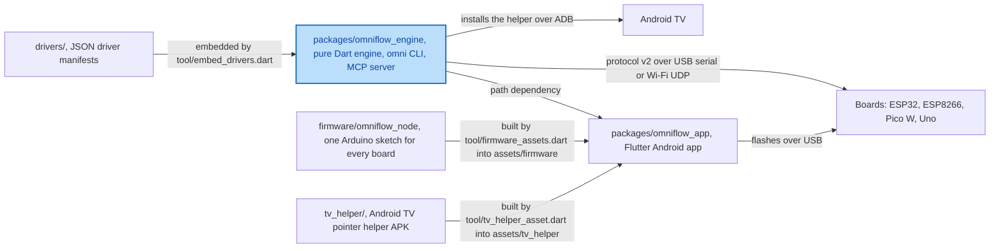
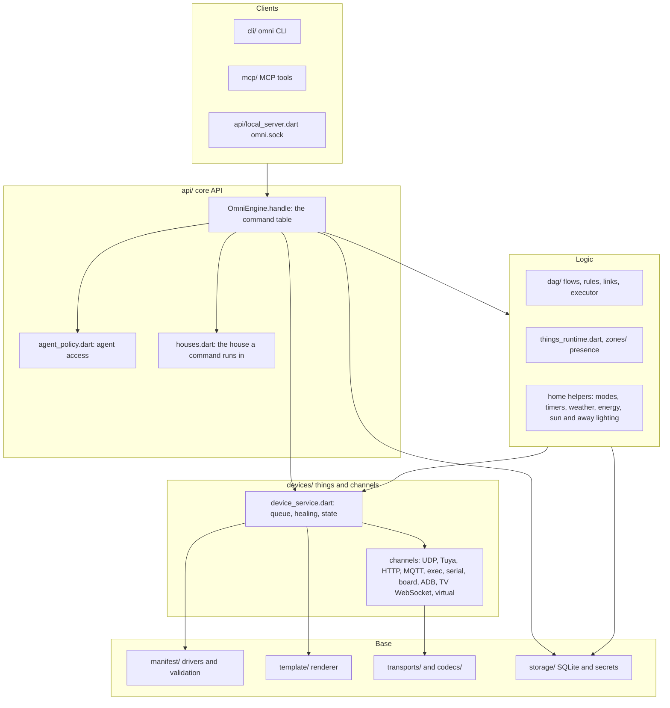
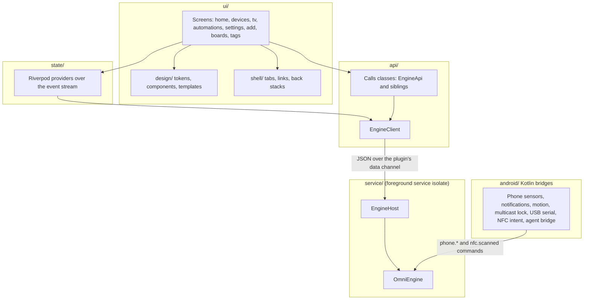
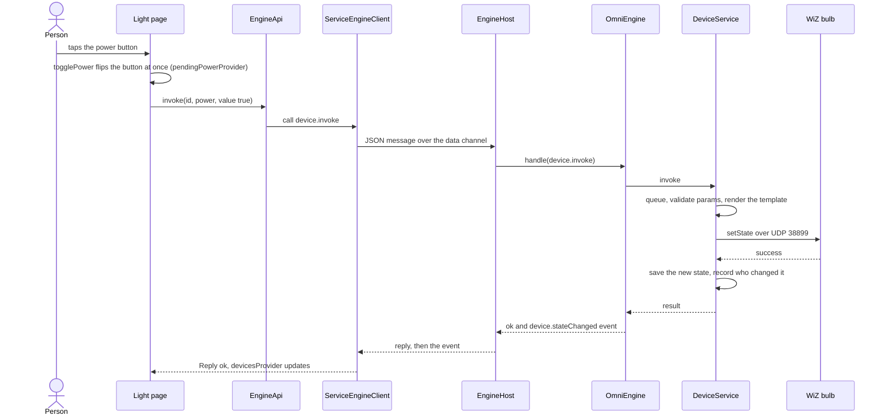
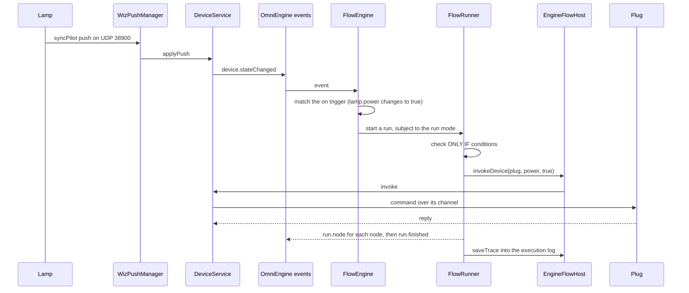
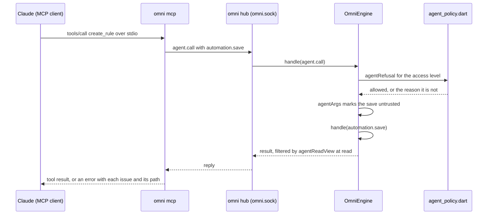
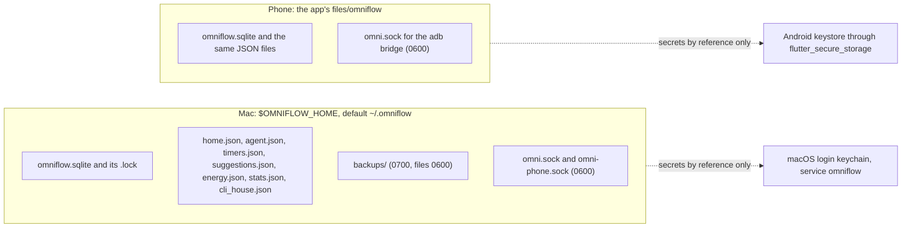

# OmniFlow architecture

This is the map of the code for contributors: which package does what, how a command travels, where data lives and where to add things. The full design, with every decision and the options it beat, is [docs/engine-design.md](docs/engine-design.md). Paths below are from the repo root.

## The packages

OmniFlow is a Dart pub workspace (the root `pubspec.yaml`) with two packages and one lock file, plus three projects that feed them.

- **`packages/omniflow_engine`** (engine version 1.0.0 in `lib/src/version.dart`) holds every rule of the system and has no Flutter dependency. `bin/omni.dart` is the `omni` CLI, and `omni mcp` serves the MCP tools over stdio. Its dependencies are in its `pubspec.yaml`: `args`, `dartssh2`, `drift`, `json_path`, `mcp_dart`, `mqtt_client`, `multicast_dns`, `pointycastle` and `sqlite3`.
- **`packages/omniflow_app`** (version 1.0.0+12 in its `pubspec.yaml`) is the Android app. It holds no logic of its own: it runs the engine in a foreground service and sends it commands. It uses `flutter_riverpod` for state, `flutter_foreground_task` for the service, `flutter_secure_storage` for secrets, `nfc_manager`, `material_symbols_icons`, `dynamic_color`, `file_picker`, `path_provider` and `share_plus`.
- **`drivers/`** has one `*.omni_driver.json` per kind of device. `packages/omniflow_engine/tool/embed_drivers.dart` turns them into string constants in `lib/src/manifest/built_in_drivers.g.dart`, so they load the same way in the CLI, in tests and in a compiled app.
- **`firmware/omniflow_node/`** is one sketch for ESP32, ESP8266, Pico W and Uno, with a native virtual board under `host/` for tests. `check.sh` runs its tests and compiles it for every board.
- **`tv_helper/`** is a small Kotlin app that draws a mouse pointer on an Android TV and takes moves from ADB only. It has no network permission.

The rule that shapes everything else: the engine owns the logic and exposes it as one core API, and the app, the CLI and the MCP tools are thin clients of that API. Anything the app can do, the CLI and an agent can do through the same command, at the access level the user allows.

## Engine layers

Each layer is a folder under `packages/omniflow_engine/lib/src/`.

### Manifests and templates

`manifest/` loads and checks driver manifests (`driver_manifest.dart`, `capability.dart`, `param_spec.dart`, `validation.dart`) and keeps them in a `DriverRegistry` (`driver_registry.dart`), the built-ins first and then the user's own from the database. A manifest says how to find a device, how to talk to it and what it can do: its transport, discovery methods, settings (with secret ones marked), state poll and push, pairing, setup steps and capabilities. A capability has a type (`toggle`, `level`, `color_temp`, `color_rgb`, `dpad_remote`, `text_command`, `exec`, `sensor`, `action` or `event`), typed params and a command template.

`template/template_renderer.dart` fills a command template with JSON values rather than text, so `{{value}}` stays a boolean or a number. A placeholder can fall back along a chain (`{{brightness|state.dimming|100}}`) and reads params, `state.*`, `device.*`, `msg.*`, `$Global` and `%run` values. Params are checked against the capability before anything is rendered or sent.

### Transports and codecs

`transports/` has the UDP transport with retries and the packet tap (`udp_transport.dart`, `packet_tap.dart`), host execution as argv with no shell (`host_exec.dart`), SSH with host keys pinned on first use (`ssh_executor.dart`) and the NDJSON line reader (`ndjson.dart`). `codecs/` has the Tuya frame codec and CRC-32. The channels in `devices/` sit on top: `channels.dart` (UDP JSON and exec), `tuya_channel.dart`, `http_channel.dart`, `mqtt_channel.dart`, `serial_channel.dart`, `board.dart`, `virtual_channel.dart`, `adb/` (ADB over TCP and Wireless debugging, in pure Dart) and `tv/` (LG webOS and Samsung Tizen over WebSocket). Each channel implements `DriverChannel.send`.

### Devices

`devices/device_service.dart` (`DeviceService`) runs every command. It queues commands per device so two automations never collide, validates the params, renders and sends through the device's channel, retries and heals the address when a device has moved (rediscovering it by its stable id), writes the commanded value as the new state, and records who changed it. `devices/discovery/` finds devices by UDP broadcast, mDNS, SSDP, Tuya announcements, USB serial and board hellos. `devices/flash/` flashes boards (`esp_rom.dart`, `stk500.dart`) and `devices/nfc/ndef.dart` reads and writes NFC records.

Everything is a thing with state, actions and events: lights and plugs, TVs, boards, and also the phone, each person, each place and each NFC tag, which are virtual things on the `virtual` transport.

### Storage and secrets

`storage/database.dart` is the drift database (schema version 7) with its migrations, and `api/versions.dart` adds the `automation_versions`, `automation_removed` and `automation_turned_off` tables. Secrets never go in the database. They sit behind the `SecretStore` interface (`storage/secret_store.dart`): `KeychainSecretStore` on the Mac, `SecureStorageSecretStore` in the app and `InMemorySecretStore` in tests.

### The core API and commands

`api/omni_engine.dart` builds `OmniEngine`, opens the database and the channels, and holds the command table: a map from a command name (`device.invoke`, `automation.save`, `thing.add`, `tv.state` and more than 200 others) to its handler. `OmniEngine.handle(command, args)` never throws. It returns `{"ok": true, ...}` or `{"ok": false, "error": {type, message, issues?}}`, and `OmniEngine.events` streams events such as `device.stateChanged`, `run.node`, `run.finished`, `automation.changed` and `packet.captured`. The handlers live in one file per concern beside it: `device_commands.dart`, `add_commands.dart`, `automation_commands.dart`, `flow_commands.dart`, `link_commands.dart`, `tv_commands.dart`, `board_commands.dart`, `backup_commands.dart` and the rest.

### Flows and rules

`dag/` is the automation engine. An automation is stored in the form it was written in, a link, a rule, a scene or a raw graph, and every form compiles to one flow: a directed acyclic graph of typed nodes.

- `rules.dart` normalises a rule (`normalizeRule`) and compiles it (`compileRule`). `rule_shorthand.dart` reads the one-line forms the CLI and agents write (`lamp.power=true`, `wait:2s`). `links.dart` compiles links.
- `node_types.dart` registers each node type with its ports and config check (`builtInNodeTypes`), and `validator.dart` checks a whole flow: unique ids, real ports, no cycle, every node reachable, every thing and key real.
- `flow_engine.dart` (`FlowEngine`) turns engine events and timers into trigger firings, and `executor.dart` (`FlowRunner`) runs a flow node by node with run modes, cooldowns, waits and traces.
- `migrate.dart` rewrites retired node types on load, and `untrusted_templates.dart` refuses an agent's rule that would send what its trigger brought to a device or the web.

The words a rule is read in come from one place, `SentenceContext` in `api/automation_view.dart`, so the app's cards, the editor, the diagram (`api/automation_diagram.dart`) and the CLI never word a step differently.

### Presence

`zones/zones.dart` turns Wi-Fi and BLE readings into being inside or outside a place, with a Kalman filter, hysteresis and dwell for BLE. `api/things_runtime.dart` moves the person things and their places from the phone's readings, and `api/presence_view.dart` explains where someone is and what decided it. The person's `home` state is what "when I get home" rules trigger on.

### Houses

`api/houses.dart` (`Houses`) keeps several homes in one engine. Every list and create command takes an optional `house`, and `Houses.scoped` runs each command in the house it names and stamps what the command created into that house. People and phones belong to no house. Saves are refused when an automation would use a thing of another house.

### MCP and agent access

`mcp/omni_mcp.dart` registers the MCP tools on an `mcp_dart` server, and `omni mcp` serves them over stdio. Every tool calls the core API through one command, `agent.call {command, args}`, which checks the agent's access level in `api/agent_policy.dart` before it runs anything. The tool descriptions that state access and the rule language are built from the policy and the rule model (`mcp/tool_words.dart`), so they cannot drift from what the engine does.

### The hub

`omni hub` keeps one engine running on a Mac and serves its control socket, `<home>/omni.sock`, a Unix socket with mode 0600 (`api/local_server.dart`). While it runs, other `omni` commands, `omni watch` and `omni mcp` send their commands through it (`api/local_client.dart`), and phones reach it over SSH with a forced `omni hub attach --phone NAME` command and a second socket, `omni-phone.sock`, whose sessions `api/hub_phone_session.dart` restricts. `api/hub_runtime.dart` starts and stops the listeners, polls and timers, and `cli/hub_cli.dart` installs the launchd agents and manages phone keys. The design is [docs/design/hub-design.md](docs/design/hub-design.md).

## App layers

Each layer is a folder under `packages/omniflow_app/lib/`.

### The engine bridge

The engine runs in a `flutter_foreground_task` service of type `connectedDevice`, in its own isolate, so automations keep running with the screen off and after the app is swiped away. The service is the only place that opens the database. `EngineClient` (`api/engine_client.dart`) is the interface every screen talks to: `call(command, args)` and an `events` stream. On the phone it is `ServiceEngineClient` (`service/service_engine_client.dart`), which sends JSON messages over the plugin's data channel to `EngineHost` (`service/engine_host.dart`) in the service. In hub mode it is `HubEngineClient` (`service/hub_engine_client.dart`) over SSH to a Mac hub. Tests use `InProcessEngineClient` or the `FakeEngine` in `test/fake_engine.dart`.

Every command the app sends is named in a calls class in `api/`: `EngineApi` in `engine_calls.dart`, with `rule_calls.dart`, `diagram_calls.dart`, `tv_calls.dart`, `smart_home_calls.dart`, `house_calls.dart`, `houses_calls.dart`, `screen_calls.dart` and their siblings. A call returns a typed `Reply<T>` and never throws.

### State with Riverpod

`state/providers.dart` holds the providers. `engineConnectionProvider` is the raw client, overridden in `main.dart` with the real one and in tests with a fake. `engineClientProvider` is the one screens use: it adds the house in view to every list and create (`state/house.dart`). `devicesProvider` and `flowsProvider` load lists and keep them current from the event stream, and `engineApiProvider` gives the typed calls.

### The UI design layer and page templates

`ui/design/` has the tokens (`tokens.dart`: palette, spacing, shape, type, depth and motion), the icons (`icons.dart`) and the components every screen is built from, such as `OmniTile`, `OmniListRow`, `OmniDisclosure`, `OmniHeroCard`, `OmniPowerButton`, `OmniRuleBlock`, `OmniButton` and `confirm`. `ui/design/templates/` has the eight page templates: `TabPage`, `ListPage`, `DetailPage`, `FormPage`, `EditorPage`, `SheetTemplate`, `PickerSheet` and `StepFlow`, each drawing its own loading, empty and error states from an `OmniLoad`. [DESIGN.md](DESIGN.md) says when to use each, and [lib/ui/design/README.md](packages/omniflow_app/lib/ui/design/README.md) lists every constructor.

### Screens

One folder per area under `ui/`: `home/`, `devices/`, `tv/`, `automations/` (with `diagram/`), `settings/`, `add/`, `boards/`, `tags/`, `onboarding/`, `help/` and `fun/`. `ui/shell/` has the four tabs (Home, Automations, Devices, Settings), each with its own back stack (`tabs.dart`), and the links a notification opens (`links.dart`), such as `/device/<id>` and `/automation/<id>`.

### The Android service and bridges

The Kotlin side is in `android/app/src/main/kotlin/com/jashnm/omniflow_app/`. The phone's inputs reach the engine as core API commands, the same ones `omni phone` sends by hand: battery, Wi-Fi and Bluetooth from `PhoneSensorsBridge.kt`, notifications, the app in front, calls, media and the calendar from `NotificationTriggers.kt`, and shake and face down from `MotionSensor.kt`. `PhoneActionsBridge.kt` runs the phone's actions, `MulticastLockBridge.kt` holds the multicast lock only while something needs it, `UsbSerialBridge.kt` talks to a board on the phone's USB, `ServiceKeeper.kt` restarts a service Android killed, and `MainActivity.kt` takes NFC intents. `AgentBridgeProvider.kt` with `EngineSocket.kt` is the adb-only way in that `omni --phone` uses.

## Runtime flows

### A tap that turns a light on

The power button is `OmniPowerButton` on the device page (`ui/devices/device_page.dart`) and calls `togglePower` in `ui/devices/device_controls.dart`. If the bulb does not answer, `DeviceService` retries, looks for the bulb at a new address by its MAC, and the call fails with a plain message that the page shows with Try again.

### A rule firing from a trigger

Time, sun and interval triggers start from timers in `FlowEngine` instead of an event. On the phone an exact alarm wakes the service before a time trigger, since a Dart timer stops while the CPU sleeps.

### An MCP tool call

With no hub running, `omni mcp` opens the engine itself and holds the database lock. `omni --phone <serial> mcp` sends the same `agent.call` to the app's engine through `adb shell content call` instead. A high-risk automation an agent saves waits for the user's approval in the app.

## Data on disk

- **The database** holds driver manifests the user added, devices with their non-secret settings and state, rooms, houses, device history (500 rows per device), flows with their spec and trust marks, global variables, board describes and an execution log of the newest 1000 runs.
- **The JSON files** beside it hold the home location, mode and alerts (`home.json`), the agent access level (`agent.json`), timers, dismissed suggestions, energy totals and day stats. Each other house keeps its own keys under `houses.<id>` in `home.json` and in files named with its id.
- **Backups.** `config.export` writes the whole home as one JSON file without secrets, and `config.import` restores it inside one transaction. While the hub runs, the engine writes one a day into `backups/`. Restored automations come back untrusted.
- **On the phone** the app data is excluded from cloud backup and device transfer (`allowBackup="false"` and data extraction rules), so the database and the secrets stay on the phone.
- **Secrets** are per device under a key such as the Tuya `localKey`, the Hue `username`, a TV's issued key or the Home Assistant `token`, plus the engine's ADB key and the SSH host key pins. On the Mac they are written to the keychain on stdin, so they never show in `ps`.

## Security model

The rules, each enforced in the engine so no client can skip them:

1. **No network listener.** No component opens a TCP listener on a network interface. `omni mcp` speaks stdio, the hub socket is a Unix socket with mode 0600 in a 0700 home, and phones reach the hub through macOS Remote Login with their own keys and a forced command. On the phone, `AgentBridgeProvider` answers only adb's shell user (uid 2000) and root, and forwards to a 0600 socket in the app's files. The only sockets bound are UDP: one command socket, 38900 for WiZ pushes and 38951 for board hellos, plus short discovery windows. Pushes and hellos count only from private, loopback or link-local addresses, and from the address of a device the user added.
2. **Agent access levels.** An agent's level is `read` by default and `setup` once the user allows it in the app (Settings, More settings, For developers, What agents can do) or with `omni agent allow setup`. `agent.access.set` is never reachable through `agent.call`. A list of commands is the user's alone at every level: storing secrets, pairing, trusting a host key, removing or moving a thing, approving or restoring an automation, registering a driver, setting presence, answering an ask, every phone reading, flashing a board, restoring a backup and the TV shell, install and settings writes. A command in no list is refused to agents. Everything an agent saves is untrusted, a high-risk automation it saves waits for approval, and its TV and device calls never start a pairing.
3. **Risk and approval.** A capability that runs host commands (`exec`), or that the manifest marks `highRisk`, is high risk, and so is any flow that drives one, runs one or sets a variable one reads. Approval is by revision (a SHA-256 of the flow), so a flow that changed after review is refused with `conflict`.
4. **Secrets only in the store.** A manifest setting marked `"secret": true` is stored in the `SecretStore` and never reaches a template. Manifests, flows, logs, the packet inspector and backups carry no secret. HTTP and TV channels redact what they send, ADB has no packet tap, and `device.pair` results carry the outcome, never the key. Secrets are read from stdin by the CLI, never taken as arguments.
5. **Typed commands, no shell.** Every value is checked against the capability's params before it is rendered. Host commands run as argv with no shell, and ADB shell lines are built from fixed words and validated values only.
6. **Pinned identities.** SSH host keys, TV certificates and Wireless debugging keys are pinned on first use, and a change fails closed until the user reviews it.
7. **Boards are set up over USB only.** The firmware takes Wi-Fi, name and peripheral settings only from its serial port, so nobody on the Wi-Fi can move a board to another network.

The full list, with the residual risks (the LAN protocols underneath have no sender authentication), is in [docs/engine-design.md](docs/engine-design.md), Security.

## Extension points

### Add a driver

1. Copy the closest manifest in `drivers/` to `drivers/<id>.omni_driver.json`, with `schemaVersion: 1` and a new `id`. A user manifest cannot reuse a built-in id.
2. Pick the `transport.type` (`udp`, `tuya`, `http`, `mqtt`, `exec`, `serial`, `omniflow`, `adb`, `websocket` or `virtual`) and fill in `discovery`, `settings` (with `"secret": true` and a `help` line where needed), `statePoll` or `statePush`, `pairing` and `setup` as the device needs them.
3. Declare each capability with its `type`, `params` and `command` template. Give each param a type and range, and mark host-command capabilities `exec` or `highRisk: true`.
4. Validate it: `dart run omniflow_engine:omni driver validate drivers/<id>.omni_driver.json` from `packages/omniflow_engine`.
5. Embed it: `dart run tool/embed_drivers.dart` from `packages/omniflow_engine`. A test in `test/manifest/driver_registry_test.dart` fails until the generated file matches `drivers/`, and `--check` runs the same comparison.
6. Add a test under `packages/omniflow_engine/test/devices/` against a loopback fake of the device, the way `wiz_push_test.dart` and `http_hubs_test.dart` do. Never put a real address, key or serial in a fixture.
7. If the app should offer it by kind when adding by hand, add it to `AddKind` in `packages/omniflow_app/lib/ui/add/driver_kinds.dart`. Its icon comes from the manifest `icon` and `category` (`OmniIcons.forManifestIcon`, `OmniIcons.forCategory` in `ui/design/icons.dart`).

A new protocol needs a channel as well: implement `DriverChannel` in `packages/omniflow_engine/lib/src/devices/`, add its `TransportType`, and register it in the `channels` map in `OmniEngine.open` (`api/omni_engine.dart`).

### Add a node type or a rule step

1. Register the node type in `builtInNodeTypes` in `packages/omniflow_engine/lib/src/dag/node_types.dart`, with its category, output ports and config check.
2. Run it in `dag/executor.dart`, in the switch on node type that the other actions use.
3. For a rule step, add its key to `RuleKeys.steps` in `dag/rules.dart`, normalise it in `_Normalizer` and compile it to your node in `_Compiler`. Add a shorthand in `dag/rule_shorthand.dart` if the CLI should take it in one line.
4. Give it words in `SentenceContext` (`api/automation_view.dart`) and a node in `api/automation_diagram.dart`, so the cards, the editor, the diagram and the CLI read it the same.
5. If it makes a value later steps can use, return it from `dag/rule_tokens.dart`.
6. Add tests: a validator test, an executor or rule test in `test/dag/`, and a dry run.
7. In the app, offer it in the step library (`ui/automations/step_library.dart`) with its form in `ui/automations/step_forms.dart`. The app writes the stored rule form directly (`lib/rules/rule_spec.dart`), and `test/real_rules_test.dart` checks that form against the engine's normaliser.

### Add a CLI or engine command

1. Write the handler in the `api/*_commands.dart` file for its concern, or a new one beside them, and add it to the command table `_commands` in `api/omni_engine.dart`. Throw `ApiError(type, message)` for a failure the caller should see.
2. Put it in exactly one list in `api/agent_policy.dart`: `_readCommands`, `_setupCommands` or `_userOnly` (with the reason). A command in none is refused to agents, and `test/api/agent_access_test.dart` checks that every listed command exists.
3. If it saves, removes or changes an automation, add it to `automationChangeCommands` in `omni_engine.dart` so screens reload. If it waits on a device or runs long, add it to the deadline lists in `api/local_client.dart`. If the app needs it in hub mode and it is user-only, allow it for phone sessions in `api/hub_phone_session.dart`.
4. Add the CLI verb in `lib/src/cli/`, in `omni_command_runner.dart` or the `*_cli.dart` file for its group, with help text. Secrets are read from stdin, never from an argument.
5. If the app sends it, name it in a calls class in `packages/omniflow_app/lib/api/`. If an agent should reach it as a tool, register the tool in `mcp/omni_mcp.dart` and send it through `agent.call`.
6. Add an engine test in `test/api/` and a CLI test in `test/cli/`.

### Add a screen

1. Pick the page template by kind: a tab root is `TabPage`, a pushed list `ListPage`, one thing `DetailPage`, fields with Save `FormPage`, a rule or scene editor `EditorPage`, a sheet `SheetTemplate`, picking one of a list `showPickerSheet`, a guided setup `StepFlow` (`ui/design/templates/`).
2. Put the file in the area folder under `packages/omniflow_app/lib/ui/`. Build it from `ui/design/` components and `OmniPalette.of(context)`, never raw colours, sizes or Material icons.
3. Read data through a provider (`state/`) or a calls class (`api/`), and pass it to the template as `state: OmniLoad.of(...)` so loading, empty and error states come for free.
4. Put secondary content behind an `OmniDisclosure` with one of the standard labels.
5. If a notification or another screen opens it by link, add a `ShellLink` in `ui/shell/links.dart` and return the page in `shellPageFor` in `ui/shell/tabs.dart`.
6. Write a widget test with `FakeEngine` (`test/fake_engine.dart`) that checks the screen at 200 % text and against `androidTapTargetGuideline`, `labeledTapTargetGuideline` and `textContrastGuideline`, in light and dark.
