# OmniFlow design system

How the app should look, read and behave, for anyone adding or changing a screen. This page gives the rules and when to apply them. The detail lives in two places, and each section links to the part it summarises:

- [docs/ui/design-v2.md](docs/ui/design-v2.md) is the design: the layout choices, the Material 3 and WCAG parameters, the per-screen layout and the writing rules.
- [packages/omniflow_app/lib/ui/design/README.md](packages/omniflow_app/lib/ui/design/README.md) is the code: every token, component and page template with its constructor and an example.

  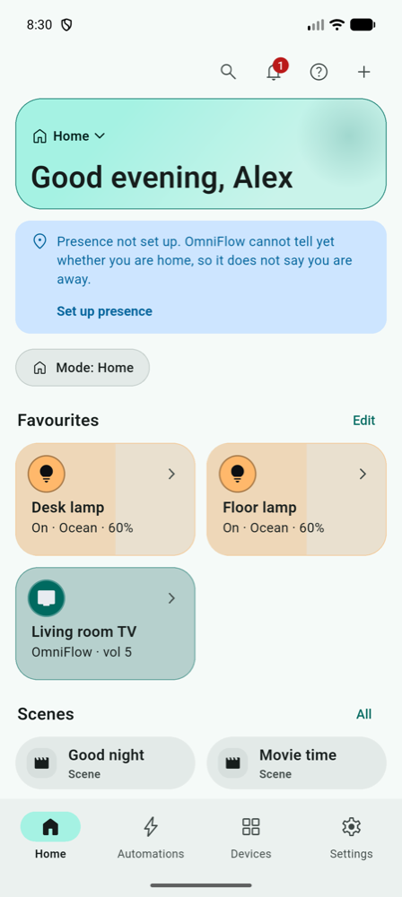
  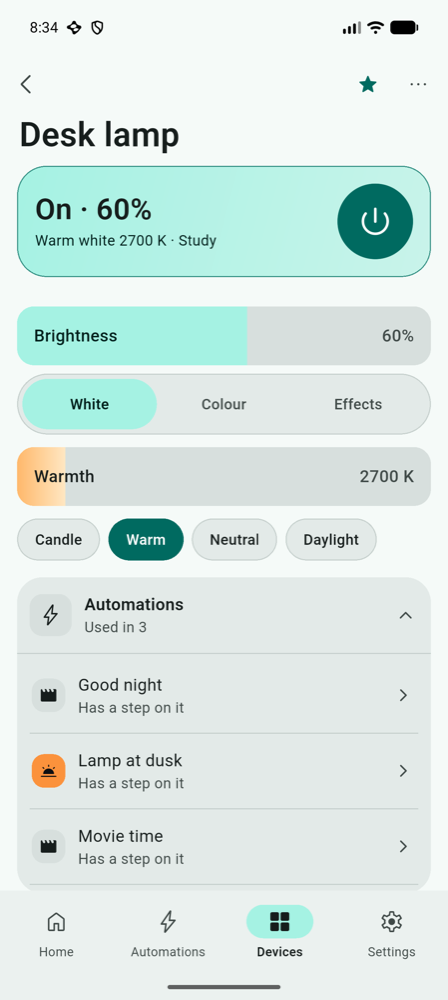
  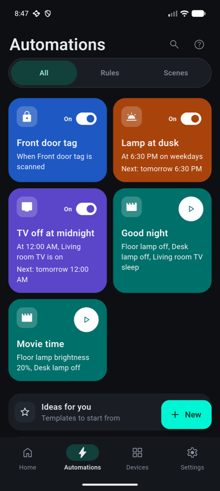
  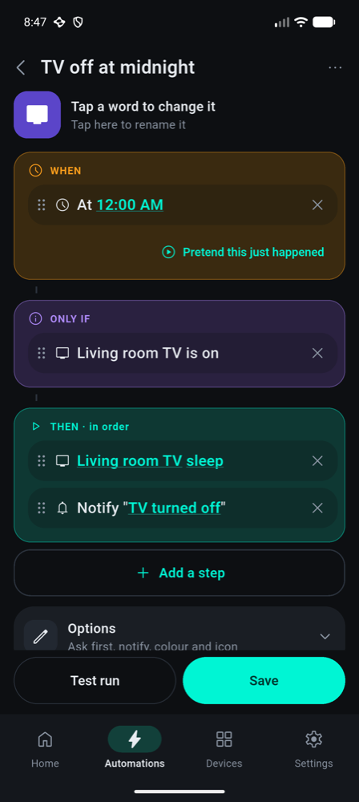

## Principles

1. **Device tiles for things you glance at, stacked blocks for things you build.** Home, Devices, the TV and Settings are places you glance at and tap, so they use large tonal device tiles and list groups in rounded cards. An automation is a sequence you build, so the list shows automation cards in a bold colour each, and the editor shows the steps as stacked blocks (When, Only if, Then) in the trigger, condition and action colours. The two styles never share a screen, so the app still reads as one product. The reasoning is in [design-v2.md](docs/ui/design-v2.md).
2. **Progressive disclosure.** Each screen shows the common action in front, large. Everything else sits one tap away behind a labelled collapsed section, an `OmniDisclosure`. A device's history, the automations that use it, its rarely changed settings and its developer details are never in front. The full list of what moves behind which section is in [design-v2.md, What moves behind a section](docs/ui/design-v2.md#what-moves-behind-a-section).
3. **Plain words.** The app speaks the way the person does: "Turned off by Good night", never a raw key, id, `null` or `true`. Words such as driver, capability, payload and host stay inside Developer details. See [Writing UI text](#writing-ui-text).
4. **Large text up to 200 %.** Every text style scales with the system font size, and layouts hold at 200 %. Rows grow rather than clip, tiles drop to one column above 130 %, and segmented labels wrap.
5. **48 dp targets.** Everything tappable has a hit area of at least 48 x 48 dp, even when it looks smaller. Primary controls (power, D-pad keys, scene run buttons, Save) are 56 dp or more, and the power button is 72 dp.
6. **One accent marks what is on.** State colours are not used as decoration, so a tile's tint always means on, and a red tint with a word and an icon always means not answering.

## Tokens, palette and light and dark

The tokens are in `packages/omniflow_app/lib/ui/design/tokens.dart`, and screens use them rather than literal colours, sizes or radii. The token list is in [lib/ui/design/README.md, Tokens](packages/omniflow_app/lib/ui/design/README.md#tokens-tokensdart), and the reason for each value is in [design-v2.md, Token changes](docs/ui/design-v2.md#token-changes).

- **Colour.** Read the palette with `OmniPalette.of(context)`, never `OmniColors` directly. `OmniPalette.teal` is the dark look and `OmniPalette.tealLight` the light one. The palette names surfaces (`background`, `bar`, `card`, `raised`, `highest`, `sheet`, `line`), text (`text`, `muted`), the accent family, the step colours (`trigger` for When, `condition` for Only if, `action` for Then, `flowControl`) and the status colours (`warn`, `bad`, `info`).
- **Light and dark.** The Appearance setting picks System (the default), Light or Dark, and the colours come from OmniFlow's teal or the phone's wallpaper. Pure black replaces the dark grey for OLED screens, in the dark theme only. Every text style leaves its colour to the theme, which is what makes both themes work. A screen that hard-codes a colour breaks one of them.
- **Automation cards** use the seven `OmniCardColors` (violet, orange, teal, blue, pink, green, slate), each at 4.5:1 or more against white text in both themes.
- **Spacing** is the 4 dp grid (`OmniSpace`): 4, 8, 12, 16, 24 and 40, screen margins of 16, `target` 48 and `targetLarge` 56, and list rows of 56 dp (one line) and 72 dp (two lines).
- **Shape** follows the Material 3 corner scale (`OmniShape`, placed per component by `OmniRadii`): tiles, cards and sections 24, sheets and the hero card 28, editor blocks 20, buttons and chips fully round.
- **Type** follows the Material 3 scale (`OmniText`): page titles 32 shrinking to 22 as the page scrolls, the state card 28, section headers and card titles 18, body 16, captions and subtitles 14. 12 is only for navigation labels and tags on cards.
- **Depth** is by tone, not shadow (`OmniDepth`). A card is a lighter surface than the screen. Only what floats, the floating button and sheets, has a shadow.
- **Motion** comes from `OmniMotion.of(context)`, which is zero when the system asks for reduced motion. Pass it to every animation you add.

The main values, for orientation. `tokens.dart` is the source of truth:

| Role | Dark | Light |
| --- | --- | --- |
| Background | `#0D0F12` | `#F5FAF8` |
| Card | `#1A1E24` | `#E3EAE8` |
| Text | `#E8ECF1` | `#161D1C` |
| Muted text | `#8B95A3` | `#3F4947` |
| Accent (on, primary) | `#00F5D4` | `#006A60` |
| When (trigger) | `#FF9F1C` | `#6E3F00` |
| Only if (condition) | `#B18CFF` | `#5A3EB0` |

## Page templates

Every screen is one of eight templates in `packages/omniflow_app/lib/ui/design/templates/`. A screen picks one and fills its slots, and never builds its own scaffold, header, loading, empty or error widget, or a bottom spacer. Each template takes `state:` as an `OmniLoad` and draws the loading skeleton, the error and the empty state itself. Constructors and examples are in [lib/ui/design/README.md, Page templates](packages/omniflow_app/lib/ui/design/README.md#page-templates-templates), and the screen inventory the templates came from is [docs/ui/page-templates.md](docs/ui/page-templates.md).

| Template | Use it for | Examples |
| --- | --- | --- |
| `TabPage` | The root of a tab | Home, Devices, Automations, Settings |
| `ListPage` | A pushed list | Scenes, NFC tags, Recently removed |
| `DetailPage` | One thing, with a hero and collapsed sections | A device, a sensor, a tag, the TV |
| `FormPage` | Fields with a Save in the bottom bar, or `FormPage.instant` for settings toggles | A new scene, Alerts |
| `EditorPage` | A rule or scene editor, as a list or a canvas | The automation editor |
| `SheetTemplate` | Any bottom sheet, with its action row pinned | Pins, a quick control sheet |
| `PickerSheet` | Picking one value from a list, through `showPickerSheet` | The house mode, the scene that shake runs |
| `StepFlow` | A guided setup with a step bar and Back, Skip and Next | The guided add steps, setting up the hub |

A one-field text prompt is `showPromptSheet`, and the one yes or no dialog is `confirm`, with `destructive: true` for anything that deletes.

### OmniDisclosure

`OmniDisclosure` (`ui/design/disclosure.dart`) is the collapsed section that carries everything secondary. It is a card with a 72 dp header: an icon, a label, a one-line summary that already answers the first question ("5 changes today", "Used in 2") and a chevron. It starts closed, remembers whether it was open in the page's `PageStorage`, and reads to a screen reader as a button with its expanded state. On a `DetailPage` pass the sections in `sections:`, which places them after the main content.

Use the standard labels, the same on every screen: Activity, Automations, More settings, Developer details, More buttons, TV tools, Options, Ideas for you and Recently removed. On a device page the order is Automations, Activity, More settings, and Activity is always closed on first open. The details are in [design-v2.md, The collapsed section](docs/ui/design-v2.md#the-collapsed-section).

## Writing UI text

The full rules are [design-v2.md, Plain-language rules](docs/ui/design-v2.md#plain-language-rules). In short:

1. Say what happened, then who: "Turned off by Good night", not "11:30 PM switch false by rule_7".
2. Never show a raw key, id, `null`, `true` or `false` in front. They belong in Developer details.
3. Use the names the person gave: device and automation names, never ids or addresses.
4. Put verbs on buttons: Try again, Add, Run, Save. No "OK" except on the TV's D-pad.
5. One idea per line. A subtitle fits on one line at 100 % text, about 40 characters.
6. Sentence case everywhere.
7. Times follow the phone's 12 or 24 hour setting ("2:43 PM", "Yesterday 11:30 PM"). A percent takes no space ("60%"), other units take one ("2700 K", "1.2 kWh").
8. Explain a problem with its likely cause and the next step: "Not answering. It may be off at the wall", with Try again.
9. Keep these words inside Developer details: capability, payload, packet, host, catalog, driver, engine, id, rule path.
10. A section's summary answers the first question about it, so most people never open it.

Error banners and empty states say what happened and what to do, and never show exception text. An automation an agent made is credited to "an agent". App names come from the engine (`appLabelFor`), never a bare package name.

## Accessibility checks

Every component in `ui/design/` already gives a 48 dp target, a semantics label and AA contrast, and skips animation under reduced motion. A new screen keeps that by building on them. Before a change lands, check:

1. **Contrast.** Text is at least 4.5:1 on its surface, and icons, switch tracks and field edges at least 3:1, in both themes. Muted text never goes on the hero gradient.
2. **Targets.** Every tappable thing is 48 dp or more. Wrap a small custom control in `OmniTapTarget`.
3. **Labels.** Every icon-only button has a spoken label through `OmniIconAction`'s `label` ("Bedroom light power", "Search"), and a count is said in it.
4. **Large text.** The screen works at 200 % font scale with nothing truncated in front.
5. **Not colour alone.** On, off and not answering each carry a word, and not answering an icon too.
6. **Reduced motion.** Every animation uses `OmniMotion.of(context)`.
7. **Tests.** A widget test for the screen runs `meetsGuideline` with `androidTapTargetGuideline`, `labeledTapTargetGuideline` and `textContrastGuideline`, in light and dark, as `test/design_test.dart` and `test/light_theme_test.dart` do.

The parameters and their sources are in [design-v2.md, Accessibility (WCAG 2.2 AA)](docs/ui/design-v2.md#accessibility-wcag-22-aa).

## The screens

Home, a light's page with a section open, the TV, the Automations list, the automation editor, Scenes, Settings and Add, in light and dark, on the Android emulator with demo data.

| Screen | Light | Dark |
| --- | --- | --- |
| Home |  | 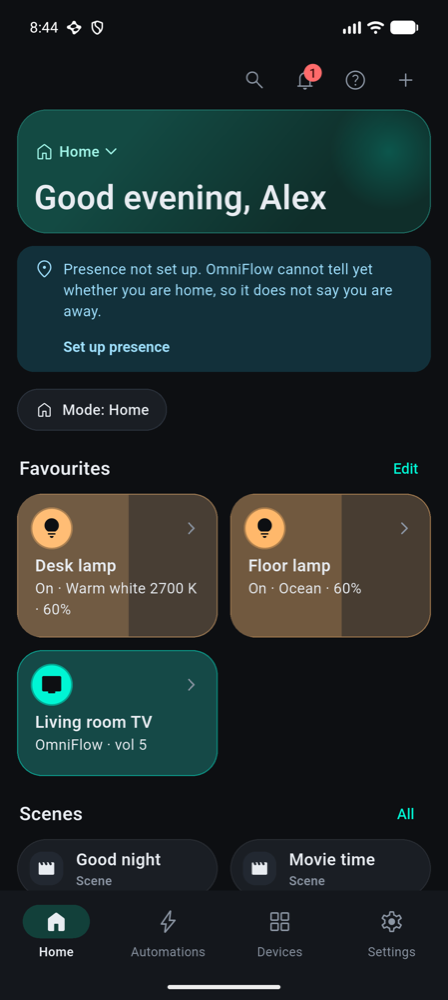 |
| Devices | 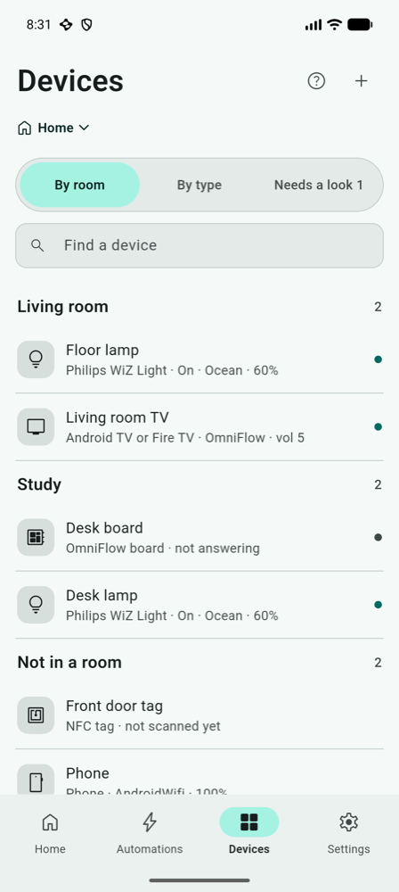 | 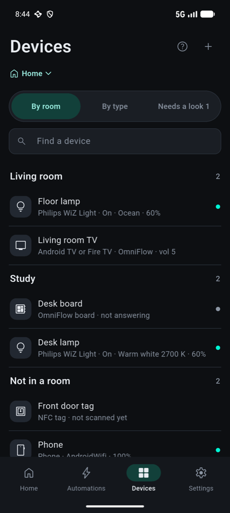 |
| A light, with a section open |  | 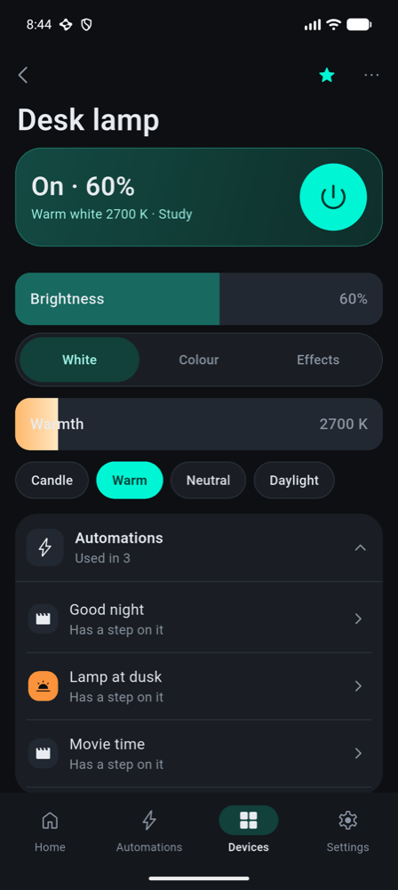 |
| TV | 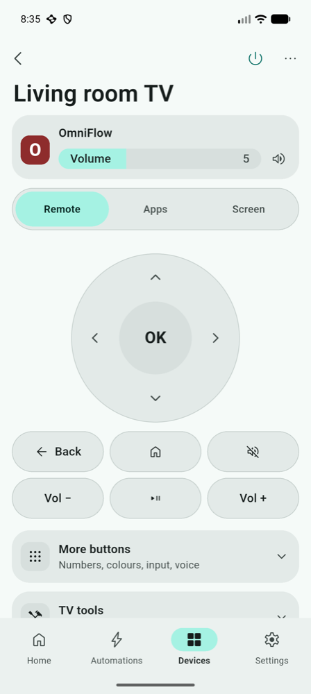 | 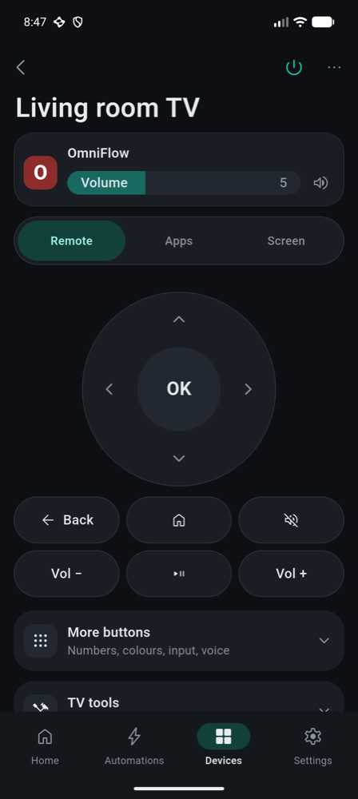 |
| Automations | 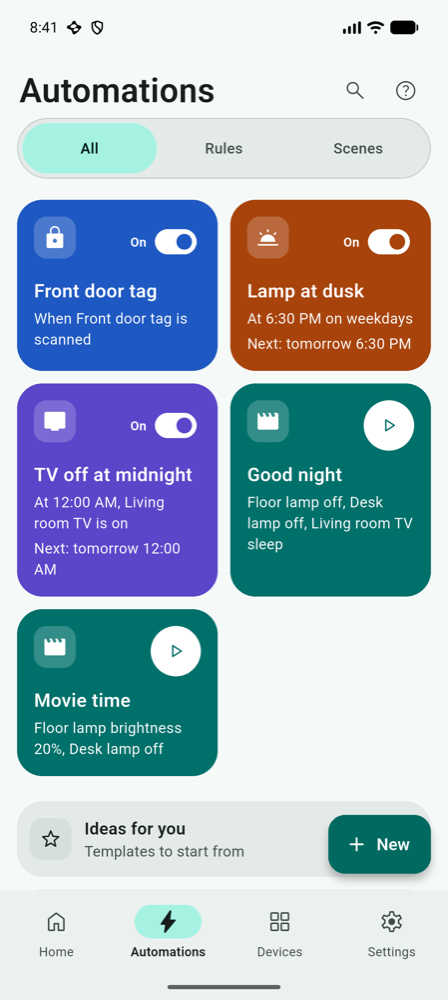 |  |
| Automation editor | 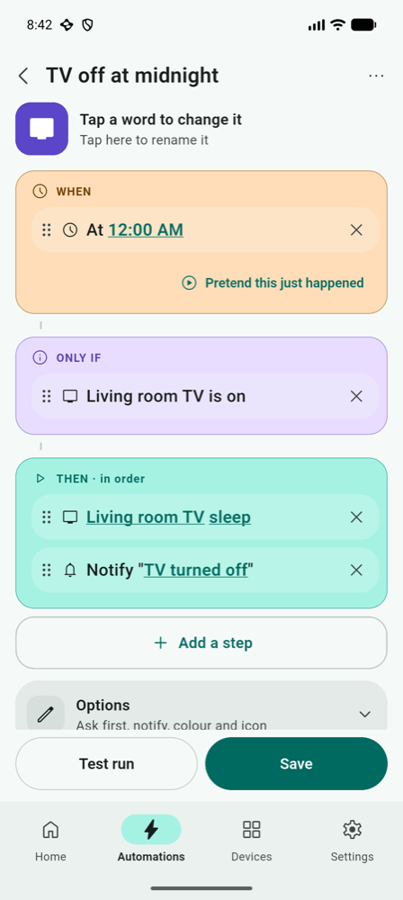 |  |
| Scenes | 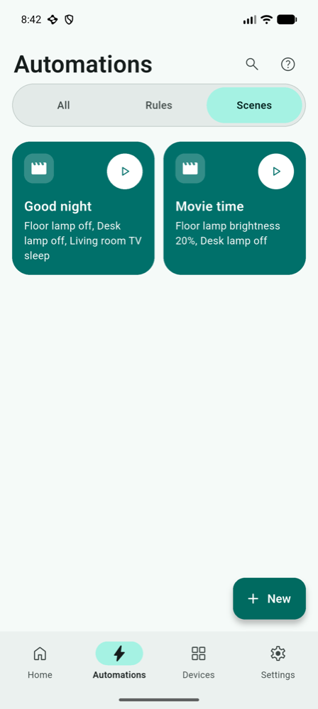 | 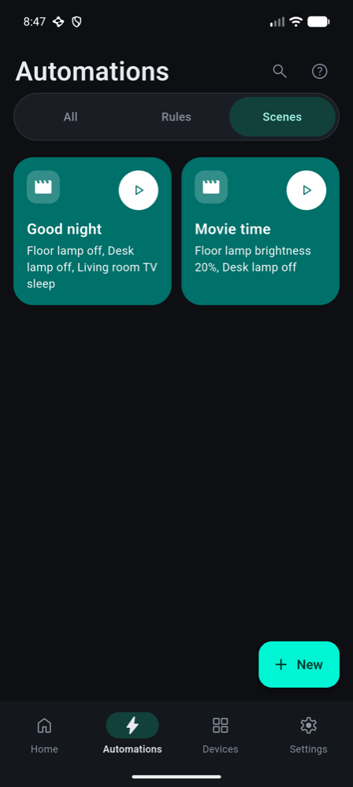 |
| Settings | 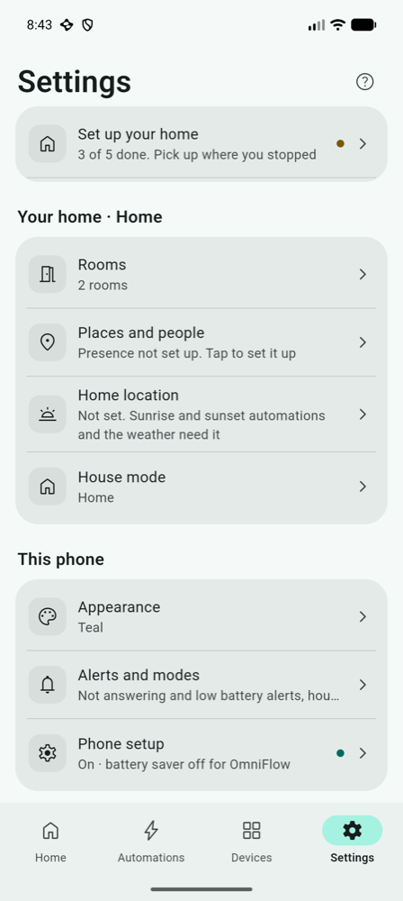 | 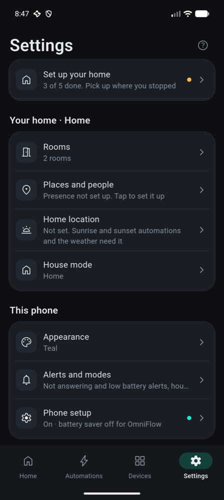 |
| Add | 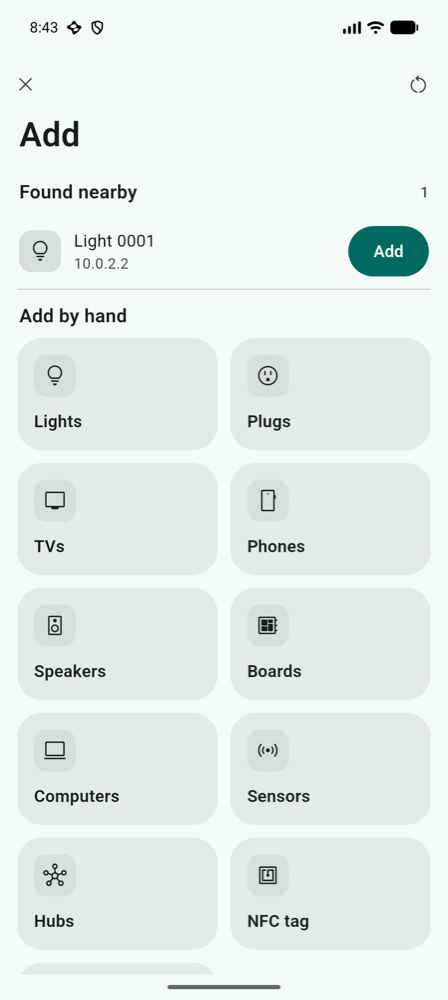 | 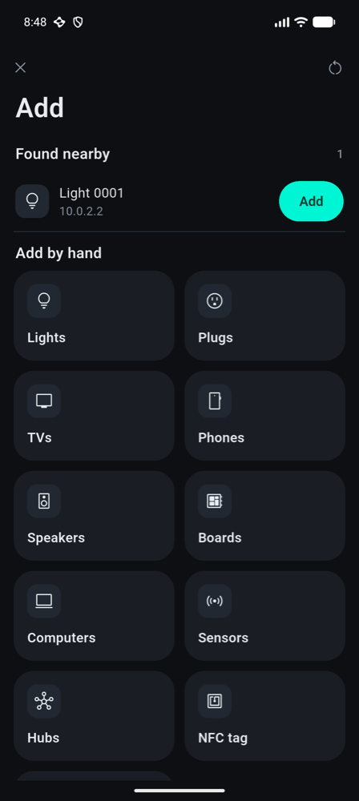 |

Home at 200 % text:

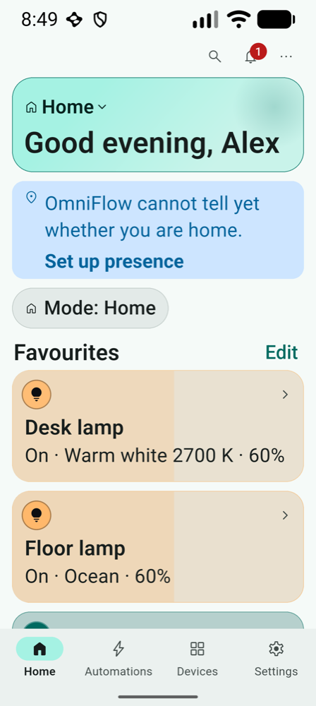
