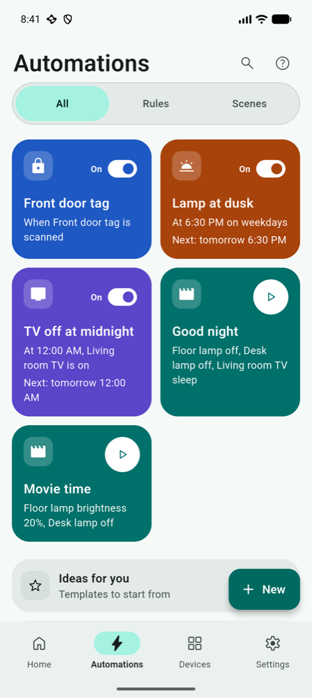

# OmniFlow

OmniFlow is a local-first home automation app, made for Android and built for iOS, macOS, Windows and Linux too. It controls lights, plugs, TVs, computers and microcontroller boards straight over your own network, with no vendor cloud, and runs your automations on the phone itself.

<p>
  
  
  
  
</p>

## Features

- **Local control.** Commands go from the phone to the device on the LAN, so they are quick and keep working when the internet is down.
- **Many kinds of device, one JSON file each.** 26 built-in drivers in `drivers/`: Philips WiZ, Tuya plugs and lights, Shelly, Philips Hue, Home Assistant, MQTT devices (Tasmota, Zigbee2MQTT and plain topics), Roku, Sonos, Android TV and Fire TV over ADB, LG webOS and Samsung Tizen TVs, Android phones over Wireless debugging, Macs and Linux hosts over SSH, OmniFlow boards and the weather. A new kind of device is a new manifest, not a new app release.
- **The phone, people, places and NFC tags are things too**, so "when I get home", "when this tag is scanned" or "when the battery drops below 15%" work like any device state.
- **Automations three ways.** A one-line link ("this button toggles that lamp"), a rule (when, only if, then) built as stacked blocks or as a diagram, or a raw flow graph. Scenes run several actions in one tap. Test runs, a run log and "why did it not run" show what happened.
- **A TV control centre** for Android TV: remote, apps, settings, files, a console and a screen view.
- **One firmware for every board** (ESP32, ESP8266, Pico W, Uno). Pins are named and given a job at runtime, IR, 433 MHz RF and NFC readers are set up from the app, and a board on the phone's USB is flashed from the app.
- **Several homes** in one app, each with its own devices and automations, and an optional Mac mini hub that runs everything while phones come and go.
- **AI agents through MCP.** `omni mcp` gives Claude and other MCP clients the same commands the app uses, at the access level you choose. What an agent writes waits for your approval when it is high risk.
- **A CLI for everything.** Every action in the app is also an `omni` command.

## Download

Each [release](https://github.com/jashnimje/omni-flow/releases/latest) opens with a "Which file do I need?" table. Most people need one file:

- **Android:** `omniflow-<version>-android.apk`. Open it to install. After that, OmniFlow updates itself from Settings, About, Check for updates, and checks once a day unless you turn that off.
- **Mac:** `omniflow-<version>-macos.zip`. Right-click OmniFlow and pick Open the first time, since it is unsigned.
- **Windows:** `omniflow-<version>-windows-x64.zip`. At the SmartScreen prompt pick More info, then Run anyway.
- **Linux:** `omniflow-<version>-linux-x64.tar.gz`.
- **iPhone:** `omniflow-<version>-ios-unsigned.ipa`, for sideloading.
- **The Mac hub and `omni` CLI:** `omniflow-<version>-hub-macos.tar.gz`, with `arm64/` and `x64/` builds.

Other Android builds, the Play bundle and the Android TV helper are in `android-extras.zip`, and the board firmware in `firmware.zip`. `SHA256SUMS` covers every file.

## Quick start

1. Install Flutter 3.47.9 (stable, Dart 3.13.7), for example with `mise use flutter@3.47.9`, and the Android SDK. [CONTRIBUTING.md](CONTRIBUTING.md) has the full setup.
2. Get the packages, from the repo root:

   ```sh
   dart pub get
   ```

3. Run the CLI on a Mac, from `packages/omniflow_engine`. It keeps its data in `~/.omniflow` (or `$OMNIFLOW_HOME`) and its secrets in the macOS keychain:

   ```sh
   dart run omniflow_engine:omni --help
   dart run omniflow_engine:omni add             # list what is on the network
   dart run omniflow_engine:omni add --pick 1    # add the first find and walk its setup
   dart run omniflow_engine:omni rule add 'Lamp at dusk' --when time:18:30 --then lamp.power=true
   ```

4. Build the app and install it on a phone or emulator, from `packages/omniflow_app`:

   ```sh
   flutter build apk --release
   adb install -r build/app/outputs/flutter-apk/app-release.apk
   ```

The engine's own README, [packages/omniflow_engine/README.md](packages/omniflow_engine/README.md), has many more CLI examples.

## Platforms

- **Android** is the full app: automations keep running with the screen off, and it has the phone's own triggers and actions, NFC tags, USB boards and hub mode.
- **iOS, macOS, Windows and Linux** run the same engine inside the app, so automations run only while it is open. They have no phone triggers or actions, no NFC, no USB boards and no hub mode, and hide those screens. The iOS build is unsigned.
- **The `omni` CLI and hub** are released for macOS, arm64 and x64 in one archive. They keep secrets in the macOS keychain, so the Linux and Windows builds are compiled in CI but not released until those systems get a secret store.
- **No web build.** The engine talks to devices over raw UDP and TCP and keeps its data in SQLite, and a browser offers neither.

[CONTRIBUTING.md](CONTRIBUTING.md#releases) says how each one is built and released.

## Repo layout

- `packages/omniflow_engine/` - the pure Dart engine with all the logic, the `omni` CLI (`bin/omni.dart`) and the MCP server.
- `packages/omniflow_app/` - the Flutter app. On Android it runs the engine in a foreground service, and on iOS and the desktop inside the app while it is open. It holds no logic of its own.
- `drivers/` - the built-in driver manifests, embedded into the engine at build time.
- `firmware/omniflow_node/` - the one Arduino sketch for every board, with a native virtual board for tests.
- `tv_helper/` - a small Android TV app that draws a mouse pointer, installed on the TV by the app.
- `tool/` - repo scripts, such as `link_build_dirs.sh`.
- `docs/` - the engine design, the roadmap, the feature designs, the UI specs and the screenshots.

## Docs

- [ARCHITECTURE.md](ARCHITECTURE.md) - the packages, the engine and app layers, the main runtime flows, data on disk, the security model and how to add a driver, a rule step, a command or a screen.
- [DESIGN.md](DESIGN.md) - the app's design system: principles, tokens, page templates, writing rules and accessibility checks.
- [CONTRIBUTING.md](CONTRIBUTING.md) - setup, the checks every change passes, live hardware tests, commits and security reports.
- [docs/README.md](docs/README.md) - an index of the deeper docs: [the engine design](docs/engine-design.md), [the roadmap](docs/ROADMAP.md), the feature designs and the UI specs.

## Status

Version 1.0.0, in active development by one person. Android is the main app target, and the Mac runs the CLI and the optional hub. The app runs from release builds on an Android 17 phone and the Android 17 emulator, and the macOS app and the iOS simulator open to Home with the engine running. On real hardware so far: WiZ bulbs and an Android TV over ADB. Every other driver, and the firmware's board protocol, is proven against loopback fakes and the native virtual board, not yet against the real device. BLE scanning for presence, the graph canvas editor and accounts with sync are not built. [docs/ROADMAP.md](docs/ROADMAP.md) tracks each item and what has been proven. Releases are on GitHub, under the MIT licence.
