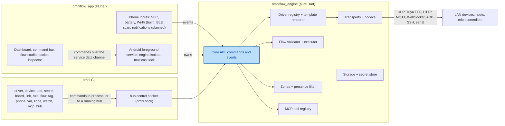
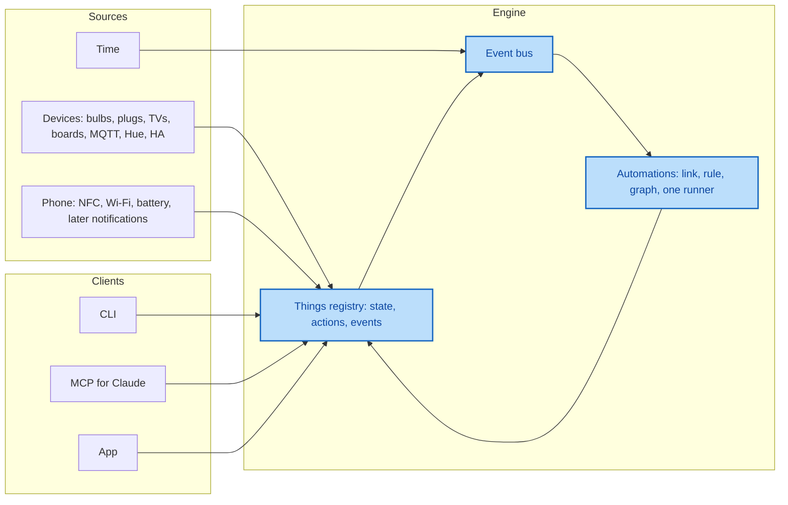

# OmniFlow Design

> Status: active. Design for M0-M7 and the architecture unification (things, one trigger, automations, the add pipeline, board peripherals and NFC). This is the only design document. The original spec set and the unification design were folded in here and are not kept.

## Purpose

OmniFlow is a local-first automation studio for Android phones. It controls LAN smart devices, desktop hosts and microcontrollers directly, without a vendor cloud, and wires them together with flows. It takes three ideas from existing tools: deep OS and hardware control, a card-based flow editor for quick mobile edits, and a node canvas with live packet inspection (Node-RED). An AI agent can drive all of it through MCP.

Consumer smart-home apps fall short for this in three ways. Commands go phone to vendor cloud and back to the LAN, which adds latency and stops working when the internet is down. They cannot reach outside their ecosystem: a shell command on a Mac, an ADB keycode to an Android TV, a JSON line from a Pico over USB. And their routines have no variables, payload extraction, filtered proximity or debounce and cooldown gates.

Nothing in OmniFlow is hardcoded to one household. Every device, protocol, trigger, condition and action comes from a declarative manifest or a registered node type.

## Requirements

1. A flow runs on the phone alone, with the screen off, and no laptop or server process is needed.
2. A new device type is supported by adding a JSON driver manifest, with no app release.
3. Local commands to LAN devices complete in tens of milliseconds and keep working with the internet down.
4. Presence at a desk or room is detected reliably enough that lights do not flicker on and off at the boundary.
5. Every action the UI can take is also available from the CLI, through one core API. MCP exposes a reviewed subset of it, without the commands that add or remove devices, store secrets, enable or run flows, or approve them.
6. An agent cannot run commands on a host, or register a driver that can, without the user approving it.
7. Secrets (Tuya local keys, SSH keys, ADB keys, LLM API keys) never appear in manifests, flows, logs or the packet inspector.
8. Background running stays within what Android allows for a long-lived service, and the battery cost is driven by what the enabled flows actually need.

## Architecture



The engine is a pure Dart package with no Flutter dependency. It owns every rule: manifests, rendering, transports, flow execution, variables, zones, storage and the MCP tools. Two hosts embed it:

- **The Android app.** The engine runs in a `flutter_foreground_task` service of type `connectedDevice`, in the service's own isolate, which starts the hub (`hub.start`) when it opens the engine. The UI talks to it through `ServiceEngineClient`: JSON messages over the plugin's data channel, with a session id per UI so a reopened UI never takes an old UI's replies. Each service task also has an instance id, sent as `i` in its `ready` and `stopped` messages. The client acts only on a `stopped` from the task whose `ready` it took, because a restarted service destroys the old task after the new one starts, and the old task's `stopped` must not close the new client. The service keeps running when the app is swiped away, starts on boot, and holds a partial wake lock, the Wi-Fi lock and the multicast lock for as long as it runs. Its notification has a Stop button. `flutter_foreground_task` takes the place of the `flutter_background_service` the plan named. None of this has run on a phone yet. Android is the only app target.
- **The `omni` CLI** runs it on the Mac. It is the development and test harness for drivers and flows against real devices, and `omni hub` can keep it running headless on a Mac Mini. The phone never needs it.

Phone inputs that only exist as Flutter plugins or Android APIs live in the app and reach the engine as core API commands, the same ones the CLI sends by hand. Built in code: NFC reading and writing through `nfc_manager`, and the battery and the Wi-Fi network through `PhoneSensorsBridge.kt` on the `omniflow/phone_sensors` event channel of the service's engine. BLE scanning and notification access are planned. The multicast lock is held by the service, through `MulticastLockBridge` on the `omniflow/multicast` method channel. On the Mac, `omni phone wifi|ble|battery|nfc` and `omni tag scan` feed the same inputs. The engine never imports a plugin, so it stays testable with `dart test` and runnable from the CLI.

### Core API as commands and events

The core API is a set of serializable commands (`device.invoke`, `flow.save`, `flow.dryRun`, `zone.list`, ...) that each return a serializable result, plus a stream of serializable events (`device.stateChanged`, `run.nodeCompleted`, `packet.captured`, ...). Every caller goes through it: the CLI calls it directly, the Android UI calls it through `EngineClient` (`ServiceEngineClient` to the service on the phone), and the MCP tools wrap it. Nothing calls engine internals around it. A client never holds logic, so the CLI, the app and Claude can each do exactly what the others can.

Lifecycle commands: `hub.start` (optional `wizPort` and `helloPort`) starts the WiZ push listener, the board hello listener, device polls, MQTT watches, flow timers and the zone tick, and is safe to call twice. A port already in use returns `unavailable` and rolls the hub back. `hub.stop` stops all of it and frees the ports. A device added while the hub runs is polled and watched at once, and a removed one stops. `engine.status` reports whether the hub runs, the loaded flows and `loadIssues`: every stored manifest, zone or flow that failed to load, as `{kind, id, error}`. A bad stored item no longer stops the engine opening. It is skipped, reported there and in `flow.list` and `driver.list`, and emitted once as `engine.loadIssue`.

This is what lets the Android UI and the engine live in separate isolates. The service runs its own Dart isolate, so the UI cannot hold a reference to the engine object. It sends commands and subscribes to events instead. On the Mac, other `omni` commands reach a running hub the same way, through its control socket.

### One owner for the database

On Android the service isolate is the only process that opens the SQLite database. The UI never opens it, and it reads everything through commands and events. Two isolates writing one SQLite file would need cross-isolate locking that drift does not provide across separate Flutter engines. On the Mac the CLI owns its own separate database, guarded by an exclusive lock file next to it. While `omni hub` runs it keeps the only engine and serves a control socket at `<home>/omni.sock`. Other `omni` commands, `omni watch` and `omni mcp` send their commands through it, so they work while the hub runs. With no hub they open the engine themselves and take the lock. A held lock still exits with code 75.

### One model: things, events and automations

OmniFlow grew one feature at a time, and each feature brought its own concept: devices, capabilities, board pins, zones, Wi-Fi and BLE readings, board events, variables, flows and links, each with its own commands and rules. The core API had 41 commands across 12 namespaces, and the flow engine 7 trigger types and 8 condition types, several of which said the same thing in different words (`var_compare`, `device_state_is`, `var_equals`). A link could not start from a zone, a tag, a board button event or the phone, because none of those were devices. Every new source meant a new event, trigger type, registry, commands, CLI verbs and screens, links, flows and rules each kept their own command family, and the app could reopen a flow only by projecting it back into cards. One model replaces all of that, with these requirements as outcomes:

1. A user can say "when anything, only if anything, do these steps" across every kind of thing OmniFlow knows, the phone, places and tags included, from the app, the CLI or Claude, with the same words.
2. A new kind of source (a sensor, a phone event, an ecosystem) needs only a driver or an event source, no new trigger type, command or screen.
3. Adding any device follows one path, whatever the device: find it, add it, pair it if it needs pairing, configure it if it has parts.
4. Nothing becomes less safe: the trust, approval and exposure rules hold unchanged.

| Separate concepts it replaced | The one model |
| --- | --- |
| Devices, plus zones, Wi-Fi, BLE, board events and NFC tags | Everything is a **thing** with **state**, **actions** and **events**. The phone, each person, each place and each tag is a thing |
| 7 trigger types | One `on` trigger: an event or a state change on any thing, with a match |
| 8 condition types | One `compare` condition over any value, plus the boolean groups and time and day windows |
| Flows, links and rules, each with its own commands | One **automation** with three authoring forms (link, rule, graph) stored together |
| Discovery, pairing, secrets and board pins as separate steps | One **add** pipeline that returns the next step |
| `ir.pin`, `rf.pin` and an NFC reader, each its own firmware command | One `periph.set` per peripheral type |



A thing is what the registry calls a device, widened to anything with an address. Every thing has a stable id, and every part of it is addressed as `thing.key`. State is a value the thing reports and keeps (`lamp.power`, `desk_board.knob`, `jade.home`). Actions are capabilities with a command (`lamp.power`, `tv.launch_app`, `desk_board.relay`). Events are momentary and carry a payload but no lasting value (`desk_board.button.pressed`, `front_door.scanned`, later `phone.notification`). Driver manifests, channels and the per-device command queue stay the extension point, changed only by the `event` capability type and `setup` steps.

### Engine placement

- **[Approved] Pure Dart engine with a CLI and a Flutter shell.** The phone runs the engine itself, so no server is needed. The same package gives a CLI for testing against real devices and an optional headless hub at no extra cost. The layout matches `projects/resonance`.
- **[Rejected] Everything inside one Flutter app, with the DAG in a background isolate.** There is no headless runner and no CLI, and plugin calls from a background isolate depend on each plugin's support.

### Hub and edge mesh

- **[Approved] Phone-first standalone runtime, mesh sync deferred to M6.** The phone reaches LAN devices directly over Wi-Fi, and reaches the Mac over SSH.
- **[Rejected for now] A Mac Mini hub that every phone streams telemetry to**, with Tailscale or WebRTC when away from home. It makes a laptop process a requirement, which contradicts requirement 1. It can be added later without engine changes, because both ends run the same engine and speak the same command and event messages.

### Accounts and sync (deferred)

OmniFlow starts with no account. It runs on one Android phone, and the CLI's database on the Mac is separate and used for development. When sync is built, these choices hold:

- **Sign-in** with Google, OAuth for installed apps with PKCE and only the `drive.file` scope, so OmniFlow sees only the files it creates. This copies resonance's working Google sign-in.
- **Store** in the user's own Google Drive: each device appends to an encrypted change log of drivers, devices, zones, flows and globals. Encryption happens on the device (argon2id key from a passphrase, AES-GCM), as in resonance's backups, so Google cannot read it. Secrets sync inside the same encrypted log. There is no server.
- **Scope** is the same setup on every signed-in device. Each device controls devices directly when it is on the same Wi-Fi. Nothing is reachable from outside home.
- **Who runs a flow.** First wins over home Wi-Fi: the device whose trigger fires announces a claim on the LAN, signed with the sync key, and waits about 200 ms. The earliest claim runs the flow and the others stand down. A trigger only one device observes runs on that device. A device away from home skips flows whose actions only reach LAN devices. This adds one UDP listen port per device that accepts only signed claims, which goes through the builder-security skill before it is built.

### Reaching each kind of device from a phone

- LAN lights and plugs (WiZ, Tuya, Shelly, WLED): UDP or TCP over Wi-Fi, pure Dart.
- A Mac or Linux host: SSH (`dartssh2`). A desktop running `omni` uses local process execution for itself.
- OmniFlow boards (ESP32, ESP8266, Pico W): UDP NDJSON over Wi-Fi. USB serial from a desktop, which is also the only link to an Uno. Android over OTG is planned.
- Android TV and Fire TV: ADB over TCP 5555, plus Wake-on-LAN.
- LG webOS and Samsung Tizen TVs: JSON over a WebSocket, paired once with a prompt on the TV.
- Hue bridges and Home Assistant: their local REST APIs over HTTP, with the bridge username or the access token as a device secret.

### Protocol coverage

| Ecosystem | Example devices | Mechanism | Milestone |
| --- | --- | --- | --- |
| Raw UDP JSON | Philips WiZ (38899), LIFX (56700), WLED, Govee LAN | UDP transport + manifest | M1 (WiZ), others by manifest |
| HTTP and REST | Shelly, Tasmota, ESPHome | HTTP transport + manifest | M1 |
| Tuya local | Tuya, SmartLife, Wipro, Halonix, Zebronics | TCP 6668 + Tuya codec, local key fetched once | M1 |
| SSH and local exec | Mac, Linux, Raspberry Pi | argv execution | M1 |
| OmniFlow boards | Uno, ESP8266, Pico W, ESP32 | Protocol v2 NDJSON over USB serial or Wi-Fi UDP | M7 |
| MQTT | Tasmota, ESPHome, Home Assistant style topics | MQTT 3.1.1 transport + manifest | M7 |
| Wireless ADB | Android TV, Fire TV | TCP 5555 + RSA auth, Dart client | M4, run on a real TV |
| BLE | Pico W beacon, BLE sensors, SwitchBot | BLE scan (presence), GATT later | M4 |
| TV WebSocket | LG webOS (SSAP), Samsung Tizen (remote control) | WebSocket JSON over `wss`, the certificate pinned on first use. An LG TV added with port 3000 uses plain `ws` | M6, built |
| Hub REST | Hue bridge (API v1), Home Assistant | HTTP + a device secret in a header or the path | M6, built |
| Hub push | Hue CLIP v2, Home Assistant | SSE and WebSocket | M6 |
| Zigbee 3.0 | Aqara, IKEA, Sonoff Zigbee | USB coordinator + Zigbee2MQTT, reached over MQTT | M7 (`zigbee2mqtt_device`) |
| Matter | Eve, Nanoleaf, Matter Wi-Fi plugs | python-matter-server sidecar over WebSocket | M6 |
| IR and 433 MHz RF | Plain TVs, split ACs, RF fans and blinds | An OmniFlow board with a 940 nm IR LED (NEC) or a 433 MHz OOK transmitter (`rf.send`, RCSwitch protocols 1 to 3) | IR M1, RF M7 |

## Repository layout

- `packages/omniflow_engine/` - `lib/src/` holds `api/`, `cli/`, `codecs/`, `dag/` (flow model, node types, validator, executor, links, cards), `devices/` (with `adb/`, `tv/` and `discovery/`), `manifest/`, `mcp/`, `storage/`, `template/`, `transports/` and `zones/`. `bin/omni.dart` is the CLI. `test/` holds unit tests and `live`-tagged tests against real devices.
- `packages/omniflow_app/` - Flutter client: `api/` (the `EngineClient` interface, `InProcessEngineClient` and the secure-storage `SecretStore`), `service/` (the foreground service, `EngineHost` in the service, `ServiceEngineClient` in the UI, and the multicast lock), `state/` (Riverpod providers over the event stream), `ui/`, and `startup.dart`. `api/engine_calls.dart` holds every call to the unified commands, `nfc/` the NFC adapter, `rules/` the rule form the builder writes, and `ui/` the rule builder and the Add page among the rest. `android/` holds `MulticastLockBridge.kt`, `PhoneSensorsBridge.kt`, `MainActivity.kt` (the NFC intent and permission channels) and `OmniFlowApplication.kt`.
- `drivers/` - built-in `*.omni_driver.json` manifests. `tool/embed_drivers.dart` generates a Dart file of string constants from them, so the manifests load the same way in the CLI, in tests and in an AOT-compiled app.
- `firmware/omniflow_node/` - the one board firmware and its native virtual board.
- Planned: `schemas/`, JSON Schemas for driver manifests and flow graphs for MCP clients and editors. The validators are Dart code today.

## Driver manifests

A driver manifest describes one kind of device: how to find it, how to talk to it, and what it can do. A device is an instance of a driver with an address and its own settings.

### Schema v1

```json
{
  "schemaVersion": 1,
  "id": "philips_wiz_udp",
  "name": "Philips WiZ Light (local UDP)",
  "category": "lighting",
  "icon": "lightbulb",
  "transport": { "type": "udp", "port": 38899, "listenPort": 38900, "payload": "json", "matchMethod": true },
  "discovery": [
    {
      "method": "udp_broadcast",
      "port": 38899,
      "probe": { "method": "registration", "params": { "phoneMac": "AAAAAAAAAAAA", "register": false, "phoneIp": "1.2.3.4", "id": "1" } },
      "matchJsonPath": "$.result.mac",
      "idJsonPath": "$.result.mac"
    }
  ],
  "statePush": { "method": "syncPilot", "jsonPath": "$.params" },
  "statePoll": { "intervalSeconds": 60, "command": { "method": "getPilot", "params": {} }, "jsonPath": "$.result" },
  "reliability": { "timeoutMs": 500, "retries": 2 },
  "capabilities": [
    {
      "id": "power",
      "type": "toggle",
      "label": "Power",
      "command": { "id": 1, "method": "setState", "params": { "state": "{{value}}" } },
      "stateJsonPath": "$.state"
    },
    {
      "id": "brightness",
      "type": "level",
      "label": "Brightness",
      "params": { "value": { "type": "number", "integer": true, "min": 10, "max": 100, "unit": "%" } },
      "command": { "id": 1, "method": "setPilot", "params": { "state": true, "dimming": "{{value}}" } },
      "stateJsonPath": "$.dimming"
    },
    {
      "id": "color_temp",
      "type": "color_temp",
      "label": "White temperature",
      "params": {
        "value": { "type": "number", "integer": true, "min": 2200, "max": 6500, "unit": "K" },
        "brightness": { "type": "number", "integer": true, "min": 10, "max": 100, "optional": true }
      },
      "command": {
        "id": 1,
        "method": "setPilot",
        "params": { "state": true, "temp": "{{value}}", "dimming": "{{brightness|state.dimming|100}}" }
      },
      "stateJsonPath": "$.temp"
    },
    {
      "id": "rgb",
      "type": "color_rgb",
      "label": "Colour",
      "params": { "brightness": { "type": "number", "integer": true, "min": 10, "max": 100, "optional": true } },
      "command": {
        "id": 1,
        "method": "setPilot",
        "params": { "state": true, "r": "{{r}}", "g": "{{g}}", "b": "{{b}}", "dimming": "{{brightness|state.dimming|100}}" }
      }
    }
  ]
}
```

- `schemaVersion` is required. The loader rejects a version it does not know, and each version bump ships a migration.
- The file suffix is `.omni_driver.json`.
- `transport.type` picks the transport: `udp`, `tuya`, `http`, `mqtt`, `exec`, `serial`, `omniflow`, `adb`, `websocket` or `virtual`. `virtual` sends nothing anywhere: the engine keeps the thing's state from its inputs, and a command is accepted as sent. `tcp` is refused until a channel exists for it. `transport.payload` is `json`, `text` or `hex` and decides how a rendered command becomes bytes.
- A UDP transport with `"matchMethod": true` accepts only a reply whose `method` equals the sent command's. Every WiZ command carries `"id": 1`, so the id cannot tell replies apart, and without this a late `setPilot` ack can be taken as the answer to a `getPilot` poll.
- `discovery` is a list, so a driver can be found more than one way, and `device.discover` runs every network method a driver declares at once and merges the results by stable id. Built:
  - `udp_broadcast`: a probe broadcast, matched by JSONPath.
  - `serial`: each USB serial port is sent `describe`.
  - `mdns`: DNS-SD over mDNS for the `service` type (`_hue._tcp`), resolved from PTR to SRV and TXT to an IPv4 A record on the local network. `idTxt` names the TXT key that holds the stable id, or `idInstance: true` takes the instance label. Results carry the SRV port and the instance name.
  - `tuya_broadcast`: listens on UDP 6666 and 6667 for the announcements Tuya devices send every few seconds (v3.1 plain, v3.3 AES-ECB, v3.5 AES-GCM, as tinytuya decodes them) and takes `gwId` as the stable id. It never sends.
  - Any entry may set `windowMs` to listen longer than the caller asked, and `idSetting` to name the device setting that holds the stable id, so a device added by hand still heals: `tuya_plug` reads it from `devId`, on add and for devices stored before. The other way round, `device.add` fills an empty `idSetting` from the stable id, so a Tuya plug picked from a scan gets its `devId` from the `gwId` it announced.
  - A method that cannot open its socket does not stop the others, and their results still come back. When every method fails, `device.discover` fails with `unavailable` and names the cause, for Tuya that another program holds UDP 6666 and 6667.
  - Accepted by the parser but not implemented: `ssdp` and `ble`. ARP scanning is a hub-mode method only, in M6.
- `settings` declares per-device fields the user fills in when adding a device, for example a Tuya `devId` and `localKey`. A field marked `"secret": true` is stored in the secret store and is never available to templates.
- `statePush` reads state from unsolicited packets (WiZ `syncPilot`). `statePoll` reads it on an interval, and also serves as the liveness check. A poll reply that carries none of the manifest's top-level state keys leaves the stored state alone. `stateJsonPath` on a capability reads that capability's value out of the state object.
- `reliability` sets the reply timeout and the retry count for transports that expect a reply.
- `pairing` says how `device.pair` pairs a device: `adb`, `tv` (a prompt on the TV issues a key), `hue_bridge` (the link button, which needs a secret setting `username`) or `secret` (the user stores the secret the entry names, with optional `instructions` up to 400 characters). An `adb` or `websocket` transport pairs that way without the entry. Device JSON carries `pairing: {method, prompt}`, the step the user takes, for UIs to show before pairing starts.
- `setup` lists the steps a device of the driver goes through once it is added, in order: `pair`, `secret:<key>` and `configure:<key>`, where a trailing `?` makes a step optional (`configure:mac?`). `pair` needs a `pairing` entry or a TV transport, a `secret` step a secret setting and a `configure` step a plain one. The engine reports the first open step as `next`.
  - **[Approved] Pairing, secrets and board setup are steps the driver declares, and the engine says which comes next.** The app's Add page, `omni add` and MCP all follow `next`, so a new driver that needs pairing gets the whole flow for free.
  - **[Rejected] A wizard per device family in the app.** That is logic in the app, which `AGENTS.md` forbids, and it repeats per family.
- A discovery entry may set `"usePort": false` when the port it finds is not the one to talk to (a Hue bridge answers mDNS on 443 and takes REST on 80), so its candidate leaves the port out.
- A user manifest cannot reuse a built-in id. To change a built-in, the user copies it under a new id.

### Capability types

The type decides the UI control, the default `value` parameter and how an agent reasons about the capability.

- `toggle` - boolean `value`.
- `level` - number `value` within `min`..`max`.
- `color_temp` - number `value` in kelvin.
- `color_rgb` - `r`, `g`, `b` numbers 0..255.
- `dpad_remote` - `value` from up, down, left, right, ok, back, home.
- `text_command` - string `value`, for drivers that take free text (an IR code, a deep link).
- `exec` - runs a command on a host. Risk-gated, see Security.
- `sensor` - read-only stream, no command.
- `action` - a button with no value (Wake-on-LAN, run a Mac shortcut).
- `event` - something that happens: momentary, with a payload, no lasting state and no command (a button press, an NFC scan). Its id may be dotted (`button.pressed`). It refuses a `command` and a `stateJsonPath`, and appears in device capability JSON as type `event`. When a thing raises one, the engine emits `thing.event` with `{thing, key, payload}`.

### Template rendering

Commands are structured JSON templates, not text templates. The renderer walks the template. A string that is exactly one placeholder (`"{{value}}"`) is replaced by the typed value, so `true` stays a boolean and `80` stays a number. A string with a placeholder inside other text gets string interpolation. This removes the escaping problem Mustache has with JSON, where `{{value}}` is HTML-escaped and would have to sit unquoted inside a JSON string.

- A placeholder is a dotted path with optional fallbacks: `{{brightness|state.dimming|100}}`. The first path that resolves wins, and a literal number, string or boolean can end the chain.
- A bare name reads the action's params. Every other source needs a prefix: `state.*` (current device state), `device.*` (non-secret device settings), `msg.*` (the triggering message), `$Name` (global variables) and `%name` (flow variables). The manifest validator rejects a bare name that is not a declared param, so a typo fails at load time instead of at the first command.
- Params are validated against the capability's `params` schema before rendering. A value out of range or of the wrong type fails the action without sending anything. A number param marked `"integer": true` also refuses a fraction (`must be a whole number`), and a whole double such as `80.0` is sent as `80`. The WiZ, Tasmota dimmer and Zigbee2MQTT brightness params carry it.
- For `text` and `hex` payloads the template is a string. For `exec` the template is an argv array (see Transports), and each element is rendered as text with no shell involved.

The original spec's flow passed `brightness: 80` to a template that read only `state.brightness`, so the 80 was dropped. Params now come first in the lookup.

### Device runtime

- **Per-device command queue.** Commands to one device run one at a time, in order. Tuya devices accept a single local TCP connection, and WiZ bulbs reply per request, so overlapping commands from two flows would collide. A toggle (`device_toggle`, links) reads the current state and sends the opposite inside one queued task, so two quick toggles flip twice.
- **Adding and removing.** `device.add` refuses an id that exists unless `replace: true`. It stores the device and lists what it still lacks: `missingSecrets`, and `missingSettings` for the plain settings it cannot work without. Those are the discovery `idSetting` and any setting a command, `statePoll` or `statePush` template reads with no fallback, so a Home Assistant entity without `domain` or a Tuya plug without `devId` is reported. `device.remove` deletes the device at once and fails anything still queued for it, stops its polls and watches, drops its TV connection and refusal cooldown, deletes its secrets, and disables every enabled flow that names it, returning those flow ids. A replace drops the TV connection too. A held ADB connection is not closed by either yet. `device.add` also returns `next`, the device's first open setup step. An `nfc_tag` keeps its `uid` unique: `device.add`, and so `thing.add`, and `thing.configure` refuse a UID another tag has with `exists`, and store it upper case with no separators.
- **Timeouts and retries** come from the manifest's `reliability` block. A command that exhausts its retries fails the action, which then leaves through its `error` port.
- **Address healing.** A device is identified by a stable id from discovery (MAC, Tuya `gwId`, a board's node name, a Shelly's mDNS instance, a Hue bridge id, a Home Assistant uuid), not by its IP. When a command times out, the engine re-runs that driver's discovery, matches the stable id, updates the address and retries once. DHCP lease changes stop breaking flows for those devices. A Tuya plug is located by listening up to 8 seconds for its announcement, and the listen ends as soon as it is heard. `udp_broadcast` and `mdns` discover again and match. Exec devices are never looked up. A device whose driver declares a secret setting does not move: any host on the LAN can announce the same id, and the device's next command would carry its secret to that host. That covers Hue, Home Assistant, the MQTT drivers, the LG and Samsung TVs and any other driver with a secret setting, custom ones included. Tuya is the exception, because its local key only encrypts and never goes on the wire. Such a device fails with a timeout that names the host announcing its id and says to add the device again with that host.
- **Pairing.** `device.pair {id}` runs the pairing the driver declares and returns `{id, method, paired, message}`. Android TV: it connects so the TV shows "Allow USB debugging?" for the engine's key and waits up to 60 seconds for the answer (`prompted` says whether the TV asked). webOS and Tizen: it connects, the TV shows its prompt, and the issued key is stored (`newKey`). A refusal cooldown is skipped, because the user asked. Hue: the user presses the link button first, and the bridge's username is stored for every Hue light on that bridge that is already added. A light added later lists `username` in `missingSecrets` and needs its own pairing, with another press of the button, which creates a second user on the bridge. So add every light on a bridge before pairing it. Home Assistant: nothing is sent, and the message says to create a long-lived access token and store it with `omni secret set <id> token`. A refused or unanswered pairing fails with `pairing_failed`. The ADB channel also emits `device.pairingPrompt` when the TV shows its prompt.
- **Pairing is not started unattended.** `device.invoke` takes `allowPairing: false`, which MCP always sends. Hub state polls never pair, and neither does a flow's `device_capability` node, in every flow run whether the flow is trusted or not, so an agent-deployed flow and a follow or threshold link cannot pair either. An LG or Samsung TV with no stored key then fails with `needs_user` before connecting, and an Android TV that does not know the engine's key fails with `needs_user` without the key being offered. A TV that no longer knows its stored key may still show its prompt once: webOS answers the registration with the prompt, and Tizen sends no `ms.channel.connect` within the normal reply timeout. The engine then closes the connection, stores nothing and fails with `needs_user`, and it does not reconnect for unattended commands until the user pairs, sets a TV secret, or removes or replaces the device. A command the user runs from the CLI or the app may still pair on first use. A flow's `device_toggle` node, which toggle links use, still pairs like a user command.
- **Liveness.** Device JSON carries `online`: true when the device answered a command, a poll or pushed state within three poll intervals, or 90 seconds for a board. Devices with neither a poll nor a board hello leave the field out. The engine also emits `device.offline`, `device.pollFailed` and `board.offline`.
- **Optimistic state.** After a successful command, the engine writes the commanded value into state, and the next push or poll corrects it if the device disagrees.

### Adding a thing

`thing.add` is the one way to add anything. The app's Add page, `omni add` and the MCP tools all use it.

- **Find.** With no `driver` and no `candidate`, it runs every discovery method at once for `windowMs` (100 to 60000, default 3000): UDP broadcast, mDNS, Tuya broadcasts, USB serial and the board hellos the hub heard (`board.found` becomes a candidate). `methods` and `drivers` narrow it. It returns `groups`, one per driver, whose `candidates` carry a suggested `id` unique against the devices and the rest of the result, `knownAs` when the find is already a device, and `add`, the arguments that add it. Drivers with no discovery are listed under `manual` (`virtual: true` for the virtual things), and `failures` names a method that could not run.
- **Add.** `{candidate, name?, room?, id?, settings?, replace?, provision?}`, or `driver` and `host` typed by hand, puts the explicit keys on top of the candidate and goes through `device.add`. A missing id comes from the name, or from the driver and the last part of the host. A find that is already a device, by stable id or `knownAs`, is refused with `exists` unless `replace: true`. With neither, a device with the same driver, host, port and settings counts as the same one. The settings stay in that match because one Home Assistant or MQTT host serves many devices that only a setting tells apart, and virtual things are never matched this way. Lights behind one Hue bridge, and entities on one Home Assistant, share the hub's stable id and address, so the stable id or address match also compares the identifying settings the driver asks for at setup (`lightId`, `entityId`, `friendlyName`, `topic`, `commandTopic`, `stateTopic`). A find and a device that both have none match by address alone. Otherwise they are the same device only when those settings are equal, so a second light or entity is added with `thing.add`, and the same light twice is still `exists`. A `knownAs` is checked again when the add names one of those settings. The reply carries `id`, the device and `next`. Only plain settings are taken here, never a secret.
- **Next.** `next` is `{step: pair | secret | configure | done, instruction, ...}`. A pair step names its `method` and `command: device.pair`. A secret step lists `keys` with `command: secret.set`, and a configure step lists `keys` with `command: thing.configure`. Open steps of the same kind next to each other are asked together, so an MQTT topic and its optional broker user come at once. `remaining` lists every open step. `done` says the thing is ready and lists the optional steps still open. A pair step is done when the secret the pairing stores is there. ADB stores none, so it counts as done once the TV has answered, or after `thing.next {id, paired: true}` reports a `device.pair` that just succeeded, which is kept in memory only.
- **Resume and configure.** `thing.next {id}` says where a device stands now, which is how a setup left half way resumes. `thing.configure {id, settings, provision?}` sets plain declared settings, `null` removing one. A secret key, an unknown key and an empty object are `invalid`. A board's pins are checked and provisioned unless `provision: false`. It returns `next`, and restarts the device's live state when the hub runs.
- **`omni add`** lists the finds (`--method`, `--window-ms`), adds one with `--pick N` or with `--driver D --host H` (`--port`, `--id`, `--name`, `--room`, `--stable-id`, `--set k=v`, `--replace`), and walks the steps. A `--set` value, on `omni add` and `omni device add` alike, stays text as typed unless it is a JSON object or list, so a UID such as `12E45678` is never read as a number. It runs the pairing, reads each secret from stdin (hidden on a terminal, never an argument), and asks for each setting. `--resume ID` continues, `--no-pair` stops at a pair step, `--no-provision` leaves a board as it is, and `--json` prints each engine reply except `secret.set`. It exits 0 when done or listed, 1 on an engine error, and 2 when it stopped before done, printing `omni add --resume ID`.

### Built-in drivers

The files in `drivers/`:

- `philips_wiz_udp` - WiZ lights: `power`, `brightness`, `color_temp`, `rgb`. Discovered by broadcast, polled every 60 s, pushed through `syncPilot`.
- `tuya_plug` - a Tuya, SmartLife or Wipro plug with its switch on DP 1 (TCP 6668, v3.3): `power`, polled, found by its UDP announcement. Needs the `devId` setting and the `localKey` secret. Tuya bulbs wait for the protocol scan.
- `shelly_plus_switch` - a Shelly Plus or Pro switch over Gen2 local RPC, switch 0: `power`, polled, found over mDNS (`_shelly._tcp`) by instance name, which is the device id.
- `macos_host` - a Mac over SSH, or locally from `omni`. Capabilities and their argv:
  - `volume`: `osascript -e "set volume output volume {{value}}"`, with `value` validated as 0..100
  - `display_wake`: `caffeinate -u -t 2`
  - `display_sleep`: `pmset displaysleepnow`
  - `run_shortcut`: `shortcuts run {{value}}`, with the name refused when it starts with `-` or holds a quote or backslash, and optional input passed on stdin
- `linux_host` - a Linux host over SSH: `service_restart` (`sudo -n systemctl restart <unit>`), `user_service_restart` (`systemctl --user restart -- <unit>`) and `suspend`. Unit names must match `[A-Za-z0-9@_][A-Za-z0-9@._-]*`, so no option can be passed in. The sudo argv keeps no `--` so that a sudoers rule for `systemctl restart <unit>` still matches.
- `omniflow_board` - any board running the OmniFlow firmware (ESP32, ESP8266, Pico W, Uno), over USB serial or Wi-Fi: `ir_nec`, `ir_code` and `rf_send` (`code`, optional `bits` 1 to 32, `protocol` 1 to 3, `repeat` 1 to 20), plus one capability per pin the user names. Found by broadcast, over USB, and over mDNS by node name. The board's peripherals decide the rest: once its `describe` has reported them, `ir_nec` and `ir_code` need an IR transmitter and `rf_send` an RF one, bound with `periph.set` or built in (the `ir` and `rf` flags, which the native virtual board sets), and a board with an NFC reader raises the `nfc.scanned` event. A board whose firmware reports neither keeps all three actions. The engine keeps what it read as the board's `periph` setting.
- `android_tv_adb` - Android TV and Fire TV over ADB: `wake`, `sleep`, `power`, a `remote` d-pad, `press_key {key, longPress?}` for any catalog key, `volume` (0 to 100, read back as state), volume keys, mute, play and pause, `type_text`, `launch_app` and `stop_app {package}`, `open_url {url}`, `set_setting` and `manage_app` (both high risk), `wake_on_lan` (the `mac` setting), and the `power_state`, `current_app` and `playback` sensors the hub poll fills. It has no exec capability: the channel builds every shell line itself from fixed words and validated values.
- `lg_webos_tv` (`volume`, `mute`, `power_off`, `launch_app`, `toast`, polled volume) and `samsung_tizen_tv` (`remote`, volume keys, `mute`, `power`, `launch_app`, no state readback).
- `philips_hue_light` - one light on a Hue bridge (API v1): `power`, `brightness` 1 to 254, `color_temp` in mireds 153 to 500, polled. Found over mDNS by bridge id, paired with the link button.
- `home_assistant_entity` (`power`, `brightness`, polled) and `home_assistant_sensor` (`value`) - a Home Assistant entity over its REST API with a long-lived token. Found over mDNS by instance uuid.
- `tasmota_mqtt` (`power`, `dimmer`), `zigbee2mqtt_device` (`power`, `brightness` and the `temperature`, `humidity`, `occupancy`, `contact`, `battery` sensors), `mqtt_switch` (`power`) and `mqtt_sensor` (`value`) - devices behind an MQTT broker.
- Virtual things, on the `virtual` transport, added with no host:
  - `phone` - state `wifi_ssid`, `wifi_bssid`, `battery`, `charging`, and the `nfc_scanned` event. Setting `person` names who carries it. The engine makes the `phone` thing on the first phone input, or when a flow names it.
  - `person` - state `home` and `place`. Setting `homePlace` names the place that counts as home, `home` when unset.
  - `place` - a zone as a thing. Settings `ble` and `wifi` hold the zone's inputs, and `zone` the zone id it answers to when that differs from its own id. State `inside` and `people` (the people inside).
  - `nfc_tag` - state `last_scanned` and the `scanned` event. Setting `uid`, optional: 4 to 10 bytes of hex, stored upper case with no separators. The tag's own id is what OmniFlow writes on it.
- **[Approved] The phone, people, places and tags are things, through built-in virtual drivers.** "I reached home" is then `jade.home` turning true, and works in links, rules, the dashboard and the command bar with no special case.
- **[Rejected] A separate trigger, command family and screen per source (zones, NFC, notifications).** That is the cost of a new source, paid again for every source.

Both host drivers use the `exec` transport, so they are high risk. Neither has a free-form `exec` capability.

Planned: `windows_host` (PowerShell over SSH, with the OpenSSH server on Windows), Tuya bulbs, the webOS d-pad (its separate pointer input socket), and Hue CLIP v2 (M6).

## Transports and wire protocols

All transports implement one interface: open, send, an incoming stream, close, and a packet tap. The tap feeds the packet inspector and `omni watch --packets` through a bounded ring buffer. Each transport owns its sockets for its whole life, so no call binds a throwaway socket.

### UDP and Wake-on-LAN

- One bound socket per transport, with broadcast enabled. Discovery probes go to `255.255.255.255` and to a /24 directed broadcast for each interface (for example `192.168.1.255`). Dart does not expose interface netmasks, and home networks are almost always /24.
- Wake-on-LAN sends 6 bytes of `0xFF` followed by the target MAC repeated 16 times (102 bytes) to port 9 on the broadcast address.
- Android's Wi-Fi stack filters out multicast packets unless the app holds a `WifiManager.MulticastLock`, and holding one costs battery. Android's documentation covers multicast only, so whether broadcast replies also need the lock is checked on the phone. The service holds the lock for as long as it runs, not only during discovery: WiZ pushes, board hellos, Tuya announcements and mDNS all arrive at times the engine does not choose. Its battery cost is part of the M4 measurement.

### Philips WiZ

- JSON-RPC over UDP 38899: `getPilot`, `setPilot`, `setState`, `getSystemConfig`.
- Discovery broadcasts `{"method":"registration","params":{"phoneMac":"AAAAAAAAAAAA","register":false,"phoneIp":"1.2.3.4","id":"1"}}` to port 38899. Each bulb answers with `result.mac`, and its IP is the reply's source address. This is the message pywizlight uses, and `register: false` tells the bulb not to push to that sender.
- Pushes: a client sends `{"method":"registration","params":{"phoneIp":<own IP>,"register":true,"phoneMac":<a MAC it made up>}}` to each bulb's port 38899 and listens on UDP 38900. The bulb then sends `syncPilot` (state in `params`, the bulb's MAC in `params.mac`) and `firstBeat` (a bulb coming online) to 38900. The registration is renewed every 20 seconds, as pywizlight does, and `syncPilot` gets no reply. Each renewal and each push looks up the bulb's current address, so a moved bulb is registered where it is now. A datagram from a non-local address is dropped, a `syncPilot` counts only when it comes from the address of the bulb its MAC names, and a push for a removed bulb is dropped. A failure there is reported as `wiz.error` and never stops the listener.
- Bulbs accept a dimming of 10 to 100 and report their own white range. pywizlight clamps colour temperature to 1000 to 10000 K. The built-in manifest uses 2200 to 6500 K, the common tunable-white range, and narrowing it per bulb from `getModelConfig` is an open item.
- WiZ has no authentication on the LAN. Anyone on the network can control the bulbs. OmniFlow does not change that.

### Tuya local protocol (TCP 6668)

Frame layout for v3.3, big-endian:

1. Prefix `0x000055AA` (4 bytes).
2. Sequence number (4 bytes).
3. Command (4 bytes): `0x07` control, `0x0A` status query, `0x09` heartbeat.
4. Length (4 bytes): everything after this field, including the CRC and the suffix.
5. Payload. For a control command, the 15-byte header `"3.3"` plus 12 zero bytes, followed by the AES-128-ECB (PKCS7) ciphertext of the JSON body, keyed by the device's 16-byte local key. The status query has no version header.
6. CRC-32 (IEEE) over everything from the prefix to the end of the payload (4 bytes).
7. Suffix `0x0000AA55` (4 bytes).

- Device responses add a 4-byte return code before the payload. The codec decodes responses (check the CRC, read the return code, decrypt) as well as encoding requests. A reply whose plaintext is not JSON is a refusal: the waiting command fails with `<id> refused the command: <text>`, and a frame that cannot be decoded is skipped so the next one is still read. A declared length over 64 KiB is treated as garbage and the splitter resyncs on the next prefix.
- The channel sends a heartbeat (`0x09` with `gwId` and `devId`) every 10 seconds when no command went out, and closes the connection after two heartbeats get no frame back. The next command reconnects. Unsolicited status frames (`0x08`) become device state.
- v3.4 adds a session-key negotiation and replaces the CRC with an HMAC-SHA256. v3.5 changes the frame prefix and uses AES-GCM. Which version each of the user's devices speaks is read with a tinytuya scan before M1 decides whether v3.5 is in scope.
- A device accepts one local TCP connection at a time. The transport keeps one persistent connection per device, and the Smart Life or vendor app holds that slot while it is open, so it must be closed during use.
- Discovery: each device announces itself every few seconds on UDP 6666 (v3.1, plain JSON) or 6667 (v3.3, AES-128-ECB under the fixed key `md5("yGAdlopoPVldABfn")`), and v3.5 devices send 0x6699 AES-GCM frames. The engine listens on both ports only during a discover or locate window, never sends, drops senders outside the local network, and refuses a `gwId` outside `[A-Za-z0-9_-]{1,64}`. Port 7000 (app broadcasts) is not listened to. The decoder matches frames built by tinytuya's own packer, not device captures.
- The local key comes from a one-time step: pair the device in Smart Life, link that account to a Tuya IoT developer project, then run `python -m tinytuya wizard`. After that, control is LAN-only. The key changes every time the device is removed and re-paired in the app, so a re-paired device needs its key fetched and stored again (`omni secret set`).

### Host execution (local and SSH)

- Commands are argv arrays, started as a process with no shell, so a parameter cannot inject a second command. Input to a command is passed on stdin as data. Output is collected as it streams, and a background child that keeps the pipes open after the command exits cannot stall it past its timeout.
- Over SSH, the argv is joined with POSIX single-quote escaping on each element, because the remote side always runs a shell. An argv element with a backslash is refused before connecting (`invalid`), which keeps the quoting literal under sh, bash, zsh and fish.
- SSH pins the host key on first use, in the secret store. A changed key fails with `host_key` and the offered and pinned fingerprints, until the user acts with `device.hostkey {id, action}` (`omni device hostkey <id> [--accept <fingerprint> | --clear]`). `show` returns the pinned key and the key the host offers now, read by a probe that refuses the key and so never authenticates. `accept` pins the offered key only when it equals the fingerprint the user reviewed, and fails with `conflict` when the host now offers another. `clear` drops the pin. Agents cannot do any of this. On the Mac the pin is the keychain item `ssh/hostkey/<host>:<port>` under the `omniflow` service. The username is a required device setting, with no default, and the private key is the `sshPrivateKey` secret.
- Planned for the app: it generates its own SSH key pair per target host and shows the public key for the user to add to `~/.ssh/authorized_keys`, and the setup guide suggests a `from="<LAN subnet>"` restriction on that key line.
- The original spec ran `/bin/zsh -c` with `runInShell: true` (two shells) and built `echo "$input" | shortcuts run` from user text. Both are replaced by the above.

### USB serial

- 115200 baud, 8N1, no flow control, newline-delimited JSON.
- The reader decodes with a streaming UTF-8 decoder and a line splitter with a maximum line length. Decoding each chunk separately corrupts characters split across reads.
- On macOS and Linux the port is set to raw mode with `stty` and read through a `cat` subprocess, so it needs no native library and closing a port never hangs on a blocked read. A port that is already open, for example by a board device, is shared rather than opened twice, so discovery asks that board through the open port and leaves it open. Android OTG needs its own adapter behind the same interface, in the app (planned, likely `flutter_libserialport`).
- Opening the port resets an Uno and most ESP32 boards, so the first command after opening is retried while the board boots.
- `stty` runs while the engine's write descriptor is held, with `-hupcl`, because macOS puts a tty back to its defaults on the last close. Opening has a 5 second limit, and a write and its flush count against the request timeout: a write that times out drops the port, and the retry opens it again. This is proven on a pseudo-terminal, not on CH340 or FTDI adapters.

### Universal board runtime (protocol v2)

A board runs one OmniFlow firmware for its whole life. The engine tells it at runtime what each pin is for, so wiring a relay, a button, a servo or a sensor to a board needs no new firmware: the user names the pin once and it appears as a switch, slider or sensor on the dashboard and in flows.

- **[Approved] A JSON pin runtime over newline-delimited JSON.** Readable in the packet inspector, the same over USB serial and Wi-Fi UDP, and validated against a board profile on both ends.
- **[Rejected] Firmata.** A binary protocol designed for serial only, with no discovery, no request ids and no readable traffic.
- **[Rejected] A firmware per project, generated from flows.** Every change means reflashing, which is exactly the friction this tool removes.
- **[Approved] One firmware, in Arduino C++.** `firmware/omniflow_node/` builds for ESP32, ESP8266, Raspberry Pi Pico W (arduino-pico core) and Arduino Uno. Its protocol core (`omni_core.cpp`) uses no Arduino headers, no heap and no STL, so it fits the Uno's 2 KB of RAM and also compiles natively into the virtual board the engine tests talk to. The ESP32 profile is for the classic ESP32 only, and the AVR build is for the Uno and Nano (ATmega328P) only: any other ESP32 variant or AVR board stops the compile with an `#error` rather than run with the wrong pin map.
- **[Rejected] A MicroPython variant for the Pico W.** The Arduino sketch runs on the Pico W too, and a second implementation of the protocol would have to be kept in step and tested twice. The earlier MicroPython firmware (protocol v1) was retired.
- **[Approved] One `periph.set` and `periph.clear` for every peripheral bound to pins (an IR LED, a 433 MHz transmitter, an RC522 or PN532 NFC reader), set over USB and kept in flash, with `describe` listing `periph`.** The engine turns each one into the board's actions and events: the `ir_nec` and `rf_send` actions, the `nfc.scanned` event. `ir.pin` and `rf.pin` stay accepted for boards already set up.

One JSON object per line over serial at 115200 baud, or one per datagram over UDP port 38950. The board ignores datagrams from outside its own subnet, and sends each UDP line whole in one datagram of up to 3 KB (a full `describe` on an ESP32 or Pico W is over 2 KB, past the 1460 bytes the ESP32 core's `NetworkUDP` would keep). Every command may carry an `id`, and the reply echoes it, so a late reply is never taken for the wrong command. A reply is an `ack` or an `error` with a message the user can read. A line that does not parse still gets an `error` carrying the `id` scanned from the raw line. A key or value too long for the board's buffer is refused with `value too long`, never truncated, and a serial line that does not fit the 200-byte line buffer gets `line too long`. String escapes `\n \t \r \b \f \/ \" \\` are decoded, and `\u` is refused. A `pin` must be a JSON number in the board's pin range.

Commands, host to board:

- `describe` - `{"event":"describe","proto":2,"fw":...,"board":"esp32","ir":true,"rf":false,"watches":12,"pins":[{"pin":4,"caps":["in","pullup","out","pwm","servo"]},{"pin":34,"caps":["in","adc"]}],"set":[{"pin":4,"mode":"out"}]}`. `ir` and `rf` say whether those outputs have a pin, `watches` is how many pins the board can watch at once (12, or 6 on the Uno), and `set` lists the pins that have a mode now. `periph` lists each peripheral with every pin it holds, bus pins included (`{"type":"nfc_rc522","pins":{"ss":8,"rst":9,"sck":13,"miso":12,"mosi":11}}`), and `periphTypes` the types this firmware takes (the Uno build has no PN532). Over UDP the reply goes to the sender, and the sender becomes one of up to three event receivers, kept for 90 seconds (three hello periods) after its last `describe`. A hub sends `describe` on every hello, so it stays a receiver. Each event goes to every live receiver as its own datagram. Over serial every event goes to the port.
- `pin.mode` `{"pin":4,"mode":"out"}` - modes `in`, `in_pullup`, `out`, `pwm`, `servo`, `adc`, `none`. Refused when the board profile does not give that pin that capability: `in_pullup` needs `pullup`. `none` releases the pin back to a plain input, frees its PWM or servo channel and stops its watch. Moving a pin to a mode that is not an input also stops its watch. Setting the mode a pin already has changes nothing, so the host can resend its whole setup at any time without switching an output off. Mode `out` takes an optional `"value"` of 0 or 1, the level the pin drives from the instant it becomes an output: the board sets the latch while the pin is still an input, so an active-low relay given 1 never clicks on during setup. A resent `out` with a value changes the level only while no `pin.write` has set it since. A servo starts at 90 degrees. When the board has no free PWM or servo channel the reply is `no free PWM or servo channel`, and the pin keeps its old mode and level.
- `pin.write` `{"pin":4,"value":1}`, `pwm.write` `{"pin":5,"value":0..100}` (percent), `servo.write` `{"pin":13,"value":0..180}` (degrees). Each needs the matching mode first.
- `pin.read` `{"pin":34}` - the reply carries `value` (0 or 1, or 0..100 percent for `adc`).
- `pin.watch` `{"pin":0,"ms":50,"delta":0}` - the board then sends `{"event":"pin.changed","pin":0,"value":...}` whenever the value moves by more than `delta`, checking every `ms` (10 to 60000). `{"pin":0,"off":true}` stops it, on any pin. Only `in`, `in_pullup` and `adc` pins can be watched.
- `ir.send` `{"address":4,"command":8}` or `{"hex":"0x20DF10EF"}` - NEC only, on the IR transmitter's pin.
- `rf.send` `{"code":5393,"bits":24,"protocol":1,"repeat":10}` - a 433 MHz OOK code on the RF transmitter's pin, sent the way RCSwitch's `send()` does: most significant bit first, then the sync pulse, `repeat` times (1 to 20). `code` must fit in `bits` (1 to 32) and `protocol` is 1 to 3. The ack comes after the signal has gone out.
- Setup, kept in the board's flash and taken only over USB serial:
  - `wifi.set` `{"ssid":...,"password":...}`. The password is empty for an open network, 8 to 63 characters, or exactly 64 hex digits. The board acks before it starts joining.
  - `wifi.clear` forgets the network, disconnects, and drops the event receivers.
  - `node.set` `{"name":...}`. A name is `^[a-z][a-z0-9_-]{0,22}$`. A board with no valid stored name makes one up (`omni_<board>_<last three MAC bytes>`, or `omni_uno`) and saves it, so it keeps the same name across boots.
  - `periph.set` `{"type": "ir" | "rf" | "nfc_rc522" | "nfc_pn532", "pins": {...}}` binds a peripheral: `tx` for `ir` and `rf`, `ss` and an optional `rst` for the RC522 (without `rst` the board resets the chip in software, and it also takes the SPI bus), and no pins for the PN532, which takes the I2C bus. Each pin it takes must have no mode (`that pin has a mode, set pin.mode none first`) and belong to no other peripheral, and its own pins must be output pins. From then on they are reserved: every pin command refuses them and `describe` leaves them out of `pins`. Setting a type again moves it. A board holds one NFC reader at a time, so the other type is refused until `periph.clear` removes the first. `periph.clear` `{"type": ...}` acks even when that type was not set.
  - `ir.pin` `{"pin":4}` and `rf.pin` `{"pin":5}` (or -1 for none) are the older form of `periph.set` for IR and RF, still taken for boards already set up.
- `wifi.status` reports the connection and IP, over serial or Wi-Fi.
- `gpio_write` from protocol v1 still works and sets the pin to output on first use.

NEC sends each byte least significant bit first, in the order address, inverted address, command, inverted command, with a 9 ms burst, a 4.5 ms space, 562 us bursts and a 38 kHz carrier. The `address` and `command` form builds exactly that. Many published code lists (old Arduino-IRremote, LIRC) use a 32-bit value written most significant bit first, such as LG's `0x20DF10EF`. The `hex` form sends that value as written, the same as IRremote's `sendNECMSB()`, so those lists work unchanged. The 38 kHz carrier is bit-banged with busy-wait timing. Whether real receivers accept it is unproven until a receiver test on each board passes.

An NFC reader is polled every 100 ms, and each tag presentation is reported once, to serial and to every event receiver: `{"node":...,"event":"nfc.scanned","uid":"04a1b2c3d4e5f6"}`, the UID 4, 7 or 10 bytes in lower case hex. The same tag counts again only after the reader has not seen it for 1 s, and a different tag counts at once. Only ISO 14443 type A tags are read (NTAG, MIFARE Classic and Ultralight), one at a time: with two in the field the RC522 reads none and the PN532 one of them. The RC522 is driven over SPI at 4 MHz register by register, and the PN532 over I2C at 100 kHz at address 0x24, with no library beyond SPI and Wire. A reader that stops answering is tried again every 2 s. The bus pins are SPI 18, 19, 23 and I2C 21, 22 on the ESP32, SPI 14, 12, 13 and I2C 4, 5 on the ESP8266, SPI 18, 16, 19 and I2C 4, 5 on the Pico W, and SPI 13, 12, 11 on the Uno, which also keeps pin 10 as an output (`hw_ss`) so its SPI master stays in master mode. The Uno has no PN532, because the Wire buffers would take its stack room. The settings layout in flash is version 4 (`OMN4`), and a board keeps its version 2 or 3 settings with no reader. The virtual board takes `sim.nfc {uid, ms?}` to hold a tag on its reader. None of this has run with a real reader or tag.

Board profiles, the pins a user may configure:

- `esp32`: GPIO 0, 2, 4, 5 and 12 to 33, except 20, 24 and 28 to 31 (not bonded out), for digital with pull-up, PWM and servo. 1 and 3 are the USB serial port and 6 to 11 the SPI flash, so they are never offered. 34 to 39 are input only, with no pull-up. Analog input is offered on 32 to 39 only, because the ADC2 pins cannot be read while Wi-Fi is on, and this firmware always runs Wi-Fi.
- `esp8266`: GPIO 0, 2, 4, 5, 12 to 15 for any digital mode with pull-up, PWM and servo. 16 is `in` and `out` only, because it has a pull-down rather than a pull-up. A0 (17) is `adc` only. 6 to 11 are flash, 1 and 3 serial.
- `pico_w`: GPIO 0 to 22 for any mode, 26 to 28 also `adc`; 23, 24, 25 and 29 belong to the CYW43 radio and are never offered. GPIO 25 is the radio's SPI chip select, and writing it breaks Wi-Fi.
- `uno`: 2 to 13 (`pwm` on 3, 5, 6, 9, 10, 11), A0 to A5 as 14 to 19 with `adc`; 0 and 1 are the USB serial port. The Uno has no Wi-Fi and stays on USB. Servos come from a pool of 12 and take Timer1, which is the PWM on 9 and 10, so 9 and 10 offer no servo, and `pwm` on 9 or 10 is refused while any servo is attached (and a servo is refused while 9 or 10 is in `pwm`). When the last servo detaches, Timer1 is put back so PWM on 9 and 10 works again.

Strapping pins decide how a board boots, so a button or a load that pulls one the wrong way at power-on stops the board starting. They are still offered, so use them last: ESP8266 0, 2 and 15, and ESP32 0, 2, 5, 12 and 15. A button on GPIO 0 of either board holds it in the bootloader when pressed at reset. The engine never refuses one, but `board.pins`, `board.provision`, `board.describe` and the `provisioned` result of `device.add` return a `warnings` list naming each configured strapping pin.

Announcing: a board on Wi-Fi broadcasts `{"event":"hello","node":...,"board":...,"proto":2,"port":38950,"up":<seconds>,"set":<pins with a mode>}` to UDP 38951 when it joins, at once after every rejoin and every 30 seconds, and registers `_omniflow._udp` over mDNS under its node name, which the `omniflow_board` driver's `mdns` entry reads as the stable id. `omni device discover --driver omniflow_board` broadcasts a `describe` and also asks every USB serial port, so a new board shows up without typing its address.

Setting a board up needs no file and no credentials in source: `omni board setup <port> --ssid <network> --name <name>` sends `wifi.set`, `node.set` and `ir.pin` over USB and waits until the board reports its IP. The password is read from stdin, hidden on a terminal, never taken from the command line, and the packet inspector shows it as `***`. `omni board periph <port|id> <type> --pin ss=8 --pin rst=9` (or `--clear`) sends `periph.set` or `periph.clear` through `board.periph {id | port, type, pins?, clear?}`, which reads the describe back so the board device offers what the peripheral raises. A board on Wi-Fi is refused, because the firmware takes it only over USB.

On the engine side, `omniflow_board` uses the `omniflow` transport, which picks USB serial when the device host is a port path and Wi-Fi UDP otherwise. A device's `pins` setting names its pins:

    {"relay": {"pin": 4, "mode": "out"},
     "fan":   {"pin": 18, "mode": "pwm"},
     "door":  {"pin": 19, "mode": "in_pullup"},
     "light": {"pin": 34, "mode": "adc", "watch": {"ms": 1000, "delta": 3}}}

Each pin becomes one capability after the driver's own: `out` a toggle, `pwm` a 0 to 100 level, `servo` a 0 to 180 level, `in`, `in_pullup` and `adc` a sensor. Inputs are watched by default, every 50 ms for digital and every second with a delta of 2 for `adc`, and `"watch": false` turns that off. A digital input reads true when the pin is high, except `in_pullup`, which is active low, so a button wired to ground reads true while pressed (`"invert": false` turns that off). An `out` pin with `"invert": true` is active low, for relay modules that switch on at 0: state stays logical, so `true` sends level 0, and the state read back from an ack is inverted the same way. A watched input also raises events: `<name>.changed` with `{pin, value}` on every change, and on a digital input `<name>.pressed` when it turns true and `<name>.released` when it turns false. Any other line a board sends on its own (`boot`, `wifi`, a v1 board's `button_press`) is an event on the board under its own name. A reader's `nfc.scanned` line goes through the same tag lookup as a phone scan, with the board as the reader. `board.event` is still emitted for every one of them. `invert` is refused on `pwm`, `servo` and `adc`. `omni board pin <device> <name> <pin> <mode>` names one pin at a time. `--active-low` sets `invert`, and `--no-active-low` on an `in_pullup` pin makes it read true when high. Without either flag, a named pin rewritten with the same mode keeps its `invert`, so moving an active-low relay to another GPIO does not flip it. MCP `configure_board_pins` tells an agent to start from the device's `pins` setting and send `"invert": true` for an active-low `out` pin.

`board.describe {id}` (`omni board describe <id>`, MCP `describe_board`) returns the board's live describe without its reply id, plus `warnings`. An offline board returns the last describe it sent with `live: false` and `seenAt`, and a board never described is a `timeout`. Every describe the engine sees, from provisioning, `board.pins`, `board.describe` or a hello, is stored, and removing the device deletes it. The app's GPIO picker is built from it.

The engine sets a board up when it is added, when its pins change, at hub start, and whenever a hello shows the board has lost its setup (`"set":0`), rebooted (`up` went down) or this engine has not set it up yet. Setting up checks every pin against the board's `describe` and names each one the board cannot do: an `in_pullup` pin needs the `pullup` cap (`has no internal pull-up: add an external resistor and use mode in`), while firmware that lists no `pullup` at all is checked against `in`, and more watched pins than `watches` is refused. It then sends every mode and output write first and every watch after them. Every `out` pin gets its start level in `pin.mode`'s `value`: the level for the remembered state, or for off. An inverted pin also gets a `pin.write` of that level right after, so it is right on firmware that ignores `value`. Output state is seeded from those acks, so a relay comes back on after a power cut, and input state from the watch replies. A configured input whose watch is off gets `pin.watch` `off`. `board.pins` sends `describe` first and refuses unsupported pins before anything is saved, and a pin change during a setup that is already running gets one fresh setup after it.

A pin the user removed is released: setup reads the pins set on the board from `describe`'s `set` list and sends `pin.mode` `none` for each one no longer configured. One refused command does not stop the rest of the setup, and every refusal is reported together.

A hello is unauthenticated, so it moves a board only when the board no longer answers `describe` at its stored address and does answer, as the same node, at the new one (`board.moved`). When the stored address still answers as that node, a hello from another host is ignored and reported as `board.conflict`. A hello from an unknown board is reported as a `board.found` event, whose `add` field holds ready `device.add` arguments. Renaming a board over USB updates the stable id of its devices. Every `pin.changed` becomes device state under the pin's name, which drives the dashboard, links and the `on` trigger. An `out` pin's state is a boolean, like any toggle.

### Android Debug Bridge

- Android TVs and Fire TV take legacy ADB over TCP 5555 once network debugging is enabled: a CNXN, AUTH (RSA signature, then the public key on first pairing), OPEN and WRTE exchange. The TV shows a prompt to accept the key the first time. The client is pure Dart: 24-byte little-endian headers with the byte-sum checksum (a zero checksum from newer devices is accepted) and the magic check, payloads up to 1 MiB from the device, and version `0x01000000`. The host asks for messages of up to 256 KiB, so a 64 KiB sync chunk arrives in one message, and sends shell OPENs of at most 4096 bytes.
- One RSA-2048 key serves the whole engine, generated once on a background isolate and stored as a PKCS#1 PEM under the secret `adb/hostKey`. The first TOKEN is signed (PKCS#1 v1.5 over the SHA-1 DigestInfo), and a second TOKEN gets the public key in Android's mincrypt layout named `omniflow@<host>`. A third TOKEN means the TV refused it.
- A command renders to `{"op": "key" | "text" | "volume" | "launch" | "stop" | "open_url" | "setting" | "app" | "wake_on_lan", ...}` and the channel builds the shell line itself from fixed words and single-quoted values it validates: key names from the key catalog or a keycode 0 to 999 (with `longPress` and `repeat` 1 to 20), printable ASCII text up to 500 characters with spaces sent as `%s`, a volume level, a package matching a Java package name, an `http` or `https` URL of safe characters, a settings namespace and key with a one-line value, and an app action from a fixed list. There is no raw shell op and unknown fields are refused, even for a user manifest that declares no pattern, so free text never reaches the TV's shell. `launch` opens the app's `LEANBACK_LAUNCHER` activity and falls back to its `LAUNCHER` one, because a TV-only app has no phone launcher entry.
- The `setting` and `app` ops change the TV beyond what a remote does, so a flow or rule with such a step is high risk and waits for the user to approve its revision, and an MCP invoke of one answers `needs_user` (`tv.capabilityRisk`). An op left to a template counts as high risk too. Settings that would cut the engine off from the TV (`adb_enabled`, `adb_wifi_enabled`, `development_settings_enabled`, `wifi_on`, `airplane_mode_on`) are refused everywhere and changed on the TV.
- Files move over the sync service (`sync:`): STAT, LIST, RECV, SEND with DONE and the modification time, and QUIT, in 64 KiB chunks. Each WRTE waits for the TV's OKAY, as legacy ADB allows one unacknowledged write per stream, and a request the TV stops answering fails after 30 seconds of silence and drops the connection. Sync and shell streams share the one connection. Legacy STAT and LIST report 32-bit sizes and do not follow a link they are asked about.
- One connection per device is kept. One the TV closed while idle is replaced quietly, and a stream the TV never acknowledged is retried once on a fresh connection. A stream it acknowledged and then dropped is not retried, so a power key is never sent twice.
- ADB has no packet tap, which keeps the AUTH payloads out of the inspector. Wake-on-LAN goes from a throwaway send-only UDP socket to 255.255.255.255:9.
- **Run on a real TV on 2026-11-07.** The Dart client paired with a TCL Smart TV Pro on Android 14 over 5555, sent Home and volume keys, and refused an injected package name before anything reached the TV. A read-only probe listed 633 settings, Private DNS through NextDNS and 24 launcher apps. The AOSP `protocol.txt` cross-check is still open.
- **The TV control surface.** `tv.*` commands work on any device whose driver speaks ADB and answer `invalid` for any other. `tv.state` reads power (`on`, `asleep`, or `off` when the TV does not answer), the focused app and activity, the active media session's playback, the media volume and its maximum and mute in one shell round trip. `tv.keys` is the key catalog in groups (power, navigation, volume, channel, media, numbers, colors, inputs with HDMI 1 to 4 as 243 to 246, system). `tv.key`, `tv.text` and `tv.volume` drive the remote, `tv.volume` sets the exact level with `cmd media_session volume --set` and presses volume keys when the TV ignores it. `tv.apps` lists every package installed for user 0 with its version, system flag, enabled state and whether a launcher lists it, from one `dumpsys package packages` read, and `tv.app` opens, stops, reads, clears, disables, enables or uninstalls one (a system app only for the user, so `cmd package install-existing` brings it back). `tv.install` pushes an APK to `/data/local/tmp`, runs `pm install` and removes the copy. `tv.settings.catalog` is a curated list of settings by category with type, range or options and the live value, checked on the TCL TV; `tv.settings.list`, `get`, `put` and `delete` reach any key, a catalog key checked against its type. `tv.files.*` list, stat, download, upload, copy, move, delete, make and rename, folders included, with `tv.progress {id, op, done, total}` events. `tv.shell` runs what the user typed and reports the exit status and the folder it ended in, which keeps an interactive `omni device shell` in place.
- **Settings catalog.** 46 typed settings in 11 categories, each with its namespace, key, label, type (`bool`, `int`, `float`, `enum`, `string`), range and step or options, unit and description, and the value read live from one `settings list` per namespace. Display and sound (brightness and its mode, font scale, sound effects, disabled HDR formats), Network (Private DNS mode `off`, `opportunistic` or `hostname`, its hostname, Wi-Fi scanning), Power and sleep (screen off, sleep and attentive timeouts, low power standby), Screensaver, HDMI-CEC (control, auto off, volume control, system audio, standby on sleep, one touch play), Bluetooth (`bluetooth_on`, written through `cmd bluetooth_manager`), Accessibility and captions, Developer (the three animation scales, stay awake, show taps, pointer location, always finish activities), Date and time, Location, and Other (device name, heads-up notifications). On the TCL TV 38 of them are stored and all read as their type. The other 8 read as null until something sets them. A catalog key is written in its stored form (a bool as `1` or `0`, a float as `1.0`) after its type and range check. Any other key is a raw write.
- **Transfers never replace silently.** Download, upload, copy and move answer `conflict` when the target exists, unless the call passes `overwrite: true`. The app asks Replace? on a conflict and retries with it. A move names the destination folder, so the item lands inside it under its own name.
- **Gating.** Rules and flows with a TV `setting` or `app` step are high risk. `device.list` with capabilities marks the same ones (`set_setting`, `manage_app`) `highRisk` through the same check, so the app's confirmation matches what a flow would wait for. MCP reads TV state, keys, apps, settings and files with `allowPairing: false`, and every TV change through `tv_change` answers `needs_user`. Setting and app changes, file writes and deletes, the shell, install and uninstall are reachable only from the CLI and the app. `invoke_device_capability` still runs a TV's remote, volume, text, launch and stop capabilities, as it did before the control centre.
- The hub reads `tv.state` into the device state keys `power`, `app`, `playing` and `volume` every `statePollSeconds` (default 5, 0 off), one read at a time, and saves only a change, so rules start on them. A poll never offers the key.
- A TV added by address learns its stable id, `adb-<serial>` (its `_adb._tcp` instance name), on the first command that reaches it. When it stops answering, the engine looks for that instance on mDNS at most once a minute and follows it to its new address.
- **Wireless Debugging pairing is feasible in pure Dart and not built.** Android 11 and later phones pair over TLS 1.3 with SPAKE2, keyed by the pairing code plus 64 bytes of TLS exporter keying material. `dart:io` has no `exportKeyingMaterial`, but the `keyLog` callback of `SecureSocket` reports `EXPORTER_SECRET`, and the RFC 8446 exporter derived from it in Dart matched OpenSSL's `-keymatexport` byte for byte against a loopback `s_server`. Client certificates are supported by `SecurityContext`. What is missing is SPAKE2 over edwards25519 exactly as BoringSSL builds it (its M and N points, the password scalar and the transcript hash), with AES-128-GCM over HKDF for the peer info. No reference source or test vector for that is available offline, and an interop check needs the user to read a pairing code off the phone. TVs on classic ADB over 5555 need none of it.
- Shizuku or a local ADB loopback for system toggles on the phone itself comes after the TV path.
- **[Approved] Legacy 5555 in pure Dart.** It works from the phone. The `adb` binary as a desktop fallback was planned to unblock testing before the Dart client existed, and is not built because the Dart client came first.
- **[Rejected] Only shell out to `adb`.** Phones do not have it.

### MQTT and HTTP

MQTT 3.1.1 through one connection per broker and user. A command renders to a topic and a payload (an object goes as JSON) and is published at QoS 1. MQTT has no replies, so state comes from the topics in the driver's `statePush.topics`, watched by the hub: a topic with a `key` stores its payload under that key, one without carries a JSON object. `statePush.refresh` is published after subscribing to ask the device for its state. The broker user is the device's `username` setting and the password its `password` secret. One connection serves every device on that broker and user, so the password is one per broker and user, shared by its devices, and the driver labels say so. `secret.set` for an MQTT device drops that broker's cached connection and reconnects with the new password. A watch is stored before the first connection, so a broker that is down at hub start still delivers state once it comes up, and every reconnect subscribes the watches again. A message is delivered only to watches on the broker it came from, and a broker that cannot be reached fails the command as a timeout. A toggle can name its device's words for on and off (`"onOff": ["ON", "OFF"]`): the command sends them and state reads them back as `true` and `false`. Built-in MQTT drivers: `tasmota_mqtt`, `zigbee2mqtt_device`, `mqtt_switch` (ESPHome and Home Assistant style command and state topics) and `mqtt_sensor`. MQTT 5 is not needed by any of them. HTTP covers outgoing REST calls. Incoming webhooks need a listener and are not built. Server-sent events (Hue CLIP v2) and the Home Assistant WebSocket come in M6.

HTTP reads a device secret without exposing it to templates. A transport `auth` option (`{"header": "Authorization", "scheme": "Bearer", "secret": "token"}`) sends the secret in a header, and a whole path segment `:secret:<setting>` in the driver's own path puts it in the path, URL-encoded. The segment is swapped for a marker made fresh for each request before rendering, so the same text arriving in a param or setting stays literal. Every form of each secret (as is, URL-encoded, JSON-escaped) becomes `***` in the packet tap, in the reply and in error messages. A request that carries a secret does not follow redirects, a rendered path segment of `.` or `..` (also percent-encoded) is refused before sending, and HTTP 401 or 403 is `secret_rejected` with the setting name, never the value. A JSON list reply holding an `error` item (the Hue style) fails the command, and the types listed in `authErrorTypes` count as a rejected secret. `flattenReply` copies a nested reply object's keys to the top level, so Home Assistant's `attributes.brightness` reads as `brightness`. The manifest options are checked when the channel first sees the manifest. Hue pairing is `POST /api` with `{"devicetype":"omniflow#<name>"}`: error 101 means the link button was not pressed.

### TV WebSocket

`TvWebSocketChannel` serves `TransportType.websocket`. The transport option `protocol` picks `webos` (LG SSAP over `wss` on 3001, the built-in driver's port, or with `secure: true`) or `tizen` (Samsung remote control at `wss://<tv>:8002`). An LG TV added with port 3000, for old firmware without `wss`, gets plain `ws` with the client key in clear text, as an explicit downgrade. One paired connection is kept per device, a 20 second ping notices a TV switched off at the wall, and an unreachable TV is a `timeout`. A TV stores secrets, so it does not follow a discovery reply to a new address.

- webOS registers with an unsigned manifest, `pairingType` PROMPT and only the permissions its capabilities need, the shape aiowebostv uses. The issued `client-key` is the device secret `clientKey`. Replies are matched by id, and the volume reply is flattened whether the TV nests it or not.
- Tizen sends the base64 client name and, once stored, the `token` the TV issues on `ms.channel.connect`. Keys go as `ms.remote.control` clicks matching `KEY_[A-Z0-9_]{1,32}`, and app launch as `ed.apps.launch`.
- Every `wss` connection pins the TV's certificate on first use: the SHA-256 of its DER is stored as the secret `certSha256` and checked after the TLS handshake, before any HTTP or WebSocket bytes go out. A mismatch closes the socket and fails with `certificate_mismatch`, carrying both fingerprints. The message says how to re-pin: remove the TV and add it again, which deletes its secrets so the next connection pins the new certificate (and the TV is paired again), or store the presented fingerprint the message prints with `omni secret set <tv> certSha256`. There is no `secret.delete`, so a pin alone can be replaced but not cleared.
- After a refused prompt the channel does not prompt again for a minute, unless a key is stored, `device.pair` runs or a TV secret is set. `secret.set` on a TV drops its connection, so a new key or pin takes effect on the next command. Keys and tokens are scrubbed from the packet tap, and the connect URI, which carries the Tizen token, is never recorded. A TV that refuses the WebSocket upgrade fails with `<id> refused the WebSocket connection (HTTP <status>)`, without the URI.
- Shutting the engine down ends a pairing or an ADB handshake still waiting on a prompt, and a connection that finishes opening after that is closed rather than kept.
- The shapes come from the aiowebostv and samsungtvws sources, proven against loopback fakes, not a TV. The webOS mute field names are not confirmed from source.

## Flows

A flow is a directed acyclic graph of typed nodes. The card editor and the canvas edit the same JSON.

### Schema v1

```json
{
  "schemaVersion": 1,
  "id": "flow_arrive_desk_evening",
  "name": "Evening desk arrival",
  "enabled": true,
  "mode": "single",
  "cooldownSeconds": 1800,
  "nodes": [
    { "id": "trig_desk", "type": "on", "label": "Arrived at desk",
      "config": { "thing": "desk", "key": "inside", "change": { "to": true } },
      "position": { "x": 80, "y": 200 } },
    { "id": "cond_evening", "type": "all_of", "label": "Evening and home Wi-Fi",
      "config": { "rules": [
        { "type": "time_window", "start": "18:00", "end": "05:00" },
        { "type": "compare", "left": { "var": "$HomeWifiConnected" }, "op": "==", "right": { "literal": true } } ] },
      "position": { "x": 420, "y": 200 } },
    { "id": "act_lamp", "type": "device_capability", "label": "Desk lamp 80% at 3000K",
      "config": { "deviceId": "desk_lamp", "capabilityId": "color_temp", "params": { "value": 3000, "brightness": 80 } },
      "position": { "x": 780, "y": 110 } },
    { "id": "act_mac", "type": "device_capability", "label": "Wake the Mac display",
      "config": { "deviceId": "mac_mini", "capabilityId": "display_wake", "params": {} },
      "position": { "x": 780, "y": 300 } }
  ],
  "edges": [
    { "id": "e1", "from": { "node": "trig_desk", "port": "out" }, "to": { "node": "cond_evening", "port": "in" } },
    { "id": "e2", "from": { "node": "cond_evening", "port": "true" }, "to": { "node": "act_lamp", "port": "in" } },
    { "id": "e3", "from": { "node": "cond_evening", "port": "true" }, "to": { "node": "act_mac", "port": "in" } }
  ]
}
```

A node's category and ports come from its registered type, not from the JSON. Device and zone ids such as `desk_lamp` and `desk` are the user's own. Built-in example flows ship as templates that ask the user to pick devices.

Changes from the original sample: the trigger references a place instead of a beacon MAC (iOS and macOS do not expose BLE MAC addresses), the Mac action calls a declared capability instead of a raw shell string, `$HomeWifiConnected` has a producer (the built-in Wi-Fi binding), and the flow declares a run mode.

### Validation

A flow is saved and run only if it passes all of these. The CLI, the UI and the MCP tools call the same validator and get back the same list of errors.

1. Node ids and edge ids are unique.
2. Every edge references an existing node and a port that node's type declares.
3. The graph is acyclic (Kahn's algorithm).
4. Trigger nodes have no incoming edges, and every non-trigger node is reachable from a trigger.
5. Each node's config passes its type's config schema, and every referenced thing exists, with the capability, state key or event named. A state key is one a capability reads or one the thing reports now. A board, a UDP or a serial device may raise events its manifest does not declare (firmware lines), so any event key is taken for those. A `device_toggle` target must have a top-level state key.
6. A `run_flow` node does not call its own flow, or any flow whose `run_flow` chain leads back to it. At run time the executor also carries the call chain in the message and fails the node with `run_flow cycle: a -> b -> a` instead of waiting forever.
7. A `debounce` gate is only allowed in a `restart` or `parallel` flow. In a `single` or `queued` flow a later trigger is dropped or waits behind the run, so it never reaches the waiting gate to restart its quiet period.

### Node types

Each node type registers its category, ports, config schema and evaluator. New types are added to the registry, never special-cased in the executor. Built types, by registry id:

- **Triggers:** `manual`, `time_of_day` (with optional days), `interval`, and `on` for everything a thing does: `{thing, key, event | change | crosses}`.
  - `{"event": true, "match": {...}}` fires when the thing raises the event `key`, with every `match` value equal to the payload's. The message carries `thing`, `key` and `payload`.
  - `{"change": {"to": value}}`, or no mode at all, fires when the state key changes, to that value when `to` is given. With no `key` it fires when any state changed. The message carries `value`, `previous`, `payload` (the whole state), `thing` and `deviceId`.
  - `{"crosses": {"above": n}}` or `{"below": n}` fires once per crossing of the number.
- **Conditions** (ports `true` and `false`): `all_of`, `any_of`, `xor`, `not`, `time_window`, `days` (`{"days": ["sat", "sun"]}`) and `compare` (`{left, op, right}`). A `compare` value is `{"literal": v}`, `{"state": "thing.key"}` (the current state), `{"msg": "key"}` (the message that reached it, dotted paths allowed) or `{"var": "$Name" | "%name"}`. `==` and `!=` take any values, numbers by value and lists and objects by content. `<`, `<=`, `>` and `>=` hold only between two numbers.
- **Retired types:** `device_state`, `board_event`, `zone_change`, `wifi_change`, `var_equals`, `var_compare` and `device_state_is`. A pure migration rewrites them to `on` and `compare` in every stored flow when the engine opens, and in any flow `flow.save`, `flow.validate`, `automation.save` or a dry run receives, so old files keep loading. A `board_event` on any board becomes one `on` trigger per board that exists at migration time, counting a v1 board on a `microcontroller` driver over UDP or serial, so a board added later does not fire it. It fails to migrate when there is no board, and a `board_event` naming a node no board answers to is refused rather than turned into a trigger on a thing that does not exist. A `var_compare` with `!=` becomes an `all_of` of the `compare` and a check that the variable is a number, so it still holds only while the variable is a number. A flow that cannot be migrated stays stored, is a load issue, and is migrated again at the next open, and a flow given to `flow.save` that cannot be migrated is `invalid`. The `on` trigger's message has its own keys, so the migration also rewrites what a flow read from the old trigger's message, only in a flow that had that trigger: `msg.zone` becomes `msg.thing` (the place thing), `msg.ssid` becomes `msg.value` (the phone's `wifi_ssid`), and `msg.node` becomes `msg.payload.node` (the board line the event carries). It rewrites them in every template, fallback alternatives included (`{{msg.zone|"away"}}`), and on the `{msg}` sides of `compare` conditions, nested ones too. A literal compared with `msg.zone` that names a zone moved to `<id>_place` becomes that place's id. A `msg` key read anywhere else, such as a transformer's `source`, is left as it was. A migrated `wifi_change` with an SSID fires on a change only.
  - **[Approved] One trigger and one `compare`.** `device_state`, `board_event`, `zone_change`, `wifi_change` and an NFC trigger collapse into `on`, and `var_equals`, `var_compare` and `device_state_is` into `compare`. The validator checks a `thing.key` against the registry as it checks a capability. Time and interval stay their own triggers, because time is not a thing. Every old type has a migration test.
  - **[Rejected] Keeping the old types next to the new ones.** Two ways to say the same thing is the drift this model removes. The migration keeps old files loadable.
- **Gates:** `cooldown` (no pass within N seconds of the last pass), `debounce` (pass only after the input has been quiet for N ms).
- **Transformers:** `jsonpath`, `regex`, `range_map` (`minIn..maxIn -> minOut..maxOut`), `math`.
- **Flow control:** `delay`, `wait_for_event` with timeout (ports `event` and `timeout`), `repeat` (runs its `body` port up to `maxIterations` times, then continues on `done`), `wait_until` (`{thing, key?, event | change | crosses, match?, timeoutMs}`, the `on` trigger's words, ports `matched` and `timeout`) and `parallel` (every edge on `branch` runs side by side, then `done` once all have ended). `wait_for_event` still waits on a raw engine event name, and `wait_until` is the unified form.
- **Actions** (ports `out` and `error`): `device_capability`, `device_toggle` (sets an on/off capability to the opposite of the device's state), `set_variable`, `run_flow`, `notify` and `speak`. `notify` and `speak` emit a `flow.announce` event today, which the app shows as a snackbar while it is open. The Android notification and text to speech come with the app's platform bridge in M4.

Planned: triggers for sunrise and sunset, cron schedules, UDP packet and serial line matches, MQTT topics, webhooks (desktop only), notifications posted with regex filters (Android), app foreground (Android), charging, screen lock and unlock, clipboard changes and global hotkeys (desktop), and boot. A `hold` gate (pass only if a condition has held for N ms). `exec` (gated), HTTP request and MQTT publish actions. Host commands today run through declared `exec`-transport capabilities in `device_capability`.

The original spec called the engine Turing-complete and listed a Loop node, which contradicts acyclic graphs. Repeat keeps the graph acyclic and bounds every loop.

### Execution

1. A trigger fires with a message (`msg`) holding its payload, source and time. The executor starts a run, subject to the flow's mode.
2. The message travels along edges. A condition sends it out of `true` or `false`. A transformer passes on a changed copy. An action sends its result out of `out`, or its error out of `error`.
3. When one port feeds several edges, the branches run concurrently, as `act_lamp` and `act_mac` do in the example.
4. The flow-level cooldown arms when a run reaches its first action, not when a trigger fires. Otherwise a trigger at 17:00 that fails the evening condition would block the real arrival at 18:01. It arms even if that action fails.
5. Each run records a trace (per node: input, output, port taken, duration, error) to the execution log. The log is a ring buffer of the newest 1000 rows. Run ids are `<flow>-<microseconds>-<counter>`, so two runs in the same microsecond stay distinct.
6. A dry run feeds a simulated event through the same executor, with actions stubbed and an injectable clock. The UI's test button and the MCP `simulate_flow_dry_run` tool both use it. A flow with no trigger cannot be dry run. In a dry run `wait_until` takes `matched` at once with `msg.event` `{thing, key?}`, so the rule steps after a `waitFor` show in the preview, while `wait_for_event` takes `timeout`.
7. A run waiting on `wait_for_event`, `wait_until` or `delay` lives in memory. A restart drops it, and the log records that. A cancelled `delay` or `wait_for_event` releases its timer and its event subscription.
8. Saving or reloading flows keeps the runner, timers and in-flight runs of every flow whose spec did not change. Only changed, disabled or removed flows are cancelled, and a run queued before a cancel is dropped instead of acting.

### Run modes

A trigger can fire while an earlier run of the same flow is still waiting on a delay. The flow's `mode` decides what happens:

- `single` (default) - the new trigger is dropped.
- `restart` - the running run is cancelled and a new one starts.
- `queued` - the new run starts when the current one finishes, with a queue cap. It checks the cooldown again when it starts, and is dropped if the cooldown has armed since it queued.
- `parallel` - runs overlap, with a cap on concurrent runs.

The queue holds 10 runs and `parallel` allows 10 at once. A dropped run still emits `run.finished` with its reason (`running`, `cooldown`, `queue_full`, `too_many_runs`, `cancelled`), but is not written to the execution log, so a busy trigger cannot flush the real traces out of it. `flow.list` reports the count per flow as `dropped`.

### Variables

- `$Name` - global, persisted, with a type (string, number, boolean, json). Set by `set_variable` actions or by built-in bindings.
- `%name` - scoped to one run.
- `msg.*` - the message flowing through the current run.
- Built-in bindings keep a few globals current from sensors: `$WifiSsid`, `$HomeWifiConnected` (true while the SSID is in the user's home list, `$HomeSsids`) and `$Zone_<id>` (true while inside that zone). Battery and charging are the phone thing's `battery` and `charging` state, not globals.
- `time_window` handles windows that cross midnight: 18:00 to 05:00 matches 23:00 and 02:00. Times are local time in the phone's time zone, and a DST change does not skip or repeat a schedule trigger.
- Sunrise and sunset triggers (planned) will take a latitude and longitude, set once in settings, so no location permission is needed for them.

## Automations

An automation is what is stored and run. It keeps the form it was written in, so each surface reopens it as it was written:

- **link**: one line, `from -> to` with toggle, follow or threshold.
- **rule**: when one of these, only if all of these, then these steps in order, with waits, wait-until with a timeout, if and else, and parallel groups.
- **graph**: the canvas, for anything a rule cannot say.

All three compile to the same flow graph, so validation, approval, dry runs, the run log and the cards are shared.

- **[Approved] The authoring form is stored next to the compiled graph**, in a `source` column (`link`, `rule` or `graph`) with the spec. A link opens as a link and a rule as a rule. A flow saved over a link or a rule promotes it to a graph, and a graph never turns back.
- **[Approved] One command family, `automation.*`, with the form in the payload.** `flow.*` and `link.*` stay as aliases for one release: `flow.save` saves a graph, `link.create` a link, `link.list` lists links only, and `flow.get` and `flow.list` rows carry `source` and `spec`.
- **[Rejected] Reverse-projecting graphs into rules.** It works only for tree-shaped graphs and loses names and grouping. The card view stays a read-only view of the graph.

The commands:

- `automation.save {form, spec, trusted?, id?, replace?}` returns `{id, source, highRisk, approved, revision, name?}`. `spec` is the rule, the link as `link.create` takes it, or the flow. `id` names a rule over its `spec.id`, and `replace` saves a rule or a link again. A rule saved over a graph or a link, and a rule or a link whose id exists without `replace: true`, is `exists`. MCP `create_rule` and `omni rule add` send no `replace`, so neither replaces a rule by accident, and the app sends it when it saves a rule it reopened or one the user chose to replace. A bad rule is `invalid` with each issue at its rule path. Trust works as for flows: only the user's own tools send `trusted: true`.
- `automation.list {source?}` lists `{id, name, source, enabled, approved, highRisk, loaded, revision, dropped}` with `loadIssues`. `automation.get {id}` returns the spec in its own form (the normalized rule, the link, or the flow itself) and the compiled flow, with enabled, approved, high risk and revision.
- `automation.enable {id, enabled}`, `automation.approve {id, revision}` (`conflict` on a stale revision), `automation.run {id, trigger?, msg?}` (the manual triggers, or the first trigger when there is none), `automation.log {id?, limit?}` and `automation.remove {id}`.
- `automation.dry_run` takes a stored `{id}`, or an unsaved `{form: rule | graph, spec}`, with `trigger`, `at` and `msg`, and returns `{run: trace}`. Each node in the trace carries its `label`, which for a rule is the step as the compiler words it (`notify Hi`, `set lamp.power to true`). A link is dry-run once it is saved.

### Rules

A rule is `{id, name, when: [trigger], onlyIf?: [condition], then: [step], mode?, cooldownSeconds?}`, with `mode` `single` by default. Its id comes from the name when it gives none (`Welcome home` is `welcome_home`). A name with any character outside ASCII also gets a short hash of the name, so `🌙` and `शाम` get ids of their own, and the same name gives the same id on every save. Two rules with the same ASCII name share an id, so saving the second is `exists` unless it is sent with `replace: true`.

- **Triggers:** `{on: "thing.key", event: true, match?}`, `{on, change: {} | {to}}`, `{on, crosses: {above | below: n}}`, `{time: "HH:MM", days?}`, `{interval: seconds}` and `{manual: true}`.
- **Conditions:** `{state: "thing.key" | var: "$Name" | msg: "key", op, value}`, with `op` one of `==`, `!=`, `<`, `<=`, `>` and `>=` (default `==`) and `value` a literal or `{state | var | msg | literal}`. Also `{between: ["HH:MM", "HH:MM"]}`, `{days: [...]}`, `{not}`, `{anyOf}` and `{allOf}`.
- **Steps:** `{do: "thing.action", params?}`, `{toggle: "thing.action"}`, `{wait: ms}`, `{waitFor: {on, event | change | crosses, match?, timeoutMs, onTimeout?: [steps]}}` (on a timeout it runs `onTimeout` and that path ends), `{if: [conditions], then, else?}`, `{together: [[steps], [steps], ...]}` (at least two groups, then it goes on), `{notify: {title, ...}}`, `{set: {var, value}}` and `{run: "automation_id"}`.

Any list item may be a string instead, which is how `omni rule add` and agents write them. Triggers: `nfc:front_door` (that tag's `scanned` event), `home:entered` and `home:left` (the household person's `home` when the place is their home, otherwise the place's `inside`), `time:18:00@mon,fri`, `every:5m`, `manual`, `event:desk.nfc.scanned`, `lamp.power`, `lamp.power=true` and `room.temp>28`. Conditions: `lamp.power` (true), `lamp.power!=true`, `$Mode=away`, `time:18:00-23:00`, `days:sat,sun` and `not:...`. Steps: `lamp.power=true`, `toggle:fan.power`, `wait:2s`, `notify:Door open`, `set:$Door=open` and `run:id`.

A rule compiles to `on`, `time_of_day`, `interval` and `manual` triggers, the conditions, and `device_capability`, `device_toggle`, `delay`, `wait_until`, `parallel`, `notify`, `set_variable` and `run_flow` nodes. Node ids come from the rule path (`when_0`, `only_if`, `then_4_then_0`), so a flow issue points back at its place in the rule. `omni rule add NAME --when ... --only-if ... --then ...` (`--id`, `--mode`, `--disabled`, `--replace`) and `omni rule list | show | remove` write and read rules. `show` and `remove` refuse an automation that is not a rule and point to `omni link` or `omni flow`. MCP `create_rule` saves one untrusted. The app's rule builder writes the stored form directly.

### Links

A link is the shortest way to connect two things. It is a flow the engine writes from one line, validated and stored like any other, so it shows in the flow list, the card view and the run log. The source is a thing's state key and the target a capability: `thing.key`, so a link can start from `jade.home` or `phone.battery`. A link compiles to an `on` trigger, a `crosses` trigger for a threshold.

- `toggle` - each time the source turns on, flip the target: `omni link add desk_board.button lamp.power --toggle`. The flow checks `msg.value` is true and runs a `device_toggle` node, which reads the target's current state and writes the opposite. Runs are queued, so two quick presses toggle twice.
- `follow` - the target copies the source, scaled from the source's range (0 to 100 for an analog pin, or the source capability's own range) into the target's: `omni link add desk_board.knob desk_board.arm --follow` puts a servo at 90 degrees for a knob at 50%. Runs restart, so the last value always wins.
- `threshold` - when the source crosses a number, set the target to a value: `omni link add desk_board.light hall_plug.power --below 30 --set true`. It fires on the crossing only, by comparing `msg.value` with `msg.previous`, so a light level hovering below 30 does not resend the command.

A link's id is `link_` plus the first 12 hex digits of a SHA-256 over the canonical JSON of its from, to, mode, above, below and set. Different links between the same two ends therefore get different ids (a hysteresis pair of `--below 30` and `--above 40` included), and ids that only differ in where an underscore falls cannot collide. Creating a link whose id exists is refused with `exists` unless `replace: true` (`--replace`).

A `toggle` is refused for a target that is not an on/off toggle, and from a numeric source unless `onValue` says which value counts as on. A `threshold` from an on/off source is refused in favour of a toggle or follow. A `follow` between an on/off end and a numeric end is refused in favour of a threshold. A source key the device does not have is refused with the keys it does have. `link.options {from}` returns the modes a source allows and, for each target, the modes it accepts, which is what the app's link sheet is built from. `omni link list` and `omni link remove` manage links, and agents use the `link_devices` tool. A follow into an integer param (WiZ brightness, the Tasmota dimmer) rounds the mapped value, so the param check never sees a fraction.

## Places and presence

A zone is a `place` thing. Stored zone rows are moved into place things when the engine opens (a zone whose id a device already has becomes `<id>_place` and answers to the zone id, and `zone.save` with a new zone id another thing has does the same). `zone.save`, `zone.list` and `zone.remove` stay as aliases that work on places, and `zone.remove` disables the flows that name the place, as `device.remove` does. The phone's inputs place the household person (the one a phone names as its `person`, or the only person) in places: each place reports `inside` and `people`, and the person reports `home` and `place`, the place reached last. `$Zone_<id>` and `zone.changed` stay. A place starts outside when the engine opens, without a state change.

The app feeds the phone with `phone.wifi {ssid?, bssid?, at?, phone?}` (no SSID means off Wi-Fi), `phone.ble {name, rssi, at?}` and `phone.battery {level?, charging?, phone?}` (at least one), and reports NFC scans with `nfc.scanned`. MCP has no tool for any of them, so an agent cannot report the user home or fake a tag scan through MCP. `omni phone wifi [SSID] [BSSID]`, `omni phone ble NAME RSSI` (a negative RSSI parses), `omni phone battery LEVEL [charging|unplugged]` and `omni phone nfc UID [TAG_ID]` send them by hand.

- **[Approved] `sensor.ble`, `sensor.wifi` and the zone commands became the phone thing's inputs and the place thing's settings.** The commands stay as thin aliases for one release so the app and scripts keep working, then go. `omni sensor wifi|ble` is the earlier name of `omni phone wifi|ble`.

A zone is a first-class entity, not part of a flow: a named place (desk, bedroom, home) with the signals that define it. Several flows can react to the same zone, and they all see one state. Each zone has a BLE input (a beacon matcher), an optional Wi-Fi input (BSSIDs or SSIDs) and an optional geofence.

Raw BLE RSSI swings by around 12 dBm from reflections and the body blocking the signal, so a raw threshold makes lights flicker. Each beacon goes through a filter and then a hysteresis gate.

1. **Kalman filter.** `P' = P + Q * dt`, `K = P' / (P' + R)`, `x = x + K (z - x)`, `P = (1 - K) P'`, with `Q = 0.65` per second, `R = 3.5`, and `dt` the seconds since the last update. Scaling Q by elapsed time keeps the filter's behaviour the same whatever rate the phone delivers scan results at. The spec added `Q = 0.065` per sample, which makes the filter slower on a phone that reports often and faster on one that reports rarely. Its beacon advertises every 100 ms, so 0.065 per sample is 0.65 per second. On a synthetic walk with readings 3 to 4 times a second and +-12 dBm noise, the zone is entered 2 to 6 seconds after reaching the desk, and exits after leaving, with no flicker in between.
2. **Silence tick.** Once a second, a beacon heard from in the last `silenceMs` (default 5000) is left alone. Otherwise the tracker feeds it an absent reading of -100 dBm. Without this, a beacon that goes out of range stops producing samples, the filter never updates, and the exit transition never fires. The original tracker had this defect.
3. **Hysteresis and dwell.** Enter when the estimate stays at or above -62 dBm for 2 s. Exit when it stays at or below -74 dBm for 8 s. The gap between the thresholds stops the state toggling at the boundary. All four values are per-zone settings, tuned from a recorded RSSI trace of the user's own desk.

Beacons are matched by advertised name, service UUID or manufacturer data, never by MAC. The same matchers go into Android `ScanFilter`s: Android stops unfiltered scans while the screen is off, and keeps filtered ones running.

Combining inputs: a zone is entered when its BLE input says entered, or, when the zone has no BLE input, when its Wi-Fi input matches. A Wi-Fi or geofence input set as `required` must also hold. This rule covers desk-level zones (BLE) and home-level zones (Wi-Fi) without a weighting model. A weighted vote was in the spec and is dropped until a real case needs it.

Saving or removing one zone leaves the others alone: a zone whose spec did not change keeps its inside state, its BLE filter and the last Wi-Fi reading, so saving an unrelated zone does not fire a spurious exit or entry. Renaming a place changes nothing about where anyone is. A new or edited place is checked against the last Wi-Fi reading at once. Where the edit moves it in or out, the place's state, the household person's state and `$Zone_<id>` are written quietly, with no state change and no `zone.changed`, because the person did not move, so editing a place never fires an exit or entry trigger. A place whose BLE or Wi-Fi input was edited starts outside for its beacon until the beacon is heard again.

### NFC tags

A tag is an `nfc_tag` thing. A scan from any reader, the phone or a board's RC522 or PN532, is resolved in one place. The tag whose id is in an `omniflow://tag/<id>` link on the tag comes first, then the tag whose `uid` matches. A tag found by its link is held to its pinned `uid`, so a card whose UID differs is refused as a mismatch. On a match the engine sets the tag's `last_scanned` and raises `scanned` on it with `{uid, ndefId?, source, at}`. A tag no thing knows is emitted as `tag.unknown {uid, ndefId?, source, add}`, where `add` is the `thing.add` candidate that names it (`{driver: "nfc_tag", id?, settings: {uid}}`, with the id from the link only when no thing has it). Then the reader raises its own event, `nfc_scanned` on the phone thing or `nfc.scanned` on the board, each with `{uid, ndefId?, at, tag?}`. A rule starts from a tag with `nfc:front_door`, and from a reader with `event:desk.nfc.scanned`.

- `nfc.scanned {uid, ndef?, source, phone?, at?}` reports a scan and returns `{tag, uid, ndefId?, source, add?, mismatch?}`. `source` is `phone` or a board's id, and `uid` is 4 to 10 bytes of hex, separators allowed. `ndef` holds at most 16 records `{tnf: 0..7, type: hex, payload: hex}`, a type up to 255 bytes and a payload up to 8192, and other keys are ignored, so a URI the client decoded itself does not count. URI and text records are decoded as strict UTF-8. The link id must match `^[a-z][a-z0-9_]{0,63}$` exactly, with no decoding: a path, query, fragment, percent escape, capital letter, newline or two links naming different ids is `invalid`. A board line `{"event":"nfc.scanned","uid"}` takes the same path with the board as the source, and a line with a bad UID is dropped. Over UDP that line counts only from a device on the board driver, the same check `nfc.scanned` makes on its `source`, so a line from a device on another driver, such as a WiZ bulb, never fires a tag.
- **[Approved] The link is trusted on first use.** The link itself is not authenticated, and anyone can write `omniflow://tag/front_door` on a blank card. So a tag thing with no `uid` takes the UID of the first card that reaches it by link, and from then on a card with that link and another UID does not raise `scanned`: the engine raises `tag.mismatch {tag, expectedUid, uid, source}`, the reader still raises its own event with no `tag`, and `nfc.scanned` returns `{tag: null, mismatch: <id>}`. A scan by UID alone works as before. The first card is not pinned when another tag already holds its UID, because two tags never share one. A copied card written before the real one is scanned still wins the pin, which is the gap trust on first use leaves.
- **[Rejected] Matching the link whatever the UID.** It fired the tag's rules for any copy of the link at any reader.
- `tag.save {id, name, uid?}` adds or renames a tag, a left-out `uid` keeping the one it has and `uid: null` clearing it, so a card written again is pinned at its next scan. Two tags never share a UID. `tag.list` lists them, and `tag.remove {id}` removes one and disables the flows that name it, as `device.remove` does.
- `tag.write_payload {id}` returns what the phone writes: the `omniflow://tag/<id>` URI record and an Android Application Record for `com.jashnm.omniflow_app`, as `records` and as `uri` and `androidPackage`. The Application Record makes Android open OmniFlow for the tag even when the app is closed and another app also takes the URI. An engine test reads the app's `applicationId` from its Gradle file and checks it against this value.
- `phone.nfc {uid, writtenId?, ndef?, phone?, at?}` and `phone.nfc_write` stay as aliases for one release. `phone.nfc` needs a `uid`, and a `writtenId` stands for the id in the tag's link, so it must be a tag id. The earlier form with only a `writtenId`, and the hex ids it carried, are gone.
- `omni tag add ID NAME [--uid HEX]`, `omni tag list`, `omni tag remove ID`, `omni tag payload ID` and `omni tag scan UID [--source phone|BOARD] [--uri URI]`.
- MCP has `list_tags`, read only. Naming, writing and scanning a tag stay with the user, so text an agent writes never names a tag or fakes a scan.

### Sensors on demand

A sensor runs only while an enabled flow or zone needs it. BLE scanning runs only while a zone with a BLE input is referenced by an enabled flow, and only while the zone's `required` inputs hold (desk presence scans only on home Wi-Fi). The app reads NFC whenever it is open. Listening only while an automation names a tag is planned. This is the main battery control, on top of the scan mode each sensor uses.

Android also offers `startScan` with a `PendingIntent`, which wakes the app only when a filtered device is in range, and its guide discourages periodic scans. That fits a zone's coarse "beacon heard" signal while the phone is away from the desk. The RSSI filter needs a stream of readings, which comes from a filtered scan inside the foreground service once the beacon has been heard.

## Storage and secrets

SQLite through drift, schema version 4. Tables:

- `driver_manifests` - id, manifest JSON, updated at. User manifests only. Built-ins come from the embedded drivers.
- `devices` - id, name, driver id, host, port, room, stable id, settings JSON (non-secret), state JSON, last seen. Online is computed from last seen, not stored.
- `zones` - id, zone JSON. Emptied into place things at open. A row that does not parse stays and is a load issue.
- `flows` - id, flow JSON, enabled, approved, trusted, updated at. Mode and cooldown live in the flow JSON. `trusted` (the user saved or approved the flow) is its own column since schema 3: the migration from 2 adds it and moves each flow's old `_trusted` marker out of the flow JSON into it. A database at schema 1 gets every table fresh. Schema 4 adds `source` (`link`, `rule` or `graph`, default `graph`) and `spec_json`, the spec the automation was written as.
- `board_describes` - device id, the last describe JSON, seen at. Added in schema 3 for `board.describe` on an offline board.
- `global_variables` - name, value JSON, updated at.
- `execution_log` - run id, flow id, outcome, started at, trace JSON. A ring buffer of the newest 1000 rows.

The database carries a schema version with a migration for each bump, from the first release on.

- **[Approved] drift.** Typed tables, generated queries and migrations, and watch queries for a later UI that reads the database directly. That is the reason for diverging from resonance's raw sqlite3. The event stream does not use watch queries today: the engine emits each change as it makes it.
- **[Rejected] raw sqlite3 with hand-written repositories**, as in resonance. It would need a separate change-notification layer.

Secrets sit behind a `SecretStore` interface. Manifests and flows hold only a reference to a secret.

- **What is a secret.** Per device, under `deviceSecretKey(deviceId, key)`: the Tuya `localKey`, MQTT `password`, SSH `sshPrivateKey`, the webOS `clientKey` and Tizen `token` the TV issues, a TV's `certSha256` pin, the Hue `username` and the Home Assistant `token`. Engine-wide: the ADB key `adb/hostKey` and SSH host key pins `ssh/hostkey/<host>:<port>`. `device.add` lists the missing ones as `missingSecrets`.
- **The app** uses the Android keystore through `flutter_secure_storage`. A value the keystore can no longer decrypt is deleted and read as missing, so the engine reports `missing_secret` instead of failing. App data is excluded from cloud backup and device transfer (`allowBackup="false"` plus data extraction rules), so secrets and the database stay on the phone.
- **The CLI on macOS** keeps them in the login keychain, reached through `/usr/bin/security`, with values written on stdin so they never appear in `ps`. The items carry no access list, so any process running as the same user can read them with `/usr/bin/security`. That is the same protection as a file only the user can read, and it keeps secrets out of the repo, the database and the logs, not away from other software run by the user.
- **Linux.** The CLI refuses to start on anything but macOS for now. A Linux store (an encrypted file whose passphrase comes from an environment variable) is planned.

## MCP and the AI architect

One tool registry inside the engine serves two surfaces:

- `omni mcp` runs an MCP server over stdio, so Claude Code or Claude Desktop starts it as a subprocess. It opens no network listener. It drives the CLI's engine and database on the Mac, not the phone's, until accounts and sync exist. While `omni hub` runs, it drives the hub through the hub's control socket. Otherwise it opens the engine and holds the database lock while it runs, and an `omni hub` started after it exits 75 with a one-line message naming the likely holders and saying to start `omni hub` first. So start `omni hub` before the MCP client launches `omni mcp`. Flows and links it saves are untrusted either way.
- **[Approved] The architect is Claude through `omni mcp`** (Claude Code or Claude Desktop), working on the same tools. The app keeps no API key, and every flow the architect writes goes through validation and approval.
- **[Rejected for now] An LLM call inside the app.** It needs an API key on the phone and an internet connection for the one part of OmniFlow that is not local.

Tools:

- `discover_devices_and_capabilities` - devices, their drivers and current state, and each capability with its params, optionally filtered by room.
- `invoke_device_capability` - runs one capability now, on any device including TVs, Hue and Home Assistant. Refused for a device whose driver runs host commands. It sends `allowPairing: false`, so a device that is not paired fails with `needs_user` and a message to run `omni device pair <id>` on this computer. The app's Pair pairs the phone's engine, so the message does not offer it.
- `register_custom_driver_manifest` - validates against the manifest schema and stores it. Refused (`needs_user`) for a driver that runs host commands, and for an id that already belongs to a user driver: only the user adds or replaces those, with `omni driver register`.
- `deploy_automation_flow_dag` - runs the full flow validator and stores the flow as untrusted, so a high-risk flow is stored but not loaded until the user approves it (`approved: false`). Saving over a flow the user saved or approved stores it unapproved whatever its risk.
- `list_flows` - flows with whether they are enabled, approved, high risk and loaded.
- `simulate_flow_dry_run` - dry run at a chosen time with a chosen message, returning the trace.
- `sniff_live_packets` - a capture of 1 to 10 seconds from the packet tap.
- `generate_mcu_firmware` - every board runs the same firmware, so nothing is generated: for a board type it returns the arduino-cli flash command, the `omni board setup` and `omni device add` commands, and the pins the board offers. Flashing stays a manual step from a desktop.
- `link_devices` - creates a toggle, follow or threshold link. It is saved untrusted, like a flow from `deploy_automation_flow_dag`.
- `configure_board_pins` - names a board's pins and sets them up on the board. Its description says to start from the device's `pins` setting and keep each `invert`.
- `describe_board` - the board's pins and capabilities, IR and RF, the pins set now and strapping warnings, read only.
- `create_rule` - saves a rule as `automation.save` with `form: rule`, untrusted, like a flow from `deploy_automation_flow_dag`. Its description carries the rule form and the shorthand.
- `find_things` - the find form of `thing.add`, with every method but USB serial, because opening a USB port resets an ESP32 or an Uno that is running. Adding a find stays with the user, in `omni add` or the app.
- `next_setup_step` - `thing.next` for one device: what it still needs and the instruction to give the user.
- `list_tags` - the NFC tags the user has named, read only.
- `tv_state`, `tv_remote_keys`, `tv_list_apps`, `tv_app_info`, `tv_settings` (catalog, list or one key) and `tv_files` (list or stat) - an Android TV read through the `tv.*` commands with `allowPairing: false`, so an unpaired TV answers `needs_user` with `omni device pair <id>`.
- `tv_change` - every change to a TV is the user's: keys, text, volume, apps, install, settings, files and the shell. It changes nothing and returns the `omni tv` command for the user. `invoke_device_capability` also refuses a TV's `set_setting` and `manage_app` with `needs_user`, and keeps running its remote, volume, text and launch capabilities.
- `pair_device` and `trust_ssh_host_key` - always refused with `needs_user` and the command the user runs. `pair_device` reads the device's driver: an ADB, TV or Hue bridge pairing gets `omni device pair <id>`, a `secret` pairing or a driver with no pairing gets `omni secret set <id> <key>` for each secret setting, and a driver with neither is `invalid`. Pairing needs someone at the device, and trusting a host key is a trust decision, so neither is reachable by an agent.

Each tool is a thin call into the core API, so an agent can do nothing the CLI cannot. The rest of the API is withheld from agents on purpose: adding, replacing or removing devices (the add form of `thing.add` included), `thing.configure`, `secret.set`, `device.pair`, `device.hostkey`, `board.setup` and `board.periph` over USB, zones, variables, the phone inputs, `nfc.scanned`, `tag.save` and `tag.write_payload`, and enabling, running, removing or approving automations. Device state as subscribable MCP resources is not built yet.

A tool returns validation failures as an MCP error result with the full error list, so the agent can correct and retry. The original spec threw an exception and checked only that a flow had at least one node.

## Security

- **Risk levels.** A capability of type `exec` and any manifest using the host-execution transport are high risk. A flow is high risk when it drives a high-risk device, runs a high-risk flow through `run_flow`, or sets a `$global` that a high-risk flow reads. This is computed to a fixpoint over every stored flow plus the one being saved, on `flow.save`, `flow.validate`, `flow.list` and every reload. Built-in drivers are trusted.
- **MCP content.** A high-risk manifest from MCP is refused with `needs_user`, and only the user registers one, with `omni driver register`. A flow or link from MCP is saved untrusted, and an untrusted high-risk flow is stored unapproved and not loaded. Imports are not built. When they are, they take the same path as MCP input.
- **Approval fails closed.** A save is trusted only when it says `trusted: true`, which the CLI's `flow save`, `link add` and `rule add`, the app's link sheet, and the app's rule builder send. A trusted save is approved outright, including a save over an existing flow or rule that was waiting for approval, so the builder sends `trusted` only for a new rule or one already approved. It saves an agent's unapproved rule untrusted and opens its approval page, which approves the new revision only after its confirmation. `flow.save`, `flow.get` and `flow.list` return a `revision` (SHA-256 of the canonical flow JSON), and `flow.approve {id, revision}` is refused with `conflict` when the flow changed since it was reviewed. The app's approval page lists every device action and `run_flow` call of the stored flow, marks the high-risk ones with the host they run on, and approves the revision it showed. Flows are re-checked after `device.add`, `device.remove` and `driver.register`: an untrusted approved flow whose risk rose loses its approval and the engine emits `flow.approvalRevoked`.
- **No listeners by default.** No component opens a TCP listener on a network interface. `omni mcp` uses stdio. A network MCP endpoint, or the sync claim port when sync is built, binds narrowly and accepts only authenticated messages. Before building one, follow the builder-security skill.
- **The local hub socket.** `omni hub` serves a Unix domain socket at `<home>/omni.sock`, mode 0600 in a 0700 home. It is not a network listener and binds no TCP or UDP port. The hub refuses to start when others can write the home, or when another hub answers on the socket. A client refuses a socket whose directory others can write, or a socket with group or other bits, before sending anything. The protocol is newline-delimited JSON: `{id, command, args}` answered by `{id, result}`, and `{id, subscribe: "events", packets}` streaming `{id, event}`. A bad line is answered without echoing it, since it may hold a secret. Lines are capped at 8 MiB on both sides: the client refuses a larger request at once with `invalid`, because the hub cannot echo the id of a line it cut off and the caller would wait forever. The server only calls `handle` and the event stream, so it can do nothing the CLI cannot. The hub opens its engine with a packet tap for socket clients.
- **What the engine and hub bind.** The engine binds one UDP command socket on an ephemeral port on all interfaces as soon as it opens, on the phone too, because LAN devices answer to it. `hub.start` adds 38900 for WiZ pushes and 38951 for board hellos, so the app, which starts the hub at launch, binds all three. Discovery adds receive-only sockets for its window only: UDP 6666 and 6667 while a Tuya discover or locate listens, and mDNS on 5353 for one browse. Outgoing clients (ADB to 5555, TV WebSockets, HTTP) open no listener. A WiZ push, a board hello or a board event counts only from a loopback, link-local or private address. A `syncPilot` counts only from the address of the bulb it names, and a pin change or board event only from the address of a device the user added (and, for a board, with its node name). A hello from an unknown board only offers it to the user, and a hello that would move a known board is checked by asking both addresses. The protocols underneath (WiZ, Tuya v3.3, the board protocol) have no sender authentication, so a host on the same LAN can still spoof a device. The address filter keeps senders beyond the LAN out, not spoofing inside it.
- **Board setup only over USB.** The firmware takes `wifi.set`, `wifi.clear`, `node.set`, `periph.set`, `periph.clear`, `ir.pin` and `rf.pin` only from its serial port, so nobody on the Wi-Fi can move a board to another network or rename it. It ignores datagrams from outside its own subnet. Pin commands over Wi-Fi are the board's purpose, the same as any LAN smart plug.
- **Agent-written content.** A rule from MCP is saved untrusted like a flow, and no tool adds a find, pairs, stores a secret, names or writes a tag or reports a scan. Untrusted NDEF records are checked strictly before any of them reaches a tag lookup.
- **The NFC intent.** `MainActivity` is exported for the `NDEF_DISCOVERED` filter, so any app on the phone can send it an NFC intent. The app ignores the intent's `EXTRA_ID` and `EXTRA_NDEF_MESSAGES`, reads the tag again from `EXTRA_TAG` through `Ndef.connect`, and forwards only a read that succeeded, marked `live`. The Dart side drops any scan on the channel without that mark. A crafted `Tag` parcel whose own binder answers as the NFC service would still pass, so an app on the phone can fake a scan that way. This Kotlin has not been compiled or run on a phone.
- **Typed params.** Every value is validated against the capability's param schema before rendering, and host commands run as argv without a shell. Over SSH an argv element with a backslash is refused, and the host-driver patterns refuse a leading `-`.
- **Secrets** stay in the secret store. The packet inspector and logs redact secret settings, and the board's Wi-Fi password shows as `***`. HTTP redacts every form of a secret it sends, the TV channel scrubs keys and tokens, and ADB has no tap at all. `device.pair` results carry the method and outcome, never the key, token or username.
- **Host keys and TV certificates are pinned on first use.** A changed SSH host key fails with `host_key` until the user accepts the reviewed fingerprint or clears the pin (`device.hostkey`). A changed TV certificate fails closed with `certificate_mismatch`.
- **Device shells.** ADB commands are built by the channel from fixed words and validated values only, never from free text.

## UI

Dark-first, in the style of Linear, Raycast and Teenage Engineering. Category colours: trigger `#FF9F1C`, condition `#7B2CBF`, transformer `#3A86FF`, flow control `#FF006E`, action `#00F5D4`. Surfaces: background `#0D0F12`, bars `#14171C`, cards `#1A1E24`.

Three tabs: Devices, Flows and Packets. Built today:

- **Dashboard.** Room cards with one control per capability, generated from capability types: toggle switches, sliders for levels and colour temperature with the value and unit shown, colour presets plus a hex field for `color_rgb`, a d-pad, a text field, sensor values, and a params form (ranges, enumerations as dropdowns, booleans as switches) for actions and exec capabilities. A type the app does not know shows as `Not supported in the app yet`. Cards show an Offline chip with the reason from `device.offline`, `board.offline` or `device.pollFailed`, and `-` for a state the device has not reported. A high-risk or exec capability carries a `Runs commands on <host>` badge and asks for confirmation before it runs.
- **Devices.** An Add device sheet (pick a driver from `driver.list`, scan with `device.discover` or type an address, then name and room, and a text field for each setting the driver declares that is not a secret, except a board's pins), Rename or move (`device.add` with `replace: true`), Pair for a device whose JSON has `pairing` other than `secret` (a dialog that shows the engine's prompt, runs `device.pair` on Start, and shows its message, then Done after a successful pairing or Try again after a failure), and Remove. Home Assistant pairs by storing a token, so it gets no Pair item, and Setup steps asks for the token in a masked field. A scan also lists devices already in use, under the new ones, labelled "Already used by <device name>", so a second light behind the same Hue bridge can be picked and keeps the bridge's stable id. Error snackbars add one `path: message` line per validation issue the engine returns. A `board.found` event offers the board, and its `add` field goes to `device.add` unchanged. Board devices (`board: true`) get a pin sheet that sends `board.pins` and shows the pins the engine holds afterwards. Its GPIO picker comes from `board.describe` and lists only the pins that can do the chosen mode, an `out` pin has a "Relay is active low" switch that sends `invert: true`, and strapping warnings show in a card as soon as the sheet opens, from `board.describe`, and again after each save. The dropdown does not tag strapping GPIOs before one is picked, because `board.describe` does not mark them per pin yet. A board that does not answer keeps a typed GPIO field.
- **TV control centre.** An `android_tv_adb` device gets a compact dashboard card (power, now playing, a volume slider and Open) fed by the hub's `power`, `app`, `playing` and `volume` state keys. Open leads to a page with a live header (power, the app in front, playback, mute, volume) that reads `tv.state` every 3 seconds and follows `device.stateChanged`, an offline banner with Retry, and five tabs with swiping off so a swipe never fights the D-pad. Remote lays out every catalog key by keycode: power, sleep and wake, TV input and HDMI 1 to 4, back, home and menu, a round D-pad, settings, search, assistant and recents, the volume and channel rockers, guide, info, captions and last channel, playback, a number pad, the colour keys, a box that types text on the TV, and a More section for catalog keys the layout does not place, with long press on any key or a long-press mode. Apps lists user, system or all apps with search, and each app opens a sheet to open, force stop, clear cache, clear data, disable or enable, uninstall and show info, plus Install APK from the phone with progress. Settings shows the catalog by category with a control per type, asks first for any Network change, and opens All settings (system, secure and global with search, raw edit, add and delete, each write confirmed). Files browses from `/sdcard` with a breadcrumb, multi-select, copy, cut and paste, rename, new folder, delete, download to the phone's `Download/OmniFlow` and upload of picked files, with a progress bar and Replace? on a conflict. Console sits behind a warning accepted once per session, runs `tv.shell` with history, exit codes and the working folder carried between commands. Every `tv.*` argument and result shape lives in `lib/api/tv_calls.dart`, and long transfers get a 30-minute call timeout instead of 2 minutes. On 2026-11-08 a release build on a Nothing A059 showed every tab with live data from the TCL TV. The phone's engine holds its own ADB key, which the TV had already accepted.
- **Links.** A link sheet driven by `link.options`: only the modes the source allows, only the targets that accept the chosen mode, labelled by device name and capability.
- **Command bar.** Device commands (`> Desk lamp 50%`) and running a flow, interpreted by the engine (`command.interpret`). A half-understood line shows the engine's summary of what it accepts. After a run, a snackbar shows each run's outcome and the first failing node.
- **Add.** The Add button lists what `thing.add` finds and follows `next` with no logic of its own: Pair runs `device.pair` and then `thing.next {id, paired: true}`, secrets go to `secret.set` from masked fields, settings to `thing.configure`, and a board's pins open the pin sheet. Optional keys on the done step get their own fields, a secret masked, and a setup whose only open keys are optional still opens. Setup steps in a device's menu resumes from `thing.next`. The drivers `thing.add` lists under `manual` (a place, a person, the TVs) open the driver sheet with that driver picked, and Pick a driver by hand opens it empty. For a virtual driver the sheet hides the address and scan controls, and a setting typed as JSON (a place's Wi-Fi `{"ssids": [...]}`) goes as JSON. The sheet adds with `device.add` and then follows its `next` the same way. It stays on `device.add` because `thing.add` refuses a second device behind one hub.
- **Flows.** The flow list with enable, run and remove, and the read-only card view (`flow.cards`, each node with its category and the port it hangs off).
- **Rules.** New rule on the Flows tab opens a builder with WHEN cards, ONLY IF cards and a THEN list of steps (do, toggle, wait, wait until with its own timeout steps, if and otherwise, do together, set a variable, notify, run). Test run sends it to `automation.dry_run` and lists each trace node by the `label` the trace carries (`notify Hi`), or by its node id (`then_0`) when it has none. Save is off while an If has no condition or no THEN step, or a Do together branch is empty, and that card is marked. Save sends the rule to `automation.save`, trusted for a new rule or one already approved. A new rule whose id, from the engine's own `ruleIdFor`, matches a stored rule asks before replacing it, and sends `replace: true` once the user says Replace. A stored rule reopens from `automation.get` and saves back with its id and `replace: true`. One an agent wrote that waits for approval shows a Waiting for your approval card, with a runs-commands warning when it is high risk, is saved untrusted, and opens its approval page. A row whose `source` is `rule` opens the builder. A test pins the builder's JSON to the engine's rule normalizer. The builder cannot yet write `anyOf`, `not`, a `msg` compare, an event `match`, `mode` or `cooldownSeconds`, and keeps them when it reopens a rule that has them.
- **Notify.** A `flow.announce` event shows as a snackbar, `title: body`, while the app is open. Phone notifications are not built.
- **NFC.** While the app is in front, `nfc_manager` reader mode sends each tag as `nfc.scanned` from the phone, with its records as the engine takes them (the tnf number, the type and payload in hex). Write to a tag, on a tag thing, writes the `records` `tag.write_payload` returns, byte for byte, and refuses before touching the tag when a record is missing or malformed. The `NDEF_DISCOVERED` filter on `omniflow://tag/` (`MainActivity.kt`, channel `omniflow/nfc_intent`) opens the closed app, reads the tag again and forwards that live read. A `tag.unknown` event offers to name the tag through `thing.add`.
- **Phone inputs.** The service sends the battery and the Wi-Fi network as `phone.battery` and `phone.wifi`. Android names the network only with location access, which the phone thing's menu asks for (`omniflow/permissions`). A background service gets no SSID without background location, which is not requested, so Wi-Fi places may update only while the app is in front.
- **Approvals.** A flow that needs approval shows a Needs approval chip that opens its approval page, which shows exactly what would run and approves that revision after a confirmation.
- **Packet inspector.** A live list of captured packets, collected from launch.
- **Startup.** A failed engine start shows the error with a Retry button. A failed `hub.start` shows a dismissible banner and the app keeps running.

Planned:

- **Flow editor, canvas view.** vyuh_node_flow with custom node widgets, typed ports, snap-to-grid, a minimap, and animated edges that light up as a run passes through them, driven by the run event stream.
- **Packet inspector tabs** for UDP, serial, MQTT, BLE RSSI (a live chart per beacon, used to tune zones) and ADB, with a button that turns a captured packet into a trigger node.
- **Command bar prompts to the AI architect**, a bento layout and sensor sparklines, marking `missingSettings` as required in the driver sheet, a setup badge only on devices whose setup is open (device rows carry no `next` yet), and a host key screen on `device.hostkey`.
- **Rule builder gaps:** `anyOf`, `not`, a `msg` compare, an event `match`, `mode` and `cooldownSeconds`.

## Platform support

- **Android.** Full standalone runtime through the foreground service, built in code and not yet run on a phone.
  - The app sets `allowBackup="false"` and data extraction rules that exclude every domain, so nothing is copied to cloud backup or a new phone.
  - The foreground service declares the `connectedDevice` type, plus `location` when Wi-Fi BSSID or geofence inputs are in use (not added yet). Not `dataSync`: apps targeting Android 15 get 6 hours of `dataSync` foreground service per 24 hours.
  - A `location` service needs a while-in-use permission, so it cannot be created from the background. After a reboot, the service starts with `connectedDevice` only (allowed from `BOOT_COMPLETED`), and adds `location` the next time the user opens the app, unless background location has been granted.
  - Declared for the phone inputs: `NFC` with the NFC feature not required, and `ACCESS_FINE_LOCATION` and `ACCESS_COARSE_LOCATION`, asked for when the user wants the Wi-Fi name. `ACCESS_BACKGROUND_LOCATION` is not requested.
  - Permissions: `BLUETOOTH_SCAN` without the `neverForLocation` flag (that flag filters some BLE beacons out of scan results), `ACCESS_FINE_LOCATION` (BLE beacons and Wi-Fi BSSID), notification-listener access for notification triggers, `POST_NOTIFICATIONS` for the service notification, and a prompt to exempt the app from battery optimisation.
  - The service holds the multicast lock for its whole life (`CHANGE_WIFI_MULTICAST_STATE`, which also meets Android 14's `connectedDevice` prerequisite), and releases it when the service is destroyed even if Dart never asks. The manifest also declares `FOREGROUND_SERVICE`, `FOREGROUND_SERVICE_CONNECTED_DEVICE`, `WAKE_LOCK` and `RECEIVE_BOOT_COMPLETED`. No battery optimisation exemption is requested yet.
  - The plugin's exported reboot receiver also listens for `QUICKBOOT_POWERON`, which any app can send. The impact is that the service starts early, nothing more.
- **Other platforms.** Not app targets. The Mac runs the `omni` CLI for development, and is also a device the phone controls over SSH. Because the engine is pure Dart, an iOS or desktop app can be added later without moving logic. iOS would be limited to foreground-only flows, because it does not allow continuous background BLE scanning or Wi-Fi monitoring.

## Dependencies

Toolchain: Flutter 3.47.9 (stable), Dart 3.13.7, installed as the Homebrew `flutter` cask. The repo is a Dart pub workspace (root `pubspec.yaml`) with one lock file covering both packages.

The spec's version pins, checked against pub.dev on 2026-11-06. Each dependency is added at the latest version in the milestone that first uses it, and its API is read from the package source before code is written against it.

| Package | Spec pin | Latest | Consequence |
| --- | --- | --- | --- |
| sqlite3 / sqlite3_flutter_libs | 3.8 / 0.5 | 3.9.0 / 0.6.0+eol | sqlite3_flutter_libs is end-of-life. sqlite3 3.x bundles the native library itself, so the app drops flutter_libs |
| drift / drift_flutter | 2.35 / 0.2 | 2.35.3 / 0.3.1 | drift_flutter minor bump |
| vyuh_node_flow | 0.20 | 0.32.0 | Twelve minor releases on a 0.x API. The spec's editor code is not trusted, and the M3 canvas is written against 0.32 |
| mcp_dart | 2.1 | 2.4.3 | Same major. Tool registration is checked against 2.4 at M5 |
| universal_ble | 2.3 | 3.2.0 | Major bump |
| dartssh2 | 2.9 | 4.1.0 | Major bump. Host-key callback and exec API are checked at M1 |
| pointycastle | 3.9 | 4.0.0 | Major bump |
| flutter_riverpod / riverpod_annotation | 3.4 / 3.0 | 3.5.0 / 4.0.8 | Annotation package is a major ahead |
| freezed | 2.5 | 4.0.3 | Not used. Models are hand-written records and classes |
| nfc_manager | 3.5 | 4.3.0 | Major bump |
| bonsoir | 5.1 | 7.1.6 | Major bump |
| network_info_plus | 6.1 | 8.2.2 | Major bump |
| flutter_libserialport / libserialport | 0.4 / - | 0.6.0 / 0.3.0+1 | Not used by the engine, which drives serial ports with `stty` and `cat`. flutter_libserialport is the candidate for Android OTG |
| mqtt_client, flutter_secure_storage, flutter_background_service, cryptography | 10.5, 11.2, 5.1, 2.7 | 10.14.0, 11.2.0, 5.1.0, 2.9.0 | Same major |
| pigeon, rive | 22.6, 0.13 | 29.1.0, 0.14.11 | pigeon major bump. rive is not needed until UI polish |

Declared today:

- Engine: args, dartssh2, drift and sqlite3, json_path, mcp_dart, mqtt_client, multicast_dns, pointycastle (AES for Tuya, RSA for the ADB key). Dev: build_runner, drift_dev, lints, test.
- App: flutter_foreground_task 11.0.3, flutter_riverpod, flutter_secure_storage, nfc_manager 4.3.0, path_provider, and the engine by path. Dev: flutter_test, flutter_lints.

Planned, by milestone:

- M3: vyuh_node_flow for the canvas.
- M4: universal_ble, network_info_plus if the bridge's Wi-Fi reading falls short, pigeon for the platform bridge, and a serial adapter for OTG.
- UI polish: lucide_icons_flutter, rive.

## Open items

- Accounts and sync: deferred, with the choices recorded above.
- Tuya protocol version of each of the user's devices, and whether v3.5 is needed in M1.
- Each WiZ bulb's white range from `getModelConfig`, instead of the fixed 2200 to 6500 K.
- The vyuh_node_flow 0.32 API (M3).
- Licences, if OmniFlow is ever distributed: libserialport is LGPL-3.0 if the OTG adapter uses it, and each dependency's licence needs checking before a release.
- Hue colour temperature in kelvin needs a value mapping in capabilities (templates do no arithmetic), so `color_temp` is in mireds for now.
- A `secret.delete` command, so a stale TV certificate pin can be cleared without removing the device.
- A flow's `device_toggle` node, which toggle links use, can still raise a TV's pairing prompt, because the device toggle takes no `allowPairing` yet. Every other flow node never pairs.
- `device.remove` and a replacing `device.add` do not close a held ADB connection, because the ADB channel has no per-device drop yet.
- Hue and Home Assistant devices, like every driver with secrets except Tuya, do not heal after a DHCP change and must be added again with the new host. Healing could come back behind an identity check of the new host that needs no secret, such as the Hue bridge's unauthenticated `/api/config` `bridgeid`.
- A Hue light added after its bridge was paired needs another link-button press. `device.add` could copy the username from a light already stored on the same bridge instead.
- A stored user manifest that no longer validates (for example one using `tcp` or `adb`) is reported in `loadIssues`. Whether it should also be offered for removal is open.
- On a Pico W the board can stop answering serial for up to 15 s while it joins Wi-Fi, because arduino-pico 6.3.2 blocks in `CYW43::begin` even through `beginNoBlock`. Setup's `wifi.status` poll has to tolerate that timeout. A retry backs off from 30 s to 5 minutes.
- A long-running `omni mcp` or client that loses its hub returns `unavailable` until restarted. It does not fall back to opening the engine, which would keep the hub from starting again.
- The aliases (`flow.*`, `link.*`, `zone.*`, `sensor.*`, `phone.nfc`, `phone.nfc_write`) go one release after the unification. The app's flow list, card view and link sheet still call `flow.list`, `flow.get`, `flow.cards`, `link.create` and `link.options`, and `flow.cards` and `link.options` have no `automation.*` name yet, so those move first.
- A migrated `wifi_change` with an SSID fires on a change only.
- Places track the household person only. `inside` and `people` for several people at once are not built.
- ADB's pairing proof is kept in memory, so after an engine restart `thing.next` reports `pair` again until the TV has answered a command. A lasting record needs a storage change.
- The TV drivers (`android_tv_adb`, `lg_webos_tv`, `samsung_tizen_tv`) have no mDNS discovery entries, because their service names were not confirmed on a device. They are added by address.
- Sunrise and sunset triggers need a location for the home place, which the place thing can hold. They are not scheduled yet.
- Phone notifications, charging, app-opened and calendar events are events on the phone thing, and wait on the Android service work.
- Whether an NFC link should count when its tag has a stored UID and the scan's UID differs. The first option ignores the link then and matches by UID, which drops "a second written tag also answers" for tags with a UID. The second is an opt-in `requireUid` setting on `nfc_tag`. The third leaves the link as it is. I would take the opt-in setting.
- A thing whose state is the whole pushed or polled object (a Zigbee2MQTT button's `action`, Tasmota, WiZ) can report keys no capability declares. Flow and rule validation still takes only declared keys and keys the thing has already reported, so `{on: btn.action}` on a Zigbee button that has not been pressed yet is refused. The manifest side (`reportsUndeclaredState`) is built, and the validator does not use it yet.
- `thing.add` matches a find by the hub's stable id, so it refuses a second light behind one Hue bridge or a second entity on one Home Assistant. Comparing `lightId` or `entityId` as well would let the app's hand-add sheet move from `device.add` to `thing.add`.
- `automation.save` has no create-only option for a rule. The app asks before a new rule replaces one with the same id, checked against its cached list, so a rule an agent saves under the same id at that moment is replaced without asking.
- The RC522 re-runs its init only when the version register read fails, so a reader unplugged after a good init reads no tags until a reboot or the next `periph.set`.
