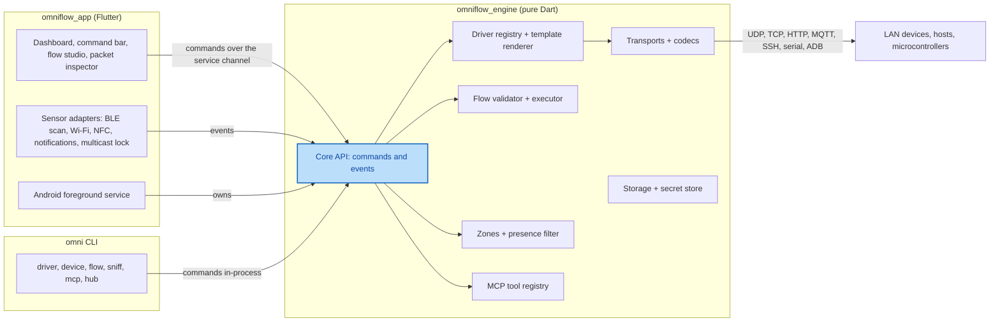

# OmniFlow Design

> Status: active. Design for M0-M6. This is the only design document. The original spec set was folded in here and is not kept.

## Purpose

OmniFlow is a local-first automation studio for Android phones. It controls LAN smart devices, desktop hosts and microcontrollers directly, without a vendor cloud, and wires them together with flows. It takes three ideas from existing tools: deep OS and hardware control, a card-based flow editor for quick mobile edits, and a node canvas with live packet inspection (Node-RED). An AI agent can drive all of it through MCP.

Consumer smart-home apps fall short for this in three ways. Commands go phone to vendor cloud and back to the LAN, which adds latency and stops working when the internet is down. They cannot reach outside their ecosystem: a shell command on a Mac, an ADB keycode to an Android TV, a JSON line from a Pico over USB. And their routines have no variables, payload extraction, filtered proximity or debounce and cooldown gates.

Nothing in OmniFlow is hardcoded to one household. Every device, protocol, trigger, condition and action comes from a declarative manifest or a registered node type.

## Requirements

1. A flow runs on the phone alone, with the screen off, and no laptop or server process is needed.
2. A new device type is supported by adding a JSON driver manifest, with no app release.
3. Local commands to LAN devices complete in tens of milliseconds and keep working with the internet down.
4. Presence at a desk or room is detected reliably enough that lights do not flicker on and off at the boundary.
5. Every action the UI can take is also available from a CLI and over MCP, through one core API.
6. An agent cannot run commands on a host, or register a driver that can, without the user approving it.
7. Secrets (Tuya local keys, SSH keys, ADB keys, LLM API keys) never appear in manifests, flows, logs or the packet inspector.
8. Background running stays within what Android allows for a long-lived service, and the battery cost is driven by what the enabled flows actually need.

## Architecture



The engine is a pure Dart package with no Flutter dependency. It owns every rule: manifests, rendering, transports, flow execution, variables, zones, storage and the MCP tools. Two hosts embed it:

- **The Android app.** The engine lives inside a foreground service, so flows keep running when the UI is closed. Android is the only app target.
- **The `omni` CLI** runs it on the Mac. It is the development and test harness for drivers and flows against real devices, and `omni hub` can keep it running headless on a Mac Mini. The phone never needs it.

Sensors that only exist as Flutter plugins (BLE scanning, NFC, Wi-Fi SSID and BSSID, notification access, the Android multicast lock) are implemented in the app behind engine interfaces (`EventSource`, `PlatformBridge`) and push events into the engine. The engine never imports a plugin, so it stays testable with `dart test` and runnable from the CLI.

### Core API as commands and events

The core API is a set of serializable commands (`device.invoke`, `flow.save`, `flow.dryRun`, `zone.list`, ...) that each return a serializable result, plus a stream of serializable events (`device.stateChanged`, `run.nodeCompleted`, `packet.captured`, ...). Every caller goes through it: the CLI calls it directly, the Android UI calls it over the service channel, and the MCP tools wrap it. Nothing calls engine internals around it.

This is what lets the Android UI and the engine live in separate isolates. The foreground service runs its own Dart isolate, so the UI cannot hold a reference to the engine object. It sends commands and subscribes to events instead.

### One owner for the database

On Android the service isolate is the only process that opens the SQLite database. The UI never opens it, and it reads everything through commands and events. Two isolates writing one SQLite file would need cross-isolate locking that drift does not provide across separate Flutter engines. On the Mac the CLI owns its own separate database, and `omni` refuses to open one that `omni hub` holds, using a lock file next to the database.

### Engine placement

- **[Approved] Pure Dart engine with a CLI and a Flutter shell.** The phone runs the engine itself, so no server is needed. The same package gives a CLI for testing against real devices and an optional headless hub at no extra cost. The layout matches `projects/resonance`.
- **[Rejected] Everything inside one Flutter app, with the DAG in a background isolate.** There is no headless runner and no CLI, and plugin calls from a background isolate depend on each plugin's support.

### Hub and edge mesh

- **[Approved] Phone-first standalone runtime, mesh sync deferred to M6.** The phone reaches LAN devices directly over Wi-Fi, and reaches the Mac over SSH.
- **[Rejected for now] A Mac Mini hub that every phone streams telemetry to**, with Tailscale or WebRTC when away from home. It makes a laptop process a requirement, which contradicts requirement 1. It can be added later without engine changes, because both ends run the same engine and speak the same command and event messages.

### Accounts and sync (deferred)

OmniFlow starts with no account. It runs on one Android phone, and the CLI's database on the Mac is separate and used for development. When sync is built, these choices hold:

- **Sign-in** with Google, OAuth for installed apps with PKCE and only the `drive.file` scope, so OmniFlow sees only the files it creates. This copies resonance's working Google sign-in.
- **Store** in the user's own Google Drive: each device appends to an encrypted change log of drivers, devices, zones, flows and globals. Encryption happens on the device (argon2id key from a passphrase, AES-GCM), as in resonance's backups, so Google cannot read it. Secrets sync inside the same encrypted log. There is no server.
- **Scope** is the same setup on every signed-in device. Each device controls devices directly when it is on the same Wi-Fi. Nothing is reachable from outside home.
- **Who runs a flow.** First wins over home Wi-Fi: the device whose trigger fires announces a claim on the LAN, signed with the sync key, and waits about 200 ms. The earliest claim runs the flow and the others stand down. A trigger only one device observes runs on that device. A device away from home skips flows whose actions only reach LAN devices. This adds one UDP listen port per device that accepts only signed claims, which goes through the builder-security skill before it is built.

### Reaching each kind of device from a phone

- LAN lights and plugs (WiZ, Tuya, Shelly, WLED): UDP or TCP over Wi-Fi, pure Dart.
- A Mac or Linux host: SSH (`dartssh2`). A desktop running `omni` uses local process execution for itself.
- Pico W: UDP NDJSON over Wi-Fi, or BLE. USB serial is used from a desktop, or from Android over OTG.
- Android TV: ADB over TCP 5555, plus Wake-on-LAN.

### Protocol coverage

| Ecosystem | Example devices | Mechanism | Milestone |
| --- | --- | --- | --- |
| Raw UDP JSON | Philips WiZ (38899), LIFX (56700), WLED, Govee LAN | UDP transport + manifest | M1 (WiZ), others by manifest |
| HTTP and REST | Shelly, Tasmota, ESPHome | HTTP transport + manifest | M1 |
| Tuya local | Tuya, SmartLife, Wipro, Halonix, Zebronics | TCP 6668 + Tuya codec, local key fetched once | M1 |
| SSH and local exec | Mac, Linux, Raspberry Pi | argv execution | M1 |
| USB serial and MQTT | Pico, Arduino, ESP32 | NDJSON over serial, UDP or MQTT | M1 |
| Wireless ADB | Android TV, Fire TV | TCP 5555 + RSA auth | M4 |
| BLE | Pico W beacon, BLE sensors, SwitchBot | BLE scan (presence), GATT later | M4 |
| Hue CLIP v2, LG webOS, Samsung Tizen, Home Assistant | | SSE and WebSocket JSON-RPC | M6 |
| Zigbee 3.0 | Aqara, IKEA, Sonoff Zigbee | USB coordinator + Zigbee2MQTT, reached over MQTT | M6 |
| Matter | Eve, Nanoleaf, Matter Wi-Fi plugs | python-matter-server sidecar over WebSocket | M6 |
| IR and 433 MHz RF | Plain TVs, split ACs, RF fans and blinds | Pico or Arduino with a 940 nm IR LED (NEC done) or a CC1101 module | IR M1, RF later |

## Repository layout

- `packages/omniflow_engine/` - `lib/src/` holds `api/`, `manifest/`, `template/`, `transports/`, `codecs/`, `devices/`, `dag/`, `nodes/`, `vars/`, `zones/`, `storage/`, `mcp/`, `platform/`, `cli/`. `bin/omni.dart` is the CLI. `test/` holds unit tests and `live`-tagged tests against real devices.
- `packages/omniflow_app/` - Flutter client: the service channel client, sensor adapters, the Android foreground service, UI.
- `drivers/` - built-in `*.omni_driver.json` manifests. `tool/embed_drivers.dart` generates a Dart file of string constants from them, so the manifests load the same way in the CLI, in tests and in an AOT-compiled app.
- `schemas/` - JSON Schemas for driver manifests and flow graphs, used by the validator, the CLI and the MCP tools.
- `firmware/` - Pico W MicroPython and the Arduino sketch.

## Driver manifests

A driver manifest describes one kind of device: how to find it, how to talk to it, and what it can do. A device is an instance of a driver with an address and its own settings.

### Schema v1

```json
{
  "schemaVersion": 1,
  "id": "philips_wiz_udp",
  "name": "Philips WiZ Light (local UDP)",
  "category": "lighting",
  "icon": "lightbulb",
  "transport": { "type": "udp", "port": 38899, "listenPort": 38900, "payload": "json" },
  "discovery": [
    {
      "method": "udp_broadcast",
      "port": 38899,
      "probe": { "method": "getSystemConfig", "params": {} },
      "matchJsonPath": "$.result.moduleName",
      "idJsonPath": "$.result.mac"
    }
  ],
  "settings": [],
  "statePush": { "jsonPath": "$.params" },
  "statePoll": { "intervalSeconds": 60, "command": { "method": "getPilot", "params": {} }, "jsonPath": "$.result" },
  "reliability": { "timeoutMs": 500, "retries": 2 },
  "capabilities": [
    {
      "id": "power",
      "type": "toggle",
      "label": "Power",
      "command": { "method": "setState", "params": { "state": "{{value}}" } },
      "stateJsonPath": "$.state"
    },
    {
      "id": "brightness",
      "type": "level",
      "label": "Brightness",
      "params": { "value": { "type": "number", "min": 10, "max": 100, "unit": "%" } },
      "command": { "method": "setPilot", "params": { "state": true, "dimming": "{{value}}" } },
      "stateJsonPath": "$.dimming"
    },
    {
      "id": "color_temp",
      "type": "color_temp",
      "label": "White temperature",
      "params": {
        "value": { "type": "number", "min": 2200, "max": 6500, "unit": "K" },
        "brightness": { "type": "number", "min": 10, "max": 100, "optional": true }
      },
      "command": { "method": "setPilot", "params": { "state": true, "temp": "{{value}}", "dimming": "{{brightness|state.dimming|100}}" } },
      "stateJsonPath": "$.temp"
    },
    {
      "id": "rgb",
      "type": "color_rgb",
      "label": "Colour",
      "params": { "brightness": { "type": "number", "min": 10, "max": 100, "optional": true } },
      "command": { "method": "setPilot", "params": { "state": true, "r": "{{r}}", "g": "{{g}}", "b": "{{b}}", "dimming": "{{brightness|state.dimming|100}}" } }
    }
  ]
}
```

- `schemaVersion` is required. The loader rejects a version it does not know, and each version bump ships a migration.
- The file suffix is `.omni_driver.json`.
- `transport.type` picks the transport. `transport.payload` is `json`, `text` or `hex` and decides how a rendered command becomes bytes.
- `discovery` is a list, so a driver can be found more than one way. Methods: `udp_broadcast`, `mdns` (service type), `ssdp`, `serial` (USB VID and PID), `ble` (advertised name, service UUID or manufacturer data). ARP scanning is a hub-mode method only, in M6.
- `settings` declares per-device fields the user fills in when adding a device, for example a Tuya `devId` and `localKey`. A field marked `"secret": true` is stored in the secret store and is never available to templates.
- `statePush` reads state from unsolicited packets (WiZ `syncPilot`). `statePoll` reads it on an interval, and also serves as the liveness check. `stateJsonPath` on a capability reads that capability's value out of the state object.
- `reliability` sets the reply timeout and the retry count for transports that expect a reply.
- A user manifest cannot reuse a built-in id. To change a built-in, the user copies it under a new id.

### Capability types

The type decides the UI control, the default `value` parameter and how an agent reasons about the capability.

- `toggle` - boolean `value`.
- `level` - number `value` within `min`..`max`.
- `color_temp` - number `value` in kelvin.
- `color_rgb` - `r`, `g`, `b` numbers 0..255.
- `dpad_remote` - `value` from up, down, left, right, ok, back, home.
- `text_command` - string `value`, for drivers that take free text (an IR code, a deep link).
- `exec` - runs a command on a host. Risk-gated, see Security.
- `sensor` - read-only stream, no command.
- `action` - a button with no value (Wake-on-LAN, run a Mac shortcut).

### Template rendering

Commands are structured JSON templates, not text templates. The renderer walks the template. A string that is exactly one placeholder (`"{{value}}"`) is replaced by the typed value, so `true` stays a boolean and `80` stays a number. A string with a placeholder inside other text gets string interpolation. This removes the escaping problem Mustache has with JSON, where `{{value}}` is HTML-escaped and would have to sit unquoted inside a JSON string.

- A placeholder is a dotted path with optional fallbacks: `{{brightness|state.dimming|100}}`. The first path that resolves wins, and a literal number, string or boolean can end the chain.
- A bare name reads the action's params. Every other source needs a prefix: `state.*` (current device state), `device.*` (non-secret device settings), `msg.*` (the triggering message), `$Name` (global variables) and `%name` (flow variables). The manifest validator rejects a bare name that is not a declared param, so a typo fails at load time instead of at the first command.
- Params are validated against the capability's `params` schema before rendering. A value out of range or of the wrong type fails the action without sending anything.
- For `text` and `hex` payloads the template is a string. For `exec` the template is an argv array (see Transports), and each element is rendered as text with no shell involved.

The original spec's flow passed `brightness: 80` to a template that read only `state.brightness`, so the 80 was dropped. Params now come first in the lookup.

### Device runtime

- **Per-device command queue.** Commands to one device run one at a time, in order. Tuya devices accept a single local TCP connection, and WiZ bulbs reply per request, so overlapping commands from two flows would collide.
- **Timeouts and retries** come from the manifest's `reliability` block. A command that exhausts its retries fails the action, which then leaves through its `error` port.
- **Address healing.** A device is identified by a stable id from discovery (MAC, Tuya `devId`, serial number), not by its IP. When a command times out, the engine re-runs that driver's discovery, matches the stable id, updates the address and retries once. DHCP lease changes stop breaking flows.
- **Liveness.** A device is online when it answered a command, a poll or pushed state within twice its poll interval.
- **Optimistic state.** After a successful command, the engine writes the commanded value into state, and the next push or poll corrects it if the device disagrees.

### Built-in drivers

- `philips_wiz_udp` - WiZ lights.
- `tuya_local` - Tuya, SmartLife, Wipro, Halonix plugs and bulbs (TCP 6668).
- `macos_host` - a Mac over SSH, or locally from `omni`. Capabilities and their argv:
  - volume: `osascript -e "set volume output volume {{value}}"`, with `value` validated as 0..100
  - display wake: `caffeinate -u -t 2`
  - display sleep: `pmset displaysleepnow`
  - run a Mac shortcut: `shortcuts run <name>`, with input passed on stdin
  - a gated `exec` for anything else
- `linux_host` - systemctl and shell over SSH.
- `windows_host` - PowerShell over SSH (OpenSSH server on Windows), after the macOS and Linux drivers.
- `omniflow_mcu_node` - Pico W or Arduino speaking the OmniFlow NDJSON protocol.
- `android_tv_adb` - keycodes, app launch, deep links, Wake-on-LAN.
- Later: Hue CLIP v2 (M6).

## Transports and wire protocols

All transports implement one interface: open, send, an incoming stream, close, and a packet tap. The tap feeds the packet inspector and the `omni sniff` command into a bounded ring buffer. Each transport owns its sockets for its whole life, so no call binds a throwaway socket.

### UDP and Wake-on-LAN

- One bound socket per transport, with broadcast enabled. Discovery probes go to the subnet-directed broadcast address (for example `192.168.1.255`), computed from the interface address and mask, with `255.255.255.255` as the fallback.
- Wake-on-LAN sends 6 bytes of `0xFF` followed by the target MAC repeated 16 times (102 bytes) to port 9 on the broadcast address.
- Android drops incoming broadcast and multicast packets unless the app holds a Wi-Fi multicast lock. The app's `PlatformBridge` acquires it only while discovery or WiZ push listening is active.

### Philips WiZ

- JSON-RPC over UDP 38899: `getPilot`, `setPilot`, `setState`, `getSystemConfig`.
- The bulb pushes `syncPilot` state changes to port 38900, but only to a client that has sent a `registration` request with its IP and MAC. A listener that has not registered receives nothing. The registration payload and how often it must be renewed are pinned against pywizlight in M1.
- WiZ has no authentication on the LAN. Anyone on the network can control the bulbs. OmniFlow does not change that.

### Tuya local protocol (TCP 6668)

Frame layout for v3.3, big-endian:

1. Prefix `0x000055AA` (4 bytes).
2. Sequence number (4 bytes).
3. Command (4 bytes): `0x07` control, `0x0A` status query, `0x09` heartbeat.
4. Length (4 bytes): everything after this field, including the CRC and the suffix.
5. Payload. For a control command, the 15-byte header `"3.3"` plus 12 zero bytes, followed by the AES-128-ECB (PKCS7) ciphertext of the JSON body, keyed by the device's 16-byte local key. The status query has no version header.
6. CRC-32 (IEEE) over everything from the prefix to the end of the payload (4 bytes).
7. Suffix `0x0000AA55` (4 bytes).

- Device responses add a 4-byte return code before the payload. The codec decodes responses (check the CRC, read the return code, decrypt) as well as encoding requests.
- v3.4 adds a session-key negotiation and replaces the CRC with an HMAC-SHA256. v3.5 changes the frame prefix and uses AES-GCM. Which version each of the user's devices speaks is read with a tinytuya scan before M1 decides whether v3.5 is in scope.
- A device accepts one local connection at a time. The transport keeps one persistent connection per device with a heartbeat, and the vendor app on the same LAN can take that slot.
- The local key comes from a one-time step through a Tuya IoT developer project linked to the Smart Life account the devices are paired with. After that, control is LAN-only.

### Host execution (local and SSH)

- Commands are argv arrays, run with `Process.run(argv[0], argv.sublist(1))`. There is no shell, so a parameter cannot inject a second command. Input to a command is passed on stdin as data.
- Over SSH, the argv is joined with POSIX single-quote escaping on each element, because the remote side always runs a shell.
- SSH pins the host key on first use, in the secret store, and refuses a changed key until the user accepts it. The username is a required device setting, with no default.
- The app generates its own SSH key pair per target host and shows the public key for the user to add to `~/.ssh/authorized_keys`. The setup guide suggests a `from="<LAN subnet>"` restriction on that key line.
- The original spec ran `/bin/zsh -c` with `runInShell: true` (two shells) and built `echo "$input" | shortcuts run` from user text. Both are replaced by the above.

### USB serial

- 115200 baud, 8N1, no flow control, newline-delimited JSON.
- The reader decodes with a streaming UTF-8 decoder and a line splitter with a maximum line length. Decoding each chunk separately corrupts characters split across reads.
- Desktop uses libserialport through FFI. Android OTG needs its own adapter behind the same interface, in the app.

### OmniFlow MCU protocol (NDJSON v1)

One JSON object per line over serial, or one per datagram over UDP. The Pico W listens on UDP port 38950 by default. The Wi-Fi credentials and the port come from a `config.json` on the board's flash.

Host to board:

- `{"cmd":"describe","id":1}` - the board answers with its identity and capabilities. The host sends it on connect, because a boot event sent before the host opened the port is lost.
- `{"cmd":"ir_send","protocol":"NEC","hex":"0x20DF10EF","id":2}`
- `{"cmd":"gpio_write","pin":16,"value":1,"id":3}` - only pins on the board's output allowlist.
- Board-specific commands are listed in its `describe` answer. The Arduino bridge has `relay_on` and `relay_off`.

Board to host:

- `{"node":"pico_desk_01","event":"describe","fw":"omniflow-pico/1","capabilities":["ble_beacon","nec_ir","button","adc_knob"],"pins":{"out":[16,17,18]}}`
- `{"node":"...","event":"ack","id":2,"cmd":"ir_send"}` and `{"node":"...","event":"error","id":3,"message":"pin not allowed"}`
- Unsolicited events: `button_press`, `knob_change` (Pico) or `analog_change` (Arduino), `boot`.

NEC codes are sent most-significant bit first, matching the 32-bit values that common IR libraries print when they capture a remote.

On the Pico W, GPIO 23, 24, 25 and 29 belong to the CYW43 wireless chip, and GPIO 25 is its SPI chip select. Writing GPIO 25, the original firmware's default pin, can break Wi-Fi and BLE. The allowlist excludes those pins, and the onboard LED is driven through `Pin("LED")`.

Firmware for NFC readers, rotary encoders and 433 MHz radios is not written yet. The spec described it, and it is added to the firmware only when built.

### Android Debug Bridge

- Android TVs and Fire TV take legacy ADB over TCP 5555 once network debugging is enabled: a CNXN, AUTH (RSA signature, then the public key on first pairing), OPEN and WRTE exchange. The TV shows a prompt to accept the key the first time. The RSA key lives in the secret store.
- Android 11 and later phones use Wireless Debugging with TLS pairing (`_adb-tls-pairing._tcp`). That path is out of scope until a phone target needs it.
- Shizuku or a local ADB loopback for system toggles on the phone itself comes after the TV path.
- **[Approved] Legacy 5555 in pure Dart, with the `adb` binary as a desktop fallback.** It works from the phone. The fallback unblocks desktop testing before the Dart client is complete.
- **[Rejected] Only shell out to `adb`.** Phones do not have it.

### MQTT and HTTP

MQTT (3.1.1 and 5) with topic wildcards and JSONPath extraction. HTTP covers REST and webhooks. Server-sent events (Hue CLIP v2) and WebSocket JSON-RPC (LG webOS, Samsung Tizen, Home Assistant) come in M6.

## Flows

A flow is a directed acyclic graph of typed nodes. The card editor and the canvas edit the same JSON.

### Schema v1

```json
{
  "schemaVersion": 1,
  "id": "flow_arrive_desk_evening",
  "name": "Evening desk arrival",
  "enabled": true,
  "mode": "single",
  "cooldownSeconds": 1800,
  "nodes": [
    { "id": "trig_desk", "type": "zone_change", "label": "Arrived at desk",
      "config": { "zoneId": "desk", "transition": "entered" },
      "position": { "x": 80, "y": 200 } },
    { "id": "cond_evening", "type": "all_of", "label": "Evening and home Wi-Fi",
      "config": { "rules": [
        { "type": "time_window", "start": "18:00", "end": "05:00" },
        { "type": "var_equals", "name": "$HomeWifiConnected", "value": true } ] },
      "position": { "x": 420, "y": 200 } },
    { "id": "act_lamp", "type": "device_capability", "label": "Desk lamp 80% at 3000K",
      "config": { "deviceId": "desk_lamp", "capabilityId": "color_temp", "params": { "value": 3000, "brightness": 80 } },
      "position": { "x": 780, "y": 110 } },
    { "id": "act_mac", "type": "device_capability", "label": "Wake the Mac display",
      "config": { "deviceId": "mac_mini", "capabilityId": "display_wake", "params": {} },
      "position": { "x": 780, "y": 300 } }
  ],
  "edges": [
    { "id": "e1", "from": { "node": "trig_desk", "port": "out" }, "to": { "node": "cond_evening", "port": "in" } },
    { "id": "e2", "from": { "node": "cond_evening", "port": "true" }, "to": { "node": "act_lamp", "port": "in" } },
    { "id": "e3", "from": { "node": "cond_evening", "port": "true" }, "to": { "node": "act_mac", "port": "in" } }
  ]
}
```

A node's category and ports come from its registered type, not from the JSON. Device and zone ids such as `desk_lamp` and `desk` are the user's own. Built-in example flows ship as templates that ask the user to pick devices.

Changes from the original sample: the trigger references a zone instead of a beacon MAC (iOS and macOS do not expose BLE MAC addresses), the Mac action calls a declared capability instead of a raw shell string, `$HomeWifiConnected` has a producer (the built-in Wi-Fi binding), and the flow declares a run mode.

### Validation

A flow is saved and run only if it passes all of these. The CLI, the UI and the MCP tools call the same validator and get back the same list of errors.

1. Node ids and edge ids are unique.
2. Every edge references an existing node and a port that node's type declares.
3. The graph is acyclic (Kahn's algorithm).
4. Trigger nodes have no incoming edges, and every non-trigger node is reachable from a trigger.
5. Each node's config passes its type's config schema, and every referenced device, capability and zone exists.

### Node types

Each node type registers its category, ports, config schema and evaluator. New types are added to the registry, never special-cased in the executor.

- **Triggers:** schedule (cron, time of day, sunrise and sunset with offset), zone change, Wi-Fi network change, NFC tag, UDP packet match, serial line match, MCU event, MQTT topic, webhook (desktop only), notification posted with regex filters on title and body (Android), app foreground (Android), charging, screen lock and unlock, clipboard changed (desktop), global hotkey (desktop), boot, manual run.
- **Conditions** (ports `true` and `false`): all_of, any_of, xor, not, time_window, var_equals, var_compare, device_state.
- **Gates:** cooldown (no pass within N seconds of the last pass), debounce (pass only after the input has been quiet for N ms), hold (pass only if a condition has held for N ms).
- **Transformers:** JSONPath extract, regex extract, range map (`minIn..maxIn -> minOut..maxOut`), math expression.
- **Flow control:** delay, wait_for_event with timeout (ports `event` and `timeout`), repeat (runs its `body` port up to `maxIterations` times, then continues on `done`).
- **Actions** (ports `out` and `error`): device_capability, exec (gated), HTTP request, MQTT publish, set_variable, run_flow, notify (rich notification with action buttons), speak (text to speech).

The original spec called the engine Turing-complete and listed a Loop node, which contradicts acyclic graphs. Repeat keeps the graph acyclic and bounds every loop.

### Execution

1. A trigger fires with a message (`msg`) holding its payload, source and time. The executor starts a run, subject to the flow's mode.
2. The message travels along edges. A condition sends it out of `true` or `false`. A transformer passes on a changed copy. An action sends its result out of `out`, or its error out of `error`.
3. When one port feeds several edges, the branches run concurrently, as `act_lamp` and `act_mac` do in the example.
4. The flow-level cooldown arms when a run reaches its first action, not when a trigger fires. Otherwise a trigger at 17:00 that fails the evening condition would block the real arrival at 18:01. It arms even if that action fails.
5. Each run records a trace (per node: input, output, port taken, duration, error) to the execution log. The log is a ring buffer with a fixed row cap.
6. A dry run feeds a simulated event through the same executor, with actions stubbed and an injectable clock. The UI's test button and the MCP `simulate_flow_dry_run` tool both use it.
7. A run waiting on `wait_for_event` or `delay` lives in memory. A restart drops it, and the log records that.

### Run modes

A trigger can fire while an earlier run of the same flow is still waiting on a delay. The flow's `mode` decides what happens:

- `single` (default) - the new trigger is dropped and logged.
- `restart` - the running run is cancelled and a new one starts.
- `queued` - the new run starts when the current one finishes, with a queue cap.
- `parallel` - runs overlap, with a cap on concurrent runs.

### Variables

- `$Name` - global, persisted, with a type (string, number, boolean, json). Set by `set_variable` actions or by built-in bindings.
- `%name` - scoped to one run.
- `msg.*` - the message flowing through the current run.
- Built-in bindings keep a few globals current from sensors: `$WifiSsid`, `$HomeWifiConnected` (true while the SSID is in the user's home list), `$Charging`, `$BatteryPercent`, and `$Zone.<id>` (true while inside that zone).
- `time_window` handles windows that cross midnight: 18:00 to 05:00 matches 23:00 and 02:00. Times are local time in the phone's time zone, and a DST change does not skip or repeat a schedule trigger.
- Sunrise and sunset need a latitude and longitude, set once in settings, so no location permission is needed for them.

## Zones and presence

A zone is a first-class entity, not part of a flow: a named place (desk, bedroom, home) with the signals that define it. Several flows can react to the same zone, and they all see one state. Each zone has a BLE input (a beacon matcher), an optional Wi-Fi input (BSSIDs or SSIDs) and an optional geofence.

Raw BLE RSSI swings by around 12 dBm from reflections and the body blocking the signal, so a raw threshold makes lights flicker. Each beacon goes through a filter and then a hysteresis gate.

1. **Kalman filter.** `P' = P + Q * dt`, `K = P' / (P' + R)`, `x = x + K (z - x)`, `P = (1 - K) P'`, with `Q = 0.065` per second, `R = 3.5`, and `dt` the seconds since the last update. Scaling Q by elapsed time keeps the filter's behaviour the same whatever rate the phone delivers scan results at. The spec added Q per sample, which makes the filter slower on a phone that reports often and faster on one that reports rarely.
2. **Silence tick.** Once a second, a beacon heard from in the last `silenceMs` (default 5000) is left alone. Otherwise the tracker feeds it an absent reading of -100 dBm. Without this, a beacon that goes out of range stops producing samples, the filter never updates, and the exit transition never fires. The original tracker had this defect.
3. **Hysteresis and dwell.** Enter when the estimate stays at or above -62 dBm for 2 s. Exit when it stays at or below -74 dBm for 8 s. The gap between the thresholds stops the state toggling at the boundary. All four values are per-zone settings, tuned from a recorded RSSI trace of the user's own desk.

Beacons are matched by advertised name, service UUID or manufacturer data, never by MAC.

Combining inputs: a zone is entered when its BLE input says entered, or, when the zone has no BLE input, when its Wi-Fi input matches. A Wi-Fi or geofence input set as `required` must also hold. This rule covers desk-level zones (BLE) and home-level zones (Wi-Fi) without a weighting model. A weighted vote was in the spec and is dropped until a real case needs it.

### Sensors on demand

A sensor runs only while an enabled flow or zone needs it. BLE scanning runs only while a zone with a BLE input is referenced by an enabled flow, and only while the zone's `required` inputs hold (desk presence scans only on home Wi-Fi). NFC listens only when a flow has an NFC trigger. This is the main battery control, on top of the scan mode each sensor uses.

## Storage and secrets

SQLite through drift. Tables:

- `driver_manifests` - id, name, category, transport type, manifest JSON, built-in flag, updated at.
- `devices` - id, name, room, driver id, stable id, address, settings JSON (non-secret), current state JSON, online flag, last seen.
- `zones` - id, name, inputs JSON, current state.
- `flows` - id, name, enabled, mode, cooldown, flow JSON, last run at, approval state.
- `global_variables` - name, type, value JSON, updated at.
- `execution_log` - run id, flow id, trigger summary, started at, duration, outcome, trace JSON. A ring buffer with a fixed row cap.

The database carries a schema version with a migration for each bump, from the first release on.

- **[Approved] drift.** Its watch queries back the event stream for device state and runs directly. That is the reason for diverging from resonance's raw sqlite3.
- **[Rejected] raw sqlite3 with hand-written repositories**, as in resonance. It would need a separate change-notification layer.

Secrets sit behind a `SecretStore` interface. The app uses the OS keychain or keystore (`flutter_secure_storage`). For the CLI on macOS the store lives in the login keychain, reached through the `security` command. On Linux it is an encrypted file whose passphrase comes from an environment variable. Manifests and flows hold only a reference to a secret.

## MCP and the AI architect

One tool registry inside the engine serves two surfaces:

- `omni mcp` runs an MCP server over stdio, so Claude Code or Claude Desktop starts it as a subprocess. It opens no network listener. It drives the CLI's engine and database on the Mac, not the phone's, until accounts and sync exist.
- The in-app architect (the command bar) calls the same tools in-process from an LLM tool-use loop. The provider and model are chosen at M5. The API key lives in the secret store. The architect is the only part of OmniFlow that needs the internet, and every flow it produces runs locally afterwards.

Tools:

- `discover_devices_and_capabilities` - devices, their drivers and current state, optionally filtered by room.
- `sniff_live_packets` - a bounded capture from the packet tap, with secrets redacted.
- `register_custom_driver_manifest` - validates against the manifest schema and stores it.
- `deploy_automation_flow_dag` - runs the full flow validator and stores the flow.
- `simulate_flow_dry_run` - dry run with a simulated event, returning the trace.
- `generate_mcu_firmware` - fills a Pico or Arduino template from a capability list and pins, checked against the pin allowlist. Flashing stays a manual step from a desktop (`mpremote` or the Arduino tools).

Device state is also exposed as MCP resources that a client can subscribe to.

A tool returns validation failures as an MCP error result with the full error list, so the agent can correct and retry. The original spec threw an exception and checked only that a flow had at least one node.

## Security

- **Risk levels.** A capability of type `exec`, any manifest using the host-execution transport, and any flow containing an `exec` action are high risk. When one of those arrives from MCP, the AI architect or an import, it is stored disabled until the user approves it in the app, which shows exactly what would run. Built-in drivers are trusted.
- **No listeners by default.** The phone opens no server socket. `omni mcp` uses stdio. A network MCP endpoint, or the sync claim port when sync is built, binds narrowly and accepts only authenticated messages. Before building one, follow the builder-security skill.
- **Typed params.** Every value is validated against the capability's param schema before rendering, and host commands run as argv without a shell.
- **Secrets** stay in the secret store. The packet inspector and logs redact secret settings, and SSH host keys are pinned.
- **Imports** are validated like MCP input, and high-risk content in them waits for approval.

## UI

Dark-first, in the style of Linear, Raycast and Teenage Engineering. Category colours: trigger `#FF9F1C`, condition `#7B2CBF`, transformer `#3A86FF`, flow control `#FF006E`, action `#00F5D4`. Surfaces: background `#0D0F12`, bars `#14171C`, cards `#1A1E24`.

- **Dashboard.** A bento grid of room cards, generated from capability types: toggles, dimmer sliders, colour pickers, a TV d-pad, sensor sparklines, and pills for running a flow by hand.
- **Command bar.** Pulled down from the top of the screen. Device commands (`> Desk lamp 50%`), running a flow, and prompts to the AI architect, in one input.
- **Flow editor, card view.** WHEN, IF and THEN blocks for quick edits on a phone. The card view is a projection of the graph: triggers form the WHEN block, each condition opens a nested IF with its true and false branches, and actions are THEN steps. A graph where a non-trigger node has more than one incoming edge cannot be shown as a tree, so the card view shows it read-only with a link to the canvas. Edits write back to the same flow JSON.
- **Flow editor, canvas view.** vyuh_node_flow with custom node widgets, typed ports, snap-to-grid, a minimap, and animated edges that light up as a run passes through them, driven by the run event stream.
- **Packet inspector.** Tabs for UDP, serial, MQTT, BLE RSSI (a live chart per beacon, used to tune zones) and ADB, with a button that turns a captured packet into a trigger node.
- **Approvals.** A list of high-risk manifests and flows waiting for the user, each showing exactly what would run.

## Platform support

- **Android.** Full standalone runtime.
  - The foreground service declares the `connectedDevice` type, plus `location` when Wi-Fi BSSID or geofence inputs are in use. Not `dataSync`: apps targeting Android 15 get 6 hours of `dataSync` foreground service per 24 hours.
  - A `location` service needs a while-in-use permission, so it cannot be created from the background. After a reboot, the service starts with `connectedDevice` only (allowed from `BOOT_COMPLETED`), and adds `location` the next time the user opens the app, unless background location has been granted.
  - Permissions: `BLUETOOTH_SCAN` without the `neverForLocation` flag (that flag filters some BLE beacons out of scan results), `ACCESS_FINE_LOCATION` (BLE beacons and Wi-Fi BSSID), notification-listener access for notification triggers, `POST_NOTIFICATIONS` for the service notification, and a prompt to exempt the app from battery optimisation.
  - A multicast lock while discovery or WiZ push listening runs.
- **Other platforms.** Not app targets. The Mac runs the `omni` CLI for development, and is also a device the phone controls over SSH. Because the engine is pure Dart, an iOS or desktop app can be added later without moving logic. iOS would be limited to foreground-only flows, because it does not allow continuous background BLE scanning or Wi-Fi monitoring.

## Dependencies

Toolchain: Flutter 3.47.9 (stable), Dart 3.13.7, installed as the Homebrew `flutter` cask. The repo is a Dart pub workspace (root `pubspec.yaml`) with one lock file covering both packages.

The spec's version pins, checked against pub.dev on 2026-11-06. Each dependency is added at the latest version in the milestone that first uses it, and its API is read from the package source before code is written against it.

| Package | Spec pin | Latest | Consequence |
| --- | --- | --- | --- |
| sqlite3 / sqlite3_flutter_libs | 3.8 / 0.5 | 3.9.0 / 0.6.0+eol | sqlite3_flutter_libs is end-of-life. sqlite3 3.x bundles the native library itself, so the app drops flutter_libs |
| drift / drift_flutter | 2.35 / 0.2 | 2.35.3 / 0.3.1 | drift_flutter minor bump |
| vyuh_node_flow | 0.20 | 0.32.0 | Twelve minor releases on a 0.x API. The spec's editor code is not trusted, and the M3 canvas is written against 0.32 |
| mcp_dart | 2.1 | 2.4.3 | Same major. Tool registration is checked against 2.4 at M5 |
| universal_ble | 2.3 | 3.2.0 | Major bump |
| dartssh2 | 2.9 | 4.1.0 | Major bump. Host-key callback and exec API are checked at M1 |
| pointycastle | 3.9 | 4.0.0 | Major bump |
| flutter_riverpod / riverpod_annotation | 3.4 / 3.0 | 3.5.0 / 4.0.8 | Annotation package is a major ahead |
| freezed | 2.5 | 4.0.3 | Not used. Models are hand-written records and classes |
| nfc_manager | 3.5 | 4.3.0 | Major bump |
| bonsoir | 5.1 | 7.1.6 | Major bump |
| network_info_plus | 6.1 | 8.2.2 | Major bump |
| flutter_libserialport / libserialport | 0.4 / - | 0.6.0 / 0.3.0+1 | The engine uses libserialport (pure FFI). The app uses flutter_libserialport, which bundles the library |
| mqtt_client, flutter_secure_storage, flutter_background_service, cryptography | 10.5, 11.2, 5.1, 2.7 | 10.14.0, 11.2.0, 5.1.0, 2.9.0 | Same major |
| pigeon, rive | 22.6, 0.13 | 29.1.0, 0.14.11 | pigeon major bump. rive is not needed until UI polish |

Engine: drift and sqlite3, dartssh2, mqtt_client, libserialport, pointycastle (AES, RSA), crypto, multicast_dns, json_path, args, mcp_dart.

App: flutter_riverpod, flutter_secure_storage, vyuh_node_flow, universal_ble, nfc_manager, network_info_plus, flutter_background_service, bonsoir, pigeon, lucide_icons_flutter.

## Open items

- Accounts and sync: deferred, with the choices recorded above.
- LLM provider and model for the in-app architect (M5).
- Tuya protocol version of each of the user's devices, and whether v3.5 is needed in M1.
- WiZ registration payload and renewal interval, pinned against pywizlight (M1).
- The vyuh_node_flow 0.32 and mcp_dart 2.4 APIs (M3, M5).
- Licences, if OmniFlow is ever distributed: libserialport is LGPL-3.0, and each dependency's licence needs checking before a release.
