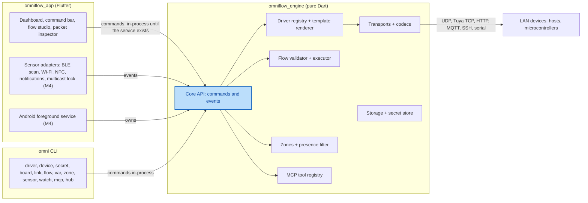

# OmniFlow Design

> Status: active. Design for M0-M6. This is the only design document. The original spec set was folded in here and is not kept.

## Purpose

OmniFlow is a local-first automation studio for Android phones. It controls LAN smart devices, desktop hosts and microcontrollers directly, without a vendor cloud, and wires them together with flows. It takes three ideas from existing tools: deep OS and hardware control, a card-based flow editor for quick mobile edits, and a node canvas with live packet inspection (Node-RED). An AI agent can drive all of it through MCP.

Consumer smart-home apps fall short for this in three ways. Commands go phone to vendor cloud and back to the LAN, which adds latency and stops working when the internet is down. They cannot reach outside their ecosystem: a shell command on a Mac, an ADB keycode to an Android TV, a JSON line from a Pico over USB. And their routines have no variables, payload extraction, filtered proximity or debounce and cooldown gates.

Nothing in OmniFlow is hardcoded to one household. Every device, protocol, trigger, condition and action comes from a declarative manifest or a registered node type.

## Requirements

1. A flow runs on the phone alone, with the screen off, and no laptop or server process is needed.
2. A new device type is supported by adding a JSON driver manifest, with no app release.
3. Local commands to LAN devices complete in tens of milliseconds and keep working with the internet down.
4. Presence at a desk or room is detected reliably enough that lights do not flicker on and off at the boundary.
5. Every action the UI can take is also available from the CLI, through one core API. MCP exposes a reviewed subset of it, without the commands that add or remove devices, store secrets, enable or run flows, or approve them.
6. An agent cannot run commands on a host, or register a driver that can, without the user approving it.
7. Secrets (Tuya local keys, SSH keys, ADB keys, LLM API keys) never appear in manifests, flows, logs or the packet inspector.
8. Background running stays within what Android allows for a long-lived service, and the battery cost is driven by what the enabled flows actually need.

## Architecture



The engine is a pure Dart package with no Flutter dependency. It owns every rule: manifests, rendering, transports, flow execution, variables, zones, storage and the MCP tools. Two hosts embed it:

- **The Android app.** Today the app opens the engine in its own process (`InProcessEngineClient`) and starts the hub (`hub.start`) at launch, so flows run while the app is open. In M4 the engine moves into a foreground service, so flows keep running when the UI is closed. Android is the only app target.
- **The `omni` CLI** runs it on the Mac. It is the development and test harness for drivers and flows against real devices, and `omni hub` can keep it running headless on a Mac Mini. The phone never needs it.

Sensors that only exist as Flutter plugins (BLE scanning, NFC, Wi-Fi SSID and BSSID, notification access, the Android multicast lock) are planned for M4. They go in the app behind engine interfaces (`EventSource`, `PlatformBridge`, neither built yet) and push events into the engine. Until then the CLI feeds those inputs by hand (`omni sensor ble|wifi`). The engine never imports a plugin, so it stays testable with `dart test` and runnable from the CLI.

### Core API as commands and events

The core API is a set of serializable commands (`device.invoke`, `flow.save`, `flow.dryRun`, `zone.list`, ...) that each return a serializable result, plus a stream of serializable events (`device.stateChanged`, `run.nodeCompleted`, `packet.captured`, ...). Every caller goes through it: the CLI calls it directly, the Android UI calls it through `EngineClient` (in-process today), and the MCP tools wrap it. Nothing calls engine internals around it.

Lifecycle commands: `hub.start` (optional `wizPort` and `helloPort`) starts the WiZ push listener, the board hello listener, device polls, MQTT watches, flow timers and the zone tick, and is safe to call twice. A port already in use returns `unavailable` and rolls the hub back. `hub.stop` stops all of it and frees the ports. A device added while the hub runs is polled and watched at once, and a removed one stops. `engine.status` reports whether the hub runs, the loaded flows and `loadIssues`: every stored manifest, zone or flow that failed to load, as `{kind, id, error}`. A bad stored item no longer stops the engine opening. It is skipped, reported there and in `flow.list` and `driver.list`, and emitted once as `engine.loadIssue`.

This is what lets the Android UI and the engine live in separate isolates once the foreground service exists (M4). The service runs its own Dart isolate, so the UI cannot hold a reference to the engine object. It sends commands and subscribes to events instead.

### One owner for the database

On Android the service isolate is the only process that opens the SQLite database. The UI never opens it, and it reads everything through commands and events. Two isolates writing one SQLite file would need cross-isolate locking that drift does not provide across separate Flutter engines. On the Mac the CLI owns its own separate database, guarded by an exclusive lock file next to it. Every `omni` command takes that lock for as long as it runs, `omni hub` and `omni mcp` included, so while the hub runs no other `omni` command can open the database: the MCP architect and CLI edits wait until the hub stops. A held lock exits with code 75. Planned: `omni` commands as clients of a running hub over a local socket, so the hub keeps the only engine and the database.

### Engine placement

- **[Approved] Pure Dart engine with a CLI and a Flutter shell.** The phone runs the engine itself, so no server is needed. The same package gives a CLI for testing against real devices and an optional headless hub at no extra cost. The layout matches `projects/resonance`.
- **[Rejected] Everything inside one Flutter app, with the DAG in a background isolate.** There is no headless runner and no CLI, and plugin calls from a background isolate depend on each plugin's support.

### Hub and edge mesh

- **[Approved] Phone-first standalone runtime, mesh sync deferred to M6.** The phone reaches LAN devices directly over Wi-Fi, and reaches the Mac over SSH.
- **[Rejected for now] A Mac Mini hub that every phone streams telemetry to**, with Tailscale or WebRTC when away from home. It makes a laptop process a requirement, which contradicts requirement 1. It can be added later without engine changes, because both ends run the same engine and speak the same command and event messages.

### Accounts and sync (deferred)

OmniFlow starts with no account. It runs on one Android phone, and the CLI's database on the Mac is separate and used for development. When sync is built, these choices hold:

- **Sign-in** with Google, OAuth for installed apps with PKCE and only the `drive.file` scope, so OmniFlow sees only the files it creates. This copies resonance's working Google sign-in.
- **Store** in the user's own Google Drive: each device appends to an encrypted change log of drivers, devices, zones, flows and globals. Encryption happens on the device (argon2id key from a passphrase, AES-GCM), as in resonance's backups, so Google cannot read it. Secrets sync inside the same encrypted log. There is no server.
- **Scope** is the same setup on every signed-in device. Each device controls devices directly when it is on the same Wi-Fi. Nothing is reachable from outside home.
- **Who runs a flow.** First wins over home Wi-Fi: the device whose trigger fires announces a claim on the LAN, signed with the sync key, and waits about 200 ms. The earliest claim runs the flow and the others stand down. A trigger only one device observes runs on that device. A device away from home skips flows whose actions only reach LAN devices. This adds one UDP listen port per device that accepts only signed claims, which goes through the builder-security skill before it is built.

### Reaching each kind of device from a phone

- LAN lights and plugs (WiZ, Tuya, Shelly, WLED): UDP or TCP over Wi-Fi, pure Dart.
- A Mac or Linux host: SSH (`dartssh2`). A desktop running `omni` uses local process execution for itself.
- OmniFlow boards (ESP32, ESP8266, Pico W): UDP NDJSON over Wi-Fi. USB serial from a desktop, which is also the only link to an Uno. Android over OTG is planned.
- Android TV: ADB over TCP 5555, plus Wake-on-LAN (M4).

### Protocol coverage

| Ecosystem | Example devices | Mechanism | Milestone |
| --- | --- | --- | --- |
| Raw UDP JSON | Philips WiZ (38899), LIFX (56700), WLED, Govee LAN | UDP transport + manifest | M1 (WiZ), others by manifest |
| HTTP and REST | Shelly, Tasmota, ESPHome | HTTP transport + manifest | M1 |
| Tuya local | Tuya, SmartLife, Wipro, Halonix, Zebronics | TCP 6668 + Tuya codec, local key fetched once | M1 |
| SSH and local exec | Mac, Linux, Raspberry Pi | argv execution | M1 |
| OmniFlow boards | Uno, ESP8266, Pico W, ESP32 | Protocol v2 NDJSON over USB serial or Wi-Fi UDP | M7 |
| MQTT | Tasmota, ESPHome, Home Assistant style topics | MQTT 3.1.1 transport + manifest | M7 |
| Wireless ADB | Android TV, Fire TV | TCP 5555 + RSA auth | M4 |
| BLE | Pico W beacon, BLE sensors, SwitchBot | BLE scan (presence), GATT later | M4 |
| Hue CLIP v2, LG webOS, Samsung Tizen, Home Assistant | | SSE and WebSocket JSON-RPC | M6 |
| Zigbee 3.0 | Aqara, IKEA, Sonoff Zigbee | USB coordinator + Zigbee2MQTT, reached over MQTT | M7 (`zigbee2mqtt_device`) |
| Matter | Eve, Nanoleaf, Matter Wi-Fi plugs | python-matter-server sidecar over WebSocket | M6 |
| IR and 433 MHz RF | Plain TVs, split ACs, RF fans and blinds | Pico or Arduino with a 940 nm IR LED (NEC done) or a CC1101 module | IR M1, RF later |

## Repository layout

- `packages/omniflow_engine/` - `lib/src/` holds `api/`, `cli/`, `codecs/`, `dag/` (flow model, node types, validator, executor, links, cards), `devices/`, `manifest/`, `mcp/`, `storage/`, `template/`, `transports/` and `zones/`. `bin/omni.dart` is the CLI. `test/` holds unit tests and `live`-tagged tests against real devices.
- `packages/omniflow_app/` - Flutter client: `api/` (the `EngineClient` interface, `InProcessEngineClient` and the secure-storage `SecretStore`), `state/` (Riverpod providers over the event stream), `ui/`, and `startup.dart`. The service-channel client, the sensor adapters and the foreground service are planned for M4.
- `drivers/` - built-in `*.omni_driver.json` manifests. `tool/embed_drivers.dart` generates a Dart file of string constants from them, so the manifests load the same way in the CLI, in tests and in an AOT-compiled app.
- `firmware/omniflow_node/` - the one board firmware and its native virtual board.
- Planned: `schemas/`, JSON Schemas for driver manifests and flow graphs for MCP clients and editors. The validators are Dart code today.

## Driver manifests

A driver manifest describes one kind of device: how to find it, how to talk to it, and what it can do. A device is an instance of a driver with an address and its own settings.

### Schema v1

```json
{
  "schemaVersion": 1,
  "id": "philips_wiz_udp",
  "name": "Philips WiZ Light (local UDP)",
  "category": "lighting",
  "icon": "lightbulb",
  "transport": { "type": "udp", "port": 38899, "listenPort": 38900, "payload": "json", "matchMethod": true },
  "discovery": [
    {
      "method": "udp_broadcast",
      "port": 38899,
      "probe": { "method": "registration", "params": { "phoneMac": "AAAAAAAAAAAA", "register": false, "phoneIp": "1.2.3.4", "id": "1" } },
      "matchJsonPath": "$.result.mac",
      "idJsonPath": "$.result.mac"
    }
  ],
  "statePush": { "method": "syncPilot", "jsonPath": "$.params" },
  "statePoll": { "intervalSeconds": 60, "command": { "method": "getPilot", "params": {} }, "jsonPath": "$.result" },
  "reliability": { "timeoutMs": 500, "retries": 2 },
  "capabilities": [
    {
      "id": "power",
      "type": "toggle",
      "label": "Power",
      "command": { "id": 1, "method": "setState", "params": { "state": "{{value}}" } },
      "stateJsonPath": "$.state"
    },
    {
      "id": "brightness",
      "type": "level",
      "label": "Brightness",
      "params": { "value": { "type": "number", "integer": true, "min": 10, "max": 100, "unit": "%" } },
      "command": { "id": 1, "method": "setPilot", "params": { "state": true, "dimming": "{{value}}" } },
      "stateJsonPath": "$.dimming"
    },
    {
      "id": "color_temp",
      "type": "color_temp",
      "label": "White temperature",
      "params": {
        "value": { "type": "number", "integer": true, "min": 2200, "max": 6500, "unit": "K" },
        "brightness": { "type": "number", "integer": true, "min": 10, "max": 100, "optional": true }
      },
      "command": {
        "id": 1,
        "method": "setPilot",
        "params": { "state": true, "temp": "{{value}}", "dimming": "{{brightness|state.dimming|100}}" }
      },
      "stateJsonPath": "$.temp"
    },
    {
      "id": "rgb",
      "type": "color_rgb",
      "label": "Colour",
      "params": { "brightness": { "type": "number", "integer": true, "min": 10, "max": 100, "optional": true } },
      "command": {
        "id": 1,
        "method": "setPilot",
        "params": { "state": true, "r": "{{r}}", "g": "{{g}}", "b": "{{b}}", "dimming": "{{brightness|state.dimming|100}}" }
      }
    }
  ]
}
```

- `schemaVersion` is required. The loader rejects a version it does not know, and each version bump ships a migration.
- The file suffix is `.omni_driver.json`.
- `transport.type` picks the transport: `udp`, `tuya`, `http`, `mqtt`, `exec`, `serial` or `omniflow`. `tcp` and `adb` are refused until a channel exists for them (`adb` comes with M4). `transport.payload` is `json`, `text` or `hex` and decides how a rendered command becomes bytes.
- A UDP transport with `"matchMethod": true` accepts only a reply whose `method` equals the sent command's. Every WiZ command carries `"id": 1`, so the id cannot tell replies apart, and without this a late `setPilot` ack can be taken as the answer to a `getPilot` poll.
- `discovery` is a list, so a driver can be found more than one way. Built: `udp_broadcast` (a probe broadcast, matched by JSONPath) and `serial` (each USB serial port is sent `describe`). Accepted by the parser but not implemented yet: `mdns` (service type), `ssdp` and `ble` (advertised name, service UUID or manufacturer data). ARP scanning is a hub-mode method only, in M6.
- `settings` declares per-device fields the user fills in when adding a device, for example a Tuya `devId` and `localKey`. A field marked `"secret": true` is stored in the secret store and is never available to templates.
- `statePush` reads state from unsolicited packets (WiZ `syncPilot`). `statePoll` reads it on an interval, and also serves as the liveness check. A poll reply that carries none of the manifest's top-level state keys leaves the stored state alone. `stateJsonPath` on a capability reads that capability's value out of the state object.
- `reliability` sets the reply timeout and the retry count for transports that expect a reply.
- A user manifest cannot reuse a built-in id. To change a built-in, the user copies it under a new id.

### Capability types

The type decides the UI control, the default `value` parameter and how an agent reasons about the capability.

- `toggle` - boolean `value`.
- `level` - number `value` within `min`..`max`.
- `color_temp` - number `value` in kelvin.
- `color_rgb` - `r`, `g`, `b` numbers 0..255.
- `dpad_remote` - `value` from up, down, left, right, ok, back, home.
- `text_command` - string `value`, for drivers that take free text (an IR code, a deep link).
- `exec` - runs a command on a host. Risk-gated, see Security.
- `sensor` - read-only stream, no command.
- `action` - a button with no value (Wake-on-LAN, run a Mac shortcut).

### Template rendering

Commands are structured JSON templates, not text templates. The renderer walks the template. A string that is exactly one placeholder (`"{{value}}"`) is replaced by the typed value, so `true` stays a boolean and `80` stays a number. A string with a placeholder inside other text gets string interpolation. This removes the escaping problem Mustache has with JSON, where `{{value}}` is HTML-escaped and would have to sit unquoted inside a JSON string.

- A placeholder is a dotted path with optional fallbacks: `{{brightness|state.dimming|100}}`. The first path that resolves wins, and a literal number, string or boolean can end the chain.
- A bare name reads the action's params. Every other source needs a prefix: `state.*` (current device state), `device.*` (non-secret device settings), `msg.*` (the triggering message), `$Name` (global variables) and `%name` (flow variables). The manifest validator rejects a bare name that is not a declared param, so a typo fails at load time instead of at the first command.
- Params are validated against the capability's `params` schema before rendering. A value out of range or of the wrong type fails the action without sending anything. A number param marked `"integer": true` also refuses a fraction (`must be a whole number`), and a whole double such as `80.0` is sent as `80`. The WiZ, Tasmota dimmer and Zigbee2MQTT brightness params carry it.
- For `text` and `hex` payloads the template is a string. For `exec` the template is an argv array (see Transports), and each element is rendered as text with no shell involved.

The original spec's flow passed `brightness: 80` to a template that read only `state.brightness`, so the 80 was dropped. Params now come first in the lookup.

### Device runtime

- **Per-device command queue.** Commands to one device run one at a time, in order. Tuya devices accept a single local TCP connection, and WiZ bulbs reply per request, so overlapping commands from two flows would collide. A toggle (`device_toggle`, links) reads the current state and sends the opposite inside one queued task, so two quick toggles flip twice.
- **Adding and removing.** `device.add` refuses an id that exists unless `replace: true`. `device.remove` deletes the device at once and fails anything still queued for it, stops its polls and watches, deletes its secrets, and disables every enabled flow that names it, returning those flow ids.
- **Timeouts and retries** come from the manifest's `reliability` block. A command that exhausts its retries fails the action, which then leaves through its `error` port.
- **Address healing.** A device is identified by a stable id from discovery (MAC, Tuya `devId`, serial number), not by its IP. When a command times out, the engine re-runs that driver's discovery, matches the stable id, updates the address and retries once. DHCP lease changes stop breaking flows. Healing needs a `udp_broadcast` discovery, so it covers WiZ bulbs and boards on Wi-Fi. `tuya_plug` and `shelly_plus_switch` declare no discovery, so they are not healed yet. Exec devices are never looked up.
- **Liveness.** Device JSON carries `online`: true when the device answered a command, a poll or pushed state within three poll intervals, or 90 seconds for a board. Devices with neither a poll nor a board hello leave the field out. The engine also emits `device.offline`, `device.pollFailed` and `board.offline`.
- **Optimistic state.** After a successful command, the engine writes the commanded value into state, and the next push or poll corrects it if the device disagrees.

### Built-in drivers

The files in `drivers/`:

- `philips_wiz_udp` - WiZ lights: `power`, `brightness`, `color_temp`, `rgb`. Discovered by broadcast, polled every 60 s, pushed through `syncPilot`.
- `tuya_plug` - a Tuya, SmartLife or Wipro plug with its switch on DP 1 (TCP 6668, v3.3): `power`, polled. Needs the `devId` setting and the `localKey` secret. Tuya bulbs wait for the protocol scan.
- `shelly_plus_switch` - a Shelly Plus or Pro switch over Gen2 local RPC, switch 0: `power`, polled.
- `macos_host` - a Mac over SSH, or locally from `omni`. Capabilities and their argv:
  - `volume`: `osascript -e "set volume output volume {{value}}"`, with `value` validated as 0..100
  - `display_wake`: `caffeinate -u -t 2`
  - `display_sleep`: `pmset displaysleepnow`
  - `run_shortcut`: `shortcuts run {{value}}`, with the name refused when it starts with `-` or holds a quote or backslash, and optional input passed on stdin
- `linux_host` - a Linux host over SSH: `service_restart` (`sudo -n systemctl restart <unit>`), `user_service_restart` (`systemctl --user restart -- <unit>`) and `suspend`. Unit names must match `[A-Za-z0-9@_][A-Za-z0-9@._-]*`, so no option can be passed in. The sudo argv keeps no `--` so that a sudoers rule for `systemctl restart <unit>` still matches.
- `omniflow_board` - any board running the OmniFlow firmware (ESP32, ESP8266, Pico W, Uno), over USB serial or Wi-Fi: `ir_nec` and `ir_code`, plus one capability per pin the user names.
- `tasmota_mqtt` (`power`, `dimmer`), `zigbee2mqtt_device` (`power`, `brightness` and the `temperature`, `humidity`, `occupancy`, `contact`, `battery` sensors), `mqtt_switch` (`power`) and `mqtt_sensor` (`value`) - devices behind an MQTT broker.

Both host drivers use the `exec` transport, so they are high risk. Neither has a free-form `exec` capability.

Planned: `windows_host` (PowerShell over SSH, with the OpenSSH server on Windows), `android_tv_adb` (keycodes, app launch, deep links, Wake-on-LAN, M4), Tuya bulbs, and Hue CLIP v2 (M6).

## Transports and wire protocols

All transports implement one interface: open, send, an incoming stream, close, and a packet tap. The tap feeds the packet inspector and `omni watch --packets` through a bounded ring buffer. Each transport owns its sockets for its whole life, so no call binds a throwaway socket.

### UDP and Wake-on-LAN

- One bound socket per transport, with broadcast enabled. Discovery probes go to `255.255.255.255` and to a /24 directed broadcast for each interface (for example `192.168.1.255`). Dart does not expose interface netmasks, and home networks are almost always /24.
- Wake-on-LAN sends 6 bytes of `0xFF` followed by the target MAC repeated 16 times (102 bytes) to port 9 on the broadcast address.
- Android's Wi-Fi stack filters out multicast packets unless the app holds a `WifiManager.MulticastLock`, and holding one costs battery. Android's documentation covers multicast only, so whether broadcast replies also need the lock is checked on the phone. The app's `PlatformBridge` holds the lock only while discovery or mDNS is running.

### Philips WiZ

- JSON-RPC over UDP 38899: `getPilot`, `setPilot`, `setState`, `getSystemConfig`.
- Discovery broadcasts `{"method":"registration","params":{"phoneMac":"AAAAAAAAAAAA","register":false,"phoneIp":"1.2.3.4","id":"1"}}` to port 38899. Each bulb answers with `result.mac`, and its IP is the reply's source address. This is the message pywizlight uses, and `register: false` tells the bulb not to push to that sender.
- Pushes: a client sends `{"method":"registration","params":{"phoneIp":<own IP>,"register":true,"phoneMac":<a MAC it made up>}}` to each bulb's port 38899 and listens on UDP 38900. The bulb then sends `syncPilot` (state in `params`, the bulb's MAC in `params.mac`) and `firstBeat` (a bulb coming online) to 38900. The registration is renewed every 20 seconds, as pywizlight does, and `syncPilot` gets no reply. Each renewal and each push looks up the bulb's current address, so a moved bulb is registered where it is now. A datagram from a non-local address is dropped, a `syncPilot` counts only when it comes from the address of the bulb its MAC names, and a push for a removed bulb is dropped. A failure there is reported as `wiz.error` and never stops the listener.
- Bulbs accept a dimming of 10 to 100 and report their own white range. pywizlight clamps colour temperature to 1000 to 10000 K. The built-in manifest uses 2200 to 6500 K, the common tunable-white range, and narrowing it per bulb from `getModelConfig` is an open item.
- WiZ has no authentication on the LAN. Anyone on the network can control the bulbs. OmniFlow does not change that.

### Tuya local protocol (TCP 6668)

Frame layout for v3.3, big-endian:

1. Prefix `0x000055AA` (4 bytes).
2. Sequence number (4 bytes).
3. Command (4 bytes): `0x07` control, `0x0A` status query, `0x09` heartbeat.
4. Length (4 bytes): everything after this field, including the CRC and the suffix.
5. Payload. For a control command, the 15-byte header `"3.3"` plus 12 zero bytes, followed by the AES-128-ECB (PKCS7) ciphertext of the JSON body, keyed by the device's 16-byte local key. The status query has no version header.
6. CRC-32 (IEEE) over everything from the prefix to the end of the payload (4 bytes).
7. Suffix `0x0000AA55` (4 bytes).

- Device responses add a 4-byte return code before the payload. The codec decodes responses (check the CRC, read the return code, decrypt) as well as encoding requests. A reply whose plaintext is not JSON is a refusal: the waiting command fails with `<id> refused the command: <text>`, and a frame that cannot be decoded is skipped so the next one is still read. A declared length over 64 KiB is treated as garbage and the splitter resyncs on the next prefix.
- The channel sends a heartbeat (`0x09` with `gwId` and `devId`) every 10 seconds when no command went out, and closes the connection after two heartbeats get no frame back. The next command reconnects. Unsolicited status frames (`0x08`) become device state.
- v3.4 adds a session-key negotiation and replaces the CRC with an HMAC-SHA256. v3.5 changes the frame prefix and uses AES-GCM. Which version each of the user's devices speaks is read with a tinytuya scan before M1 decides whether v3.5 is in scope.
- A device accepts one local TCP connection at a time. The transport keeps one persistent connection per device, and the Smart Life or vendor app holds that slot while it is open, so it must be closed during use.
- The local key comes from a one-time step: pair the device in Smart Life, link that account to a Tuya IoT developer project, then run `python -m tinytuya wizard`. After that, control is LAN-only. The key changes every time the device is removed and re-paired in the app, so a re-paired device needs its key fetched and stored again (`omni secret set`).

### Host execution (local and SSH)

- Commands are argv arrays, started as a process with no shell, so a parameter cannot inject a second command. Input to a command is passed on stdin as data. Output is collected as it streams, and a background child that keeps the pipes open after the command exits cannot stall it past its timeout.
- Over SSH, the argv is joined with POSIX single-quote escaping on each element, because the remote side always runs a shell. An argv element with a backslash is refused before connecting (`invalid`), which keeps the quoting literal under sh, bash, zsh and fish.
- SSH pins the host key on first use, in the secret store. A changed key fails every connection until the pin is cleared. No command clears it yet. On the Mac the pin is the keychain item `ssh/hostkey/<host>:<port>` under the `omniflow` service. The username is a required device setting, with no default, and the private key is the `sshPrivateKey` secret.
- Planned for the app: it generates its own SSH key pair per target host and shows the public key for the user to add to `~/.ssh/authorized_keys`, and the setup guide suggests a `from="<LAN subnet>"` restriction on that key line.
- The original spec ran `/bin/zsh -c` with `runInShell: true` (two shells) and built `echo "$input" | shortcuts run` from user text. Both are replaced by the above.

### USB serial

- 115200 baud, 8N1, no flow control, newline-delimited JSON.
- The reader decodes with a streaming UTF-8 decoder and a line splitter with a maximum line length. Decoding each chunk separately corrupts characters split across reads.
- On macOS and Linux the port is set to raw mode with `stty` and read through a `cat` subprocess, so it needs no native library and closing a port never hangs on a blocked read. A port that is already open, for example by a board device, is shared rather than opened twice, so discovery asks that board through the open port and leaves it open. Android OTG needs its own adapter behind the same interface, in the app (planned, likely `flutter_libserialport`).
- Opening the port resets an Uno and most ESP32 boards, so the first command after opening is retried while the board boots.

### Universal board runtime (protocol v2)

A board runs one OmniFlow firmware for its whole life. The engine tells it at runtime what each pin is for, so wiring a relay, a button, a servo or a sensor to a board needs no new firmware: the user names the pin once and it appears as a switch, slider or sensor on the dashboard and in flows.

- **[Approved] A JSON pin runtime over newline-delimited JSON.** Readable in the packet inspector, the same over USB serial and Wi-Fi UDP, and validated against a board profile on both ends.
- **[Rejected] Firmata.** A binary protocol designed for serial only, with no discovery, no request ids and no readable traffic.
- **[Rejected] A firmware per project, generated from flows.** Every change means reflashing, which is exactly the friction this tool removes.
- **[Approved] One firmware, in Arduino C++.** `firmware/omniflow_node/` builds for ESP32, ESP8266, Raspberry Pi Pico W (arduino-pico core) and Arduino Uno. Its protocol core (`omni_core.cpp`) uses no Arduino headers, no heap and no STL, so it fits the Uno's 2 KB of RAM and also compiles natively into the virtual board the engine tests talk to. The ESP32 profile is for the classic ESP32 only, and the AVR build is for the Uno and Nano (ATmega328P) only: any other ESP32 variant or AVR board stops the compile with an `#error` rather than run with the wrong pin map.
- **[Rejected] A MicroPython variant for the Pico W.** The Arduino sketch runs on the Pico W too, and a second implementation of the protocol would have to be kept in step and tested twice. The earlier MicroPython firmware (protocol v1) was retired.

One JSON object per line over serial at 115200 baud, or one per datagram over UDP port 38950. The board ignores datagrams from outside its own subnet, and sends each UDP line whole in one datagram of up to 3 KB (a full `describe` on an ESP32 or Pico W is over 2 KB, past the 1460 bytes the ESP32 core's `NetworkUDP` would keep). Every command may carry an `id`, and the reply echoes it, so a late reply is never taken for the wrong command. A reply is an `ack` or an `error` with a message the user can read. A line that does not parse still gets an `error` carrying the `id` scanned from the raw line. A key or value too long for the board's buffer is refused with `value too long`, never truncated, and a serial line that does not fit the 200-byte line buffer gets `line too long`. String escapes `\n \t \r \b \f \/ \" \\` are decoded, and `\u` is refused. A `pin` must be a JSON number in the board's pin range.

Commands, host to board:

- `describe` - `{"event":"describe","proto":2,"fw":...,"board":"esp32","ir":true,"watches":12,"pins":[{"pin":4,"caps":["in","pullup","out","pwm","servo"]},{"pin":34,"caps":["in","adc"]}],"set":[{"pin":4,"mode":"out"}]}`. `watches` is how many pins the board can watch at once (12, or 6 on the Uno), and `set` lists the pins that have a mode now. Over UDP the reply goes to the sender, and the sender becomes one of up to three event receivers, kept for 90 seconds (three hello periods) after its last `describe`. A hub sends `describe` on every hello, so it stays a receiver. Each event goes to every live receiver as its own datagram. Over serial every event goes to the port.
- `pin.mode` `{"pin":4,"mode":"out"}` - modes `in`, `in_pullup`, `out`, `pwm`, `servo`, `adc`, `none`. Refused when the board profile does not give that pin that capability: `in_pullup` needs `pullup`. `none` releases the pin back to a plain input, frees its PWM or servo channel and stops its watch. Moving a pin to a mode that is not an input also stops its watch. Setting the mode a pin already has changes nothing, so the host can resend its whole setup at any time without switching an output off. A servo starts at 90 degrees. When the board has no free PWM or servo channel the reply is `no free PWM or servo channel`, and the pin keeps its old mode and level.
- `pin.write` `{"pin":4,"value":1}`, `pwm.write` `{"pin":5,"value":0..100}` (percent), `servo.write` `{"pin":13,"value":0..180}` (degrees). Each needs the matching mode first.
- `pin.read` `{"pin":34}` - the reply carries `value` (0 or 1, or 0..100 percent for `adc`).
- `pin.watch` `{"pin":0,"ms":50,"delta":0}` - the board then sends `{"event":"pin.changed","pin":0,"value":...}` whenever the value moves by more than `delta`, checking every `ms` (10 to 60000). `{"pin":0,"off":true}` stops it, on any pin. Only `in`, `in_pullup` and `adc` pins can be watched.
- `ir.send` `{"address":4,"command":8}` or `{"hex":"0x20DF10EF"}` - NEC only, on the pin set with `ir.pin`.
- Setup, kept in the board's flash and taken only over USB serial:
  - `wifi.set` `{"ssid":...,"password":...}`. The password is empty for an open network, 8 to 63 characters, or exactly 64 hex digits. The board acks before it starts joining.
  - `wifi.clear` forgets the network, disconnects, and drops the event receivers.
  - `node.set` `{"name":...}`. A name is `^[a-z][a-z0-9_-]{0,22}$`. A board with no valid stored name makes one up (`omni_<board>_<last three MAC bytes>`, or `omni_uno`) and saves it, so it keeps the same name across boots.
  - `ir.pin` `{"pin":4}` (or -1 for none). The pin must offer `out` and have no mode (`that pin has a mode, set pin.mode none first`). From then on it is reserved: every pin command refuses it and `describe` leaves it out.
- `wifi.status` reports the connection and IP, over serial or Wi-Fi.
- `gpio_write` from protocol v1 still works and sets the pin to output on first use.

NEC sends each byte least significant bit first, in the order address, inverted address, command, inverted command, with a 9 ms burst, a 4.5 ms space, 562 us bursts and a 38 kHz carrier. The `address` and `command` form builds exactly that. Many published code lists (old Arduino-IRremote, LIRC) use a 32-bit value written most significant bit first, such as LG's `0x20DF10EF`. The `hex` form sends that value as written, the same as IRremote's `sendNECMSB()`, so those lists work unchanged. The 38 kHz carrier is bit-banged with busy-wait timing. Whether real receivers accept it is unproven until a receiver test on each board passes.

Board profiles, the pins a user may configure:

- `esp32`: GPIO 0, 2, 4, 5 and 12 to 33, except 20, 24 and 28 to 31 (not bonded out), for digital with pull-up, PWM and servo. 1 and 3 are the USB serial port and 6 to 11 the SPI flash, so they are never offered. 34 to 39 are input only, with no pull-up. Analog input is offered on 32 to 39 only, because the ADC2 pins cannot be read while Wi-Fi is on, and this firmware always runs Wi-Fi.
- `esp8266`: GPIO 0, 2, 4, 5, 12 to 15 for any digital mode with pull-up, PWM and servo. 16 is `in` and `out` only, because it has a pull-down rather than a pull-up. A0 (17) is `adc` only. 6 to 11 are flash, 1 and 3 serial.
- `pico_w`: GPIO 0 to 22 for any mode, 26 to 28 also `adc`; 23, 24, 25 and 29 belong to the CYW43 radio and are never offered. GPIO 25 is the radio's SPI chip select, and writing it breaks Wi-Fi.
- `uno`: 2 to 13 (`pwm` on 3, 5, 6, 9, 10, 11), A0 to A5 as 14 to 19 with `adc`; 0 and 1 are the USB serial port. The Uno has no Wi-Fi and stays on USB. Servos come from a pool of 12 and take Timer1, which is the PWM on 9 and 10, so 9 and 10 offer no servo, and `pwm` on 9 or 10 is refused while any servo is attached (and a servo is refused while 9 or 10 is in `pwm`). When the last servo detaches, Timer1 is put back so PWM on 9 and 10 works again.

Strapping pins decide how a board boots, so a button or a load that pulls one the wrong way at power-on stops the board starting. They are still offered, so use them last: ESP8266 0, 2 and 15, and ESP32 0, 2, 5, 12 and 15. A button on GPIO 0 of either board holds it in the bootloader when pressed at reset.

Announcing: a board on Wi-Fi broadcasts `{"event":"hello","node":...,"board":...,"proto":2,"port":38950,"up":<seconds>,"set":<pins with a mode>}` to UDP 38951 when it joins and every 30 seconds, and registers `_omniflow._udp` over mDNS. `omni device discover --driver omniflow_board` broadcasts a `describe` and also asks every USB serial port, so a new board shows up without typing its address.

Setting a board up needs no file and no credentials in source: `omni board setup <port> --ssid <network> --name <name>` sends `wifi.set`, `node.set` and `ir.pin` over USB and waits until the board reports its IP. The password is read from stdin, hidden on a terminal, never taken from the command line, and the packet inspector shows it as `***`.

On the engine side, `omniflow_board` uses the `omniflow` transport, which picks USB serial when the device host is a port path and Wi-Fi UDP otherwise. A device's `pins` setting names its pins:

    {"relay": {"pin": 4, "mode": "out"},
     "fan":   {"pin": 18, "mode": "pwm"},
     "door":  {"pin": 19, "mode": "in_pullup"},
     "light": {"pin": 34, "mode": "adc", "watch": {"ms": 1000, "delta": 3}}}

Each pin becomes one capability after the driver's own: `out` a toggle, `pwm` a 0 to 100 level, `servo` a 0 to 180 level, `in`, `in_pullup` and `adc` a sensor. Inputs are watched by default, every 50 ms for digital and every second with a delta of 2 for `adc`, and `"watch": false` turns that off. A digital input reads true when the pin is high, except `in_pullup`, which is active low, so a button wired to ground reads true while pressed (`"invert": false` turns that off). `omni board pin <device> <name> <pin> <mode>` names one pin at a time.

The engine sets a board up when it is added, when its pins change, at hub start, and whenever a hello shows the board has lost its setup (`"set":0`), rebooted (`up` went down) or this engine has not set it up yet. Setting up checks every pin against the board's `describe` and names each one the board cannot do: an `in_pullup` pin needs the `pullup` cap (`has no internal pull-up: add an external resistor and use mode in`), while firmware that lists no `pullup` at all is checked against `in`,, and more watched pins than `watches` is refused. It then sends every mode and output write first and every watch after them, writes back the output values the device state remembers so a relay comes back on after a power cut, and seeds input state from the watch replies. A configured input whose watch is off gets `pin.watch` `off`. `board.pins` sends `describe` first and refuses unsupported pins before anything is saved, and a pin change during a setup that is already running gets one fresh setup after it.

Releasing pins the user removed is not wired yet. `pinSetupCommands` can emit `pin.mode` `none` for them, but the engine does not pass it the board's current pins, and `pinsSetOnBoard` reads a `mode` on each `pins` entry while the firmware reports them in `set`. Until both are fixed a removed pin keeps its mode until the board reboots.

A hello is unauthenticated, so it moves a board only when the board no longer answers `describe` at its stored address and does answer, as the same node, at the new one (`board.moved`). When the stored address still answers as that node, a hello from another host is ignored and reported as `board.conflict`. A hello from an unknown board is reported as a `board.found` event, whose `add` field holds ready `device.add` arguments. Renaming a board over USB updates the stable id of its devices. Every `pin.changed` becomes device state under the pin's name, which drives the dashboard, links and the `device_state` trigger. An `out` pin's state is a boolean, like any toggle.

### Android Debug Bridge

- Android TVs and Fire TV take legacy ADB over TCP 5555 once network debugging is enabled: a CNXN, AUTH (RSA signature, then the public key on first pairing), OPEN and WRTE exchange. The TV shows a prompt to accept the key the first time. The RSA key lives in the secret store.
- Android 11 and later phones use Wireless Debugging with TLS pairing (`_adb-tls-pairing._tcp`). That path is out of scope until a phone target needs it.
- Shizuku or a local ADB loopback for system toggles on the phone itself comes after the TV path.
- **[Approved] Legacy 5555 in pure Dart, with the `adb` binary as a desktop fallback.** It works from the phone. The fallback unblocks desktop testing before the Dart client is complete.
- **[Rejected] Only shell out to `adb`.** Phones do not have it.

### MQTT and HTTP

MQTT 3.1.1 through one connection per broker and user. A command renders to a topic and a payload (an object goes as JSON) and is published at QoS 1. MQTT has no replies, so state comes from the topics in the driver's `statePush.topics`, watched by the hub: a topic with a `key` stores its payload under that key, one without carries a JSON object. `statePush.refresh` is published after subscribing to ask the device for its state. The broker user is the device's `username` setting and the password its `password` secret. One connection serves every device on that broker and user, so the password is one per broker and user, shared by its devices, and the driver labels say so. `secret.set` for an MQTT device drops that broker's cached connection and reconnects with the new password. A watch is stored before the first connection, so a broker that is down at hub start still delivers state once it comes up, and every reconnect subscribes the watches again. A message is delivered only to watches on the broker it came from, and a broker that cannot be reached fails the command as a timeout. A toggle can name its device's words for on and off (`"onOff": ["ON", "OFF"]`): the command sends them and state reads them back as `true` and `false`. Built-in MQTT drivers: `tasmota_mqtt`, `zigbee2mqtt_device`, `mqtt_switch` (ESPHome and Home Assistant style command and state topics) and `mqtt_sensor`. MQTT 5 is not needed by any of them. HTTP covers outgoing REST calls. Incoming webhooks need a listener and are not built. Server-sent events (Hue CLIP v2) and WebSocket JSON-RPC (LG webOS, Samsung Tizen, Home Assistant) come in M6.

## Flows

A flow is a directed acyclic graph of typed nodes. The card editor and the canvas edit the same JSON.

### Schema v1

```json
{
  "schemaVersion": 1,
  "id": "flow_arrive_desk_evening",
  "name": "Evening desk arrival",
  "enabled": true,
  "mode": "single",
  "cooldownSeconds": 1800,
  "nodes": [
    { "id": "trig_desk", "type": "zone_change", "label": "Arrived at desk",
      "config": { "zoneId": "desk", "transition": "entered" },
      "position": { "x": 80, "y": 200 } },
    { "id": "cond_evening", "type": "all_of", "label": "Evening and home Wi-Fi",
      "config": { "rules": [
        { "type": "time_window", "start": "18:00", "end": "05:00" },
        { "type": "var_equals", "name": "$HomeWifiConnected", "value": true } ] },
      "position": { "x": 420, "y": 200 } },
    { "id": "act_lamp", "type": "device_capability", "label": "Desk lamp 80% at 3000K",
      "config": { "deviceId": "desk_lamp", "capabilityId": "color_temp", "params": { "value": 3000, "brightness": 80 } },
      "position": { "x": 780, "y": 110 } },
    { "id": "act_mac", "type": "device_capability", "label": "Wake the Mac display",
      "config": { "deviceId": "mac_mini", "capabilityId": "display_wake", "params": {} },
      "position": { "x": 780, "y": 300 } }
  ],
  "edges": [
    { "id": "e1", "from": { "node": "trig_desk", "port": "out" }, "to": { "node": "cond_evening", "port": "in" } },
    { "id": "e2", "from": { "node": "cond_evening", "port": "true" }, "to": { "node": "act_lamp", "port": "in" } },
    { "id": "e3", "from": { "node": "cond_evening", "port": "true" }, "to": { "node": "act_mac", "port": "in" } }
  ]
}
```

A node's category and ports come from its registered type, not from the JSON. Device and zone ids such as `desk_lamp` and `desk` are the user's own. Built-in example flows ship as templates that ask the user to pick devices.

Changes from the original sample: the trigger references a zone instead of a beacon MAC (iOS and macOS do not expose BLE MAC addresses), the Mac action calls a declared capability instead of a raw shell string, `$HomeWifiConnected` has a producer (the built-in Wi-Fi binding), and the flow declares a run mode.

### Validation

A flow is saved and run only if it passes all of these. The CLI, the UI and the MCP tools call the same validator and get back the same list of errors.

1. Node ids and edge ids are unique.
2. Every edge references an existing node and a port that node's type declares.
3. The graph is acyclic (Kahn's algorithm).
4. Trigger nodes have no incoming edges, and every non-trigger node is reachable from a trigger.
5. Each node's config passes its type's config schema, and every referenced device, capability and zone exists. A `device_toggle` target must have a top-level state key.
6. A `run_flow` node does not call its own flow, or any flow whose `run_flow` chain leads back to it. At run time the executor also carries the call chain in the message and fails the node with `run_flow cycle: a -> b -> a` instead of waiting forever.
7. A `debounce` gate is only allowed in a `restart` or `parallel` flow. In a `single` or `queued` flow a later trigger is dropped or waits behind the run, so it never reaches the waiting gate to restart its quiet period.

### Node types

Each node type registers its category, ports, config schema and evaluator. New types are added to the registry, never special-cased in the executor. Built types, by registry id:

- **Triggers:** `manual`, `time_of_day` (with optional days), `interval`, `zone_change`, `device_state` (optional `key`), `board_event`, `wifi_change`. A `device_state` trigger puts the new value in `msg.value` and the one before it in `msg.previous`. With no `key`, it fires only when the state really changed.
- **Conditions** (ports `true` and `false`): `all_of`, `any_of`, `xor`, `not`, `time_window`, `var_equals`, `var_compare`, `device_state_is`. `var_equals` and `var_compare` read a global (`$Name`), a run variable (`%name`) or a field of the message that reached them (`msg.value`).
- **Gates:** `cooldown` (no pass within N seconds of the last pass), `debounce` (pass only after the input has been quiet for N ms).
- **Transformers:** `jsonpath`, `regex`, `range_map` (`minIn..maxIn -> minOut..maxOut`), `math`.
- **Flow control:** `delay`, `wait_for_event` with timeout (ports `event` and `timeout`), `repeat` (runs its `body` port up to `maxIterations` times, then continues on `done`).
- **Actions** (ports `out` and `error`): `device_capability`, `device_toggle` (sets an on/off capability to the opposite of the device's state), `set_variable`, `run_flow`, `notify` and `speak`. `notify` and `speak` emit a `flow.announce` event today. The Android notification and text to speech come with the app's platform bridge in M4.

Planned: triggers for sunrise and sunset, cron schedules, NFC tags, UDP packet and serial line matches, MQTT topics, webhooks (desktop only), notifications posted with regex filters (Android), app foreground (Android), charging, screen lock and unlock, clipboard changes and global hotkeys (desktop), and boot. A `hold` gate (pass only if a condition has held for N ms). `exec` (gated), HTTP request and MQTT publish actions. Host commands today run through declared `exec`-transport capabilities in `device_capability`.

The original spec called the engine Turing-complete and listed a Loop node, which contradicts acyclic graphs. Repeat keeps the graph acyclic and bounds every loop.

### Execution

1. A trigger fires with a message (`msg`) holding its payload, source and time. The executor starts a run, subject to the flow's mode.
2. The message travels along edges. A condition sends it out of `true` or `false`. A transformer passes on a changed copy. An action sends its result out of `out`, or its error out of `error`.
3. When one port feeds several edges, the branches run concurrently, as `act_lamp` and `act_mac` do in the example.
4. The flow-level cooldown arms when a run reaches its first action, not when a trigger fires. Otherwise a trigger at 17:00 that fails the evening condition would block the real arrival at 18:01. It arms even if that action fails.
5. Each run records a trace (per node: input, output, port taken, duration, error) to the execution log. The log is a ring buffer of the newest 1000 rows. Run ids are `<flow>-<microseconds>-<counter>`, so two runs in the same microsecond stay distinct.
6. A dry run feeds a simulated event through the same executor, with actions stubbed and an injectable clock. The UI's test button and the MCP `simulate_flow_dry_run` tool both use it. A flow with no trigger cannot be dry run.
7. A run waiting on `wait_for_event` or `delay` lives in memory. A restart drops it, and the log records that. A cancelled `delay` or `wait_for_event` releases its timer and its event subscription.
8. Saving or reloading flows keeps the runner, timers and in-flight runs of every flow whose spec did not change. Only changed, disabled or removed flows are cancelled, and a run queued before a cancel is dropped instead of acting.

### Run modes

A trigger can fire while an earlier run of the same flow is still waiting on a delay. The flow's `mode` decides what happens:

- `single` (default) - the new trigger is dropped.
- `restart` - the running run is cancelled and a new one starts.
- `queued` - the new run starts when the current one finishes, with a queue cap. It checks the cooldown again when it starts, and is dropped if the cooldown has armed since it queued.
- `parallel` - runs overlap, with a cap on concurrent runs.

The queue holds 10 runs and `parallel` allows 10 at once. A dropped run still emits `run.finished` with its reason (`running`, `cooldown`, `queue_full`, `too_many_runs`, `cancelled`), but is not written to the execution log, so a busy trigger cannot flush the real traces out of it. `flow.list` reports the count per flow as `dropped`.

### Variables

- `$Name` - global, persisted, with a type (string, number, boolean, json). Set by `set_variable` actions or by built-in bindings.
- `%name` - scoped to one run.
- `msg.*` - the message flowing through the current run.
- Built-in bindings keep a few globals current from sensors: `$WifiSsid`, `$HomeWifiConnected` (true while the SSID is in the user's home list, `$HomeSsids`) and `$Zone_<id>` (true while inside that zone). `$Charging` and `$BatteryPercent` are planned with the platform bridge in M4.
- `time_window` handles windows that cross midnight: 18:00 to 05:00 matches 23:00 and 02:00. Times are local time in the phone's time zone, and a DST change does not skip or repeat a schedule trigger.
- Sunrise and sunset triggers (planned) will take a latitude and longitude, set once in settings, so no location permission is needed for them.

## Links

A link is the shortest way to connect two things. It is a flow the engine writes from one line, validated and stored like any other, so it shows in the flow list, the card view and the run log. The source is a device state key and the target a capability: `device.key`.

- `toggle` - each time the source turns on, flip the target: `omni link add desk_board.button lamp.power --toggle`. The flow checks `msg.value` is true and runs a `device_toggle` node, which reads the target's current state and writes the opposite. Runs are queued, so two quick presses toggle twice.
- `follow` - the target copies the source, scaled from the source's range (0 to 100 for an analog pin, or the source capability's own range) into the target's: `omni link add desk_board.knob desk_board.arm --follow` puts a servo at 90 degrees for a knob at 50%. Runs restart, so the last value always wins.
- `threshold` - when the source crosses a number, set the target to a value: `omni link add desk_board.light hall_plug.power --below 30 --set true`. It fires on the crossing only, by comparing `msg.value` with `msg.previous`, so a light level hovering below 30 does not resend the command.

A link's id is `link_` plus the first 12 hex digits of a SHA-256 over the canonical JSON of its from, to, mode, above, below and set. Different links between the same two ends therefore get different ids (a hysteresis pair of `--below 30` and `--above 40` included), and ids that only differ in where an underscore falls cannot collide. Creating a link whose id exists is refused with `exists` unless `replace: true` (`--replace`).

A `toggle` is refused for a target that is not an on/off toggle, and from a numeric source unless `onValue` says which value counts as on. A `threshold` from an on/off source is refused in favour of a toggle or follow. A `follow` between an on/off end and a numeric end is refused in favour of a threshold. A source key the device does not have is refused with the keys it does have. `link.options {from}` returns the modes a source allows and, for each target, the modes it accepts, which is what the app's link sheet is built from. `omni link list` and `omni link remove` manage links, and agents use the `link_devices` tool. A follow into an integer param (WiZ brightness, the Tasmota dimmer) can produce a fraction from the range map, and the param check then fails that action with `must be a whole number`. Rounding for integer targets is an open item.

## Zones and presence

A zone is a first-class entity, not part of a flow: a named place (desk, bedroom, home) with the signals that define it. Several flows can react to the same zone, and they all see one state. Each zone has a BLE input (a beacon matcher), an optional Wi-Fi input (BSSIDs or SSIDs) and an optional geofence.

Raw BLE RSSI swings by around 12 dBm from reflections and the body blocking the signal, so a raw threshold makes lights flicker. Each beacon goes through a filter and then a hysteresis gate.

1. **Kalman filter.** `P' = P + Q * dt`, `K = P' / (P' + R)`, `x = x + K (z - x)`, `P = (1 - K) P'`, with `Q = 0.65` per second, `R = 3.5`, and `dt` the seconds since the last update. Scaling Q by elapsed time keeps the filter's behaviour the same whatever rate the phone delivers scan results at. The spec added `Q = 0.065` per sample, which makes the filter slower on a phone that reports often and faster on one that reports rarely. Its beacon advertises every 100 ms, so 0.065 per sample is 0.65 per second. On a synthetic walk with readings 3 to 4 times a second and +-12 dBm noise, the zone is entered 2 to 6 seconds after reaching the desk, and exits after leaving, with no flicker in between.
2. **Silence tick.** Once a second, a beacon heard from in the last `silenceMs` (default 5000) is left alone. Otherwise the tracker feeds it an absent reading of -100 dBm. Without this, a beacon that goes out of range stops producing samples, the filter never updates, and the exit transition never fires. The original tracker had this defect.
3. **Hysteresis and dwell.** Enter when the estimate stays at or above -62 dBm for 2 s. Exit when it stays at or below -74 dBm for 8 s. The gap between the thresholds stops the state toggling at the boundary. All four values are per-zone settings, tuned from a recorded RSSI trace of the user's own desk.

Beacons are matched by advertised name, service UUID or manufacturer data, never by MAC. The same matchers go into Android `ScanFilter`s: Android stops unfiltered scans while the screen is off, and keeps filtered ones running.

Combining inputs: a zone is entered when its BLE input says entered, or, when the zone has no BLE input, when its Wi-Fi input matches. A Wi-Fi or geofence input set as `required` must also hold. This rule covers desk-level zones (BLE) and home-level zones (Wi-Fi) without a weighting model. A weighted vote was in the spec and is dropped until a real case needs it.

Saving or removing one zone leaves the others alone: a zone whose spec did not change keeps its inside state, its BLE filter and the last Wi-Fi reading, so saving an unrelated zone does not fire a spurious exit or entry. A new or edited zone starts outside.

### Sensors on demand

A sensor runs only while an enabled flow or zone needs it. BLE scanning runs only while a zone with a BLE input is referenced by an enabled flow, and only while the zone's `required` inputs hold (desk presence scans only on home Wi-Fi). NFC listens only when a flow has an NFC trigger. This is the main battery control, on top of the scan mode each sensor uses.

Android also offers `startScan` with a `PendingIntent`, which wakes the app only when a filtered device is in range, and its guide discourages periodic scans. That fits a zone's coarse "beacon heard" signal while the phone is away from the desk. The RSSI filter needs a stream of readings, which comes from a filtered scan inside the foreground service once the beacon has been heard.

## Storage and secrets

SQLite through drift, schema version 2. Tables:

- `driver_manifests` - id, manifest JSON, updated at. User manifests only. Built-ins come from the embedded drivers.
- `devices` - id, name, driver id, host, port, room, stable id, settings JSON (non-secret), state JSON, last seen. Online is computed from last seen, not stored.
- `zones` - id, zone JSON. Zone state lives in memory.
- `flows` - id, flow JSON, enabled, approved, updated at. Mode and cooldown live in the flow JSON. Whether the user saved or approved a flow (trusted) is kept as a `_trusted` marker inside the stored flow JSON, stripped before the flow is returned, hashed or parsed. Moving it to its own column is an open item.
- `global_variables` - name, value JSON, updated at.
- `execution_log` - run id, flow id, outcome, started at, trace JSON. A ring buffer of the newest 1000 rows.

The database carries a schema version with a migration for each bump, from the first release on.

- **[Approved] drift.** Typed tables, generated queries and migrations, and watch queries for a later UI that reads the database directly. That is the reason for diverging from resonance's raw sqlite3. The event stream does not use watch queries today: the engine emits each change as it makes it.
- **[Rejected] raw sqlite3 with hand-written repositories**, as in resonance. It would need a separate change-notification layer.

Secrets sit behind a `SecretStore` interface. Manifests and flows hold only a reference to a secret.

- **The app** uses the Android keystore through `flutter_secure_storage`. A value the keystore can no longer decrypt is deleted and read as missing, so the engine reports `missing_secret` instead of failing. App data is excluded from cloud backup and device transfer (`allowBackup="false"` plus data extraction rules), so secrets and the database stay on the phone.
- **The CLI on macOS** keeps them in the login keychain, reached through `/usr/bin/security`, with values written on stdin so they never appear in `ps`. The items carry no access list, so any process running as the same user can read them with `/usr/bin/security`. That is the same protection as a file only the user can read, and it keeps secrets out of the repo, the database and the logs, not away from other software run by the user.
- **Linux.** The CLI refuses to start on anything but macOS for now. A Linux store (an encrypted file whose passphrase comes from an environment variable) is planned.

## MCP and the AI architect

One tool registry inside the engine serves two surfaces:

- `omni mcp` runs an MCP server over stdio, so Claude Code or Claude Desktop starts it as a subprocess. It opens no network listener. It drives the CLI's engine and database on the Mac, not the phone's, until accounts and sync exist. It holds the database lock for as long as it runs, so it cannot run beside `omni hub` on the same data directory, and the hub has to stop while the architect works. Making `omni` commands clients of a running hub is planned.
- **[Approved] The architect is Claude through `omni mcp`** (Claude Code or Claude Desktop), working on the same tools. The app keeps no API key, and every flow the architect writes goes through validation and approval.
- **[Rejected for now] An LLM call inside the app.** It needs an API key on the phone and an internet connection for the one part of OmniFlow that is not local.

Tools:

- `discover_devices_and_capabilities` - devices, their drivers and current state, and each capability with its params, optionally filtered by room.
- `invoke_device_capability` - runs one capability now. Refused for a device whose driver runs host commands.
- `register_custom_driver_manifest` - validates against the manifest schema and stores it. Refused (`needs_user`) for a driver that runs host commands, and for an id that already belongs to a user driver: only the user adds or replaces those, with `omni driver register`.
- `deploy_automation_flow_dag` - runs the full flow validator and stores the flow as untrusted, so a high-risk flow is stored but not loaded until the user approves it (`approved: false`). Saving over a flow the user saved or approved stores it unapproved whatever its risk.
- `list_flows` - flows with whether they are enabled, approved, high risk and loaded.
- `simulate_flow_dry_run` - dry run at a chosen time with a chosen message, returning the trace.
- `sniff_live_packets` - a capture of 1 to 10 seconds from the packet tap.
- `generate_mcu_firmware` - every board runs the same firmware, so nothing is generated: for a board type it returns the arduino-cli flash command, the `omni board setup` and `omni device add` commands, and the pins the board offers. Flashing stays a manual step from a desktop.
- `link_devices` - creates a toggle, follow or threshold link. It is saved untrusted, like a flow from `deploy_automation_flow_dag`.
- `configure_board_pins` - names a board's pins and sets them up on the board.

Each tool is a thin call into the core API, so an agent can do nothing the CLI cannot. The rest of the API is withheld from agents on purpose: adding, replacing or removing devices, `secret.set`, `board.setup` over USB, zones, variables, sensor input, and enabling, running, removing or approving flows. Device state as subscribable MCP resources is not built yet.

A tool returns validation failures as an MCP error result with the full error list, so the agent can correct and retry. The original spec threw an exception and checked only that a flow had at least one node.

## Security

- **Risk levels.** A capability of type `exec` and any manifest using the host-execution transport are high risk. A flow is high risk when it drives a high-risk device, runs a high-risk flow through `run_flow`, or sets a `$global` that a high-risk flow reads. This is computed to a fixpoint over every stored flow plus the one being saved, on `flow.save`, `flow.validate`, `flow.list` and every reload. Built-in drivers are trusted.
- **MCP content.** A high-risk manifest from MCP is refused with `needs_user`, and only the user registers one, with `omni driver register`. A flow or link from MCP is saved untrusted, and an untrusted high-risk flow is stored unapproved and not loaded. Imports are not built. When they are, they take the same path as MCP input.
- **Approval fails closed.** A save is trusted only when it says `trusted: true`, which the CLI's `flow save` and `link add` and the app's link sheet send. `flow.save`, `flow.get` and `flow.list` return a `revision` (SHA-256 of the canonical flow JSON), and `flow.approve {id, revision}` is refused with `conflict` when the flow changed since it was reviewed. The app's approval page lists every device action and `run_flow` call of the stored flow, marks the high-risk ones with the host they run on, and approves the revision it showed. Flows are re-checked after `device.add`, `device.remove` and `driver.register`: an untrusted approved flow whose risk rose loses its approval and the engine emits `flow.approvalRevoked`.
- **No listeners by default.** No component opens a TCP listener. `omni mcp` uses stdio. A network MCP endpoint, or the sync claim port when sync is built, binds narrowly and accepts only authenticated messages. Before building one, follow the builder-security skill.
- **What the engine and hub bind.** The engine binds one UDP command socket on an ephemeral port on all interfaces as soon as it opens, on the phone too, because LAN devices answer to it. `hub.start` adds 38900 for WiZ pushes and 38951 for board hellos, so the app, which starts the hub at launch, binds all three. A WiZ push, a board hello or a board event counts only from a loopback, link-local or private address. A `syncPilot` counts only from the address of the bulb it names, and a pin change or board event only from the address of a device the user added (and, for a board, with its node name). A hello from an unknown board only offers it to the user, and a hello that would move a known board is checked by asking both addresses. The protocols underneath (WiZ, Tuya v3.3, the board protocol) have no sender authentication, so a host on the same LAN can still spoof a device. The address filter keeps senders beyond the LAN out, not spoofing inside it.
- **Board setup only over USB.** The firmware takes `wifi.set`, `wifi.clear`, `node.set` and `ir.pin` only from its serial port, so nobody on the Wi-Fi can move a board to another network or rename it. It ignores datagrams from outside its own subnet. Pin commands over Wi-Fi are the board's purpose, the same as any LAN smart plug.
- **Typed params.** Every value is validated against the capability's param schema before rendering, and host commands run as argv without a shell. Over SSH an argv element with a backslash is refused, and the host-driver patterns refuse a leading `-`.
- **Secrets** stay in the secret store. The packet inspector and logs redact secret settings, and the board's Wi-Fi password shows as `***`. SSH host keys are pinned on first use. A changed key fails until the pin is cleared, and an accept command is planned.

## UI

Dark-first, in the style of Linear, Raycast and Teenage Engineering. Category colours: trigger `#FF9F1C`, condition `#7B2CBF`, transformer `#3A86FF`, flow control `#FF006E`, action `#00F5D4`. Surfaces: background `#0D0F12`, bars `#14171C`, cards `#1A1E24`.

Three tabs: Devices, Flows and Packets. Built today:

- **Dashboard.** Room cards with one control per capability, generated from capability types: toggle switches, sliders for levels and colour temperature with the value and unit shown, colour presets plus a hex field for `color_rgb`, a d-pad, a text field, sensor values, and a params form (ranges, enumerations as dropdowns, booleans as switches) for actions and exec capabilities. A type the app does not know shows as `Not supported in the app yet`. Cards show an Offline chip with the reason from `device.offline`, `board.offline` or `device.pollFailed`, and `-` for a state the device has not reported. A high-risk or exec capability carries a `Runs commands on <host>` badge and asks for confirmation before it runs.
- **Devices.** An Add device sheet (pick a driver from `driver.list`, scan with `device.discover` or type an address, then name and room), Rename or move (`device.add` with `replace: true`), and Remove. A `board.found` event offers the board, and its `add` field goes to `device.add` unchanged. Board devices (`board: true`) get a pin sheet that sends `board.pins` and shows the pins the engine holds afterwards. MQTT and Tuya devices still need the CLI for their settings and secrets.
- **Links.** A link sheet driven by `link.options`: only the modes the source allows, only the targets that accept the chosen mode, labelled by device name and capability.
- **Command bar.** Device commands (`> Desk lamp 50%`) and running a flow, interpreted by the engine (`command.interpret`). A half-understood line shows the engine's summary of what it accepts. After a run, a snackbar shows each run's outcome and the first failing node.
- **Flows.** The flow list with enable, run and remove, and the read-only card view (`flow.cards`, each node with its category and the port it hangs off).
- **Approvals.** A flow that needs approval shows a Needs approval chip that opens its approval page, which shows exactly what would run and approves that revision after a confirmation.
- **Packet inspector.** A live list of captured packets, collected from launch.
- **Startup.** A failed engine start shows the error with a Retry button. A failed `hub.start` shows a dismissible banner and the app keeps running.

Planned:

- **Flow editor, card view editing.** WHEN, IF and THEN blocks for quick edits on a phone. The card view is a projection of the graph: triggers form the WHEN block, each condition opens a nested IF with its true and false branches, and actions are THEN steps. A graph where a non-trigger node has more than one incoming edge cannot be shown as a tree, so the card view shows it read-only with a link to the canvas. Edits write back to the same flow JSON.
- **Flow editor, canvas view.** vyuh_node_flow with custom node widgets, typed ports, snap-to-grid, a minimap, and animated edges that light up as a run passes through them, driven by the run event stream.
- **Packet inspector tabs** for UDP, serial, MQTT, BLE RSSI (a live chart per beacon, used to tune zones) and ADB, with a button that turns a captured packet into a trigger node.
- **Command bar prompts to the AI architect**, a bento layout and sensor sparklines, a GPIO picker built from the board's `describe` (the engine does not expose describe pins to the app yet), and secret entry for `missingSecrets`.

## Platform support

- **Android.** Full standalone runtime once the foreground service lands in M4. Today flows run while the app is open.
  - The app sets `allowBackup="false"` and data extraction rules that exclude every domain, so nothing is copied to cloud backup or a new phone.
  - The foreground service declares the `connectedDevice` type, plus `location` when Wi-Fi BSSID or geofence inputs are in use. Not `dataSync`: apps targeting Android 15 get 6 hours of `dataSync` foreground service per 24 hours.
  - A `location` service needs a while-in-use permission, so it cannot be created from the background. After a reboot, the service starts with `connectedDevice` only (allowed from `BOOT_COMPLETED`), and adds `location` the next time the user opens the app, unless background location has been granted.
  - Permissions: `BLUETOOTH_SCAN` without the `neverForLocation` flag (that flag filters some BLE beacons out of scan results), `ACCESS_FINE_LOCATION` (BLE beacons and Wi-Fi BSSID), notification-listener access for notification triggers, `POST_NOTIFICATIONS` for the service notification, and a prompt to exempt the app from battery optimisation.
  - A multicast lock while discovery or WiZ push listening runs. The manifest declares the permission, and nothing acquires the lock until the platform bridge exists.
- **Other platforms.** Not app targets. The Mac runs the `omni` CLI for development, and is also a device the phone controls over SSH. Because the engine is pure Dart, an iOS or desktop app can be added later without moving logic. iOS would be limited to foreground-only flows, because it does not allow continuous background BLE scanning or Wi-Fi monitoring.

## Dependencies

Toolchain: Flutter 3.47.9 (stable), Dart 3.13.7, installed as the Homebrew `flutter` cask. The repo is a Dart pub workspace (root `pubspec.yaml`) with one lock file covering both packages.

The spec's version pins, checked against pub.dev on 2026-11-06. Each dependency is added at the latest version in the milestone that first uses it, and its API is read from the package source before code is written against it.

| Package | Spec pin | Latest | Consequence |
| --- | --- | --- | --- |
| sqlite3 / sqlite3_flutter_libs | 3.8 / 0.5 | 3.9.0 / 0.6.0+eol | sqlite3_flutter_libs is end-of-life. sqlite3 3.x bundles the native library itself, so the app drops flutter_libs |
| drift / drift_flutter | 2.35 / 0.2 | 2.35.3 / 0.3.1 | drift_flutter minor bump |
| vyuh_node_flow | 0.20 | 0.32.0 | Twelve minor releases on a 0.x API. The spec's editor code is not trusted, and the M3 canvas is written against 0.32 |
| mcp_dart | 2.1 | 2.4.3 | Same major. Tool registration is checked against 2.4 at M5 |
| universal_ble | 2.3 | 3.2.0 | Major bump |
| dartssh2 | 2.9 | 4.1.0 | Major bump. Host-key callback and exec API are checked at M1 |
| pointycastle | 3.9 | 4.0.0 | Major bump |
| flutter_riverpod / riverpod_annotation | 3.4 / 3.0 | 3.5.0 / 4.0.8 | Annotation package is a major ahead |
| freezed | 2.5 | 4.0.3 | Not used. Models are hand-written records and classes |
| nfc_manager | 3.5 | 4.3.0 | Major bump |
| bonsoir | 5.1 | 7.1.6 | Major bump |
| network_info_plus | 6.1 | 8.2.2 | Major bump |
| flutter_libserialport / libserialport | 0.4 / - | 0.6.0 / 0.3.0+1 | Not used by the engine, which drives serial ports with `stty` and `cat`. flutter_libserialport is the candidate for Android OTG |
| mqtt_client, flutter_secure_storage, flutter_background_service, cryptography | 10.5, 11.2, 5.1, 2.7 | 10.14.0, 11.2.0, 5.1.0, 2.9.0 | Same major |
| pigeon, rive | 22.6, 0.13 | 29.1.0, 0.14.11 | pigeon major bump. rive is not needed until UI polish |

Declared today:

- Engine: args, dartssh2, drift and sqlite3, json_path, mcp_dart, mqtt_client, pointycastle (AES for Tuya). Dev: build_runner, drift_dev, lints, test.
- App: flutter_riverpod, flutter_secure_storage, path_provider, and the engine by path. Dev: flutter_test, flutter_lints.

Planned, by milestone:

- M3: vyuh_node_flow for the canvas.
- M4: flutter_background_service, universal_ble, nfc_manager, network_info_plus, pigeon for the platform bridge, an ADB client (pointycastle RSA), and a serial adapter for OTG.
- With mDNS discovery: multicast_dns in the engine or bonsoir in the app.
- UI polish: lucide_icons_flutter, rive.

## Open items

- Accounts and sync: deferred, with the choices recorded above.
- Tuya protocol version of each of the user's devices, and whether v3.5 is needed in M1.
- Each WiZ bulb's white range from `getModelConfig`, instead of the fixed 2200 to 6500 K.
- The vyuh_node_flow 0.32 API (M3).
- Licences, if OmniFlow is ever distributed: libserialport is LGPL-3.0 if the OTG adapter uses it, and each dependency's licence needs checking before a release.
- Releasing board pins the user removed: the engine reads describe modes from `pins[].mode` while the firmware reports them in `set`, and provisioning does not pass the board's current pins yet.
- Provisioning stops at the first failed command instead of reporting every failure.
- Rounding a follow link's value for an integer target param.
- The flow `trusted` marker moves from the flow JSON to its own column (schema version 3).
- A stored user manifest that no longer validates (for example one using `tcp` or `adb`) is reported in `loadIssues`. Whether it should also be offered for removal is open.
- On a Pico W the board can stop answering serial for up to 15 s while it joins Wi-Fi, because arduino-pico 6.3.2 blocks in `CYW43::begin` even through `beginNoBlock`. Setup's `wifi.status` poll has to tolerate that timeout. A retry backs off from 30 s to 5 minutes.
- `omni` as a client of a running hub, so the hub, the CLI and MCP can run together.
- `board.found` carries no `name`, so a board added from the prompt is named by its id.
