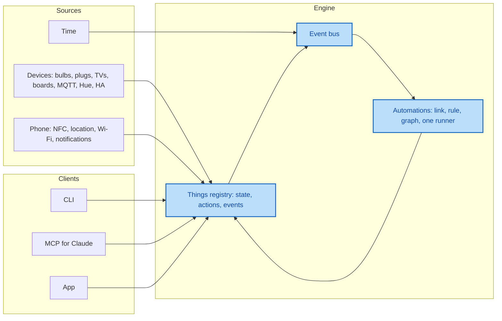

# OmniFlow Architecture Unification

> Status: active. Decisions taken 2026-11-07, to be built after the M7 build lands, then folded into `docs/DESIGN.md` and this file removed.

## Problem

OmniFlow grew one feature at a time, and each feature brought its own concept. Today a user meets devices, capabilities, board pins, zones, Wi-Fi sensors, BLE readings, board events, variables, flows, links and soon rules, NFC tags and pairing, each with its own commands and its own rules. The core API has 41 commands across 12 namespaces, and the flow engine has 7 trigger types and 8 condition types, several of which say the same thing in different words (`var_compare`, `device_state_is`, `var_equals`).

The cost shows in three places:

- **Things that should connect cannot.** A link connects one device state to one device capability, so it cannot start from a zone ("I got home"), an NFC tag, a board button event or the phone itself, because none of those are devices.
- **Every new source is new plumbing.** Adding NFC as it stands means a new event, a new trigger type, a new registry, new commands, new CLI verbs and new app screens. The phone's notifications, battery and calendar would each repeat that.
- **Three authoring paths drift apart.** Links and rules compile to flows, but each keeps its own command family, and the app can only reopen a flow by projecting it back into cards.

## Requirements

1. A user can say "when anything, only if anything, do these steps" across every kind of thing OmniFlow knows, including the phone, places and tags, from the app, the CLI or Claude, with the same words.
2. A new kind of source (a sensor, a phone event, an ecosystem) needs only a driver or an event source, no new trigger type, command or screen.
3. Adding any device follows one path, whatever the device: find it, add it, pair it if it needs pairing, configure it if it has parts.
4. Nothing becomes less safe: the trust, approval and exposure rules hold unchanged.

## Target model at a glance

| Today | After |
| --- | --- |
| Devices, plus zones, Wi-Fi, BLE, board events and soon NFC tags as separate concepts | Everything is a **thing** with **state**, **actions** and **events**. The phone, each person, each place and each tag is a thing |
| 7 trigger types | One trigger: an event or a state change on any thing, with a match |
| 8 condition types | One `compare` condition over any value, plus the boolean groups and time and day windows |
| Flows, links and rules each with their own commands | One **automation** with three authoring forms (link, rule, graph) stored together |
| Discovery, pairing, secrets and board pins as separate steps | One **add** pipeline that returns the next step |
| `ir.pin`, `rf.pin`, and soon an NFC reader, each its own firmware command | One `periph.set` per peripheral type |

## Things, state, actions and events

A thing is what the registry calls a device today, widened to anything with an address. Every thing has a stable id, and every part of it is addressed as `thing.key`, which links already use.

- **State** is a value the thing reports and keeps: `lamp.power`, `desk_board.knob`, `jade.home`.
- **Actions** are today's capabilities with a command: `lamp.power`, `tv.launch_app`, `desk_board.relay`.
- **Events** are momentary and carry a payload but no lasting value: `desk_board.button.pressed`, `front_door_tag.scanned`, `phone.notification`. This is a new capability type, `event`. Today's `board_event` messages become events on the board that sent them, and an NFC scan becomes an event on the tag.

The decisions:

- **[Approved] The phone, people, places and tags become things through built-in virtual drivers.** `phone` is fed by the app (NFC reader, Wi-Fi, battery, later notifications), a `place` holds the zone filter and reports `inside` per person, a `person` reports `home` and `place`, and an `nfc_tag` reports `last_scanned` and the `scanned` event. "I reached home" is then `jade.home` turning true, and works in links, rules, the dashboard and the command bar with no special case.
- **[Rejected] A separate trigger, command family and screen per source (zones, NFC, notifications).** It is the cost listed under Problem, paid again for every source.
- **[Approved] `sensor.ble`, `sensor.wifi` and the zone commands become the phone thing's inputs and the place thing's settings.** The commands stay as thin aliases for one release so the app and scripts keep working, then go.

## One trigger and one compare

A trigger is `{on: "thing.key", event | change | crosses}`:

- `event`: the thing raised that event, optionally matching its payload (`front_door_tag.scanned`, `desk_board.button.pressed` with `{"hold": true}`).
- `change`: the state key changed, optionally to a value (`jade.home` to `true`, `hall_sensor.occupancy` to `true`).
- `crosses`: a number crossed a threshold in one direction, firing once per crossing (`room_temp.value` above 28).
- Time and interval stay as their own trigger, because time is not a thing.

A condition is `compare(value, op, value)` where a value is a literal, `thing.key` (current state), `msg.key` (the triggering event) or a variable, plus `all_of`, `any_of`, `not`, `time_window` and the new `days`.

- **[Approved] Collapse `device_state`, `board_event`, `zone_change`, `wifi_change` and the coming `nfc_tag` into the one trigger, and `var_equals`, `var_compare` and `device_state_is` into `compare`.** The validator checks a `thing.key` against the registry exactly as it checks a capability today. Stored flows are migrated once by a pure function, with a test per old type.
- **[Rejected] Keep the old types next to the new ones.** Two ways to say the same thing is the drift this work removes. The migration keeps old files loadable.

## One automation, three ways to write it

An automation is what is stored and run. It keeps the form it was written in, so each surface reopens it as it was written:

- **link**: one line, `from -> to` with toggle, follow or threshold.
- **rule**: when one of these, only if all of these, then these steps in order, with waits, wait-until with a timeout, if/else and parallel groups.
- **graph**: the canvas, for anything a rule cannot say.

All three compile to the same flow graph, so validation, approval, dry runs, the run log and the cards are shared.

- **[Approved] Store the authoring form next to the compiled graph** (a `source` column: `link`, `rule` or `graph`, and the spec). A link opens as a link, a rule as a rule, and a rule can be promoted to a graph but not back.
- **[Approved] One command family, `automation.*` (save, list, get, enable, approve, run, dry_run, log, remove), with the form in the payload.** `link.*` and `flow.*` remain as aliases for one release.
- **[Rejected] Reverse-projecting graphs into rules.** It works only for tree-shaped graphs and loses names and grouping. The card view keeps it as a read-only view.

## One way to add anything

`thing.add` runs discovery across every method at once (UDP broadcast, mDNS, USB serial, board hellos, Tuya broadcasts), matches each find to a driver, and returns candidates. Adding one returns the next step until there is none:

1. `pair`: the TV prompt, the Hue link button, the ADB allow dialog.
2. `secret`: a token the user pastes (Home Assistant), a Tuya local key.
3. `configure`: board pins, a Zigbee friendly name.
4. `done`.

The app's Add sheet, `omni add` and the MCP tools all follow `next`, so a new driver that needs pairing gets the whole flow for free.

- **[Approved] Pairing, secrets and board setup become steps the driver manifest declares** (`"setup": ["pair", "configure"]`), and the engine says which comes next.
- **[Rejected] A wizard per device family in the app.** That is logic in the app, which `AGENTS.md` forbids, and it repeats per family.

## Peripherals on boards

The firmware grew `ir.pin`, `rf.pin`, and an NFC reader is next. Each is a peripheral bound to pins, set over USB and kept in flash.

- **[Approved] One `periph.set {"type": "ir" | "rf" | "nfc_rc522" | "nfc_pn532", "pins": {...}}` and `periph.clear {type}`, with `describe` listing `periph`.** The engine turns each peripheral into the board's actions and events: `ir_nec` and `rf_send` actions, the `nfc.scanned` event. `ir.pin` and `rf.pin` stay accepted for boards already set up.

## Clients

One engine owns the database, and everything else is a client of the same command protocol: in process in the app's service, over the local socket for the CLI and MCP while a hub runs, or by opening the engine when nothing runs. A client never holds logic, so the CLI, the app and Claude can each do exactly what the others can.

## What stays as it is

- Driver manifests, channels and the per-device command queue. They are already the extension point and need no change beyond the `event` capability type and `setup` steps.
- Trust and approval: an automation from Claude is untrusted, a risky one waits for approval of the exact revision, and pairing and secrets stay user only.
- Exposure: no TCP listener, UDP traffic filtered to the local network and known devices, the local socket at 0600.

## Order of work

1. The `event` capability type, virtual drivers for phone, person, place and tag, and the one trigger and `compare` with the migration.
2. Automations: the `source` column and spec, `automation.*`, link and rule compilers, the rule builder in the app.
3. NFC on top: the tag driver, phone read and write with Android hand-off, `periph.set` with RC522 and PN532 readers.
4. `thing.add` with `next` steps, folding discovery, pairing, secrets and board pins in.
5. Aliases removed one release later.

## Open items

- Sunrise and sunset triggers need a location for the home place, which the place thing can hold. They are not scheduled yet.
- Phone notifications, charging, app-opened and calendar events are events on the phone thing, and wait on the Android service work.
