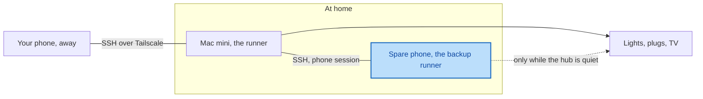

# Home Mesh

> Status: deferred, 2026-11-13. A constant hub is the chosen design. The standby runner below is kept as the later option if hub downtime proves to matter.

## Problem

With the Mac mini as hub, the home keeps running when a phone leaves, but it stops whenever the Mac mini is off, asleep or updating. Without the hub, "when I leave" cannot reach the home's devices at all, because the phone has already left the Wi-Fi. People want every OmniFlow device in the home (the Mac mini, a spare phone on the wall, a partner's phone) to be part of one home, so that when one device goes, another carries on.

## Requirements

1. Every device that joins the home holds a full copy of it: devices, rooms, automations, scenes, variables, modes, timers, and the secrets and pairings it needs to act.
2. Exactly one device runs the home's automations at a time, so nothing fires twice.
3. When the runner goes quiet, another device at home takes over within about two minutes, and hands back when the runner returns.
4. A phone that leaves keeps sending its readings (where its person is) to whichever device runs the home.
5. No new network listener and no home-made authentication in phase one.

## Where automations can run

| Runner | When it is gone | Why it fits or not |
| --- | --- | --- |
| A phone | Nothing runs while it is away, asleep or killed by Android | Phones leave the house, sleep and get stopped by the system, so a phone is a remote and a sensor, never the runner |
| One constant hub at home | Nothing runs until it is back | Simple, one place holds the home, and nothing can fire twice. The cost is downtime while it is off or updating |
| A hub with a standby | The standby takes over | Needs every device to hold a copy of the home, and something that decides which one is in charge. Without that referee, a network fault at home lets two runners act at once |
| A cloud service | Keeps running | Breaks the local-first rule, so it is not an option for OmniFlow |

A radio mesh between bulbs and sensors, where one device relays for its neighbours, is a different question. It decides how messages travel, not which device runs the automations.

- **The phone is never the runner.** It stays a remote and a sensor, and its readings go to whichever device runs the home.
- **A standby needs a referee.** OmniFlow has no cloud to decide which device is in charge, which is why a standby here can end up with two runners after a home network fault.

## Recommendation

Keep one constant hub, which fits a local-first app with no cloud.
- **Phones stay remotes and sensors.**
- **The gap worth closing is downtime after a power cut.** Start the Mac mini after power failure, add a UPS, and decide how FileVault is handled. Every phone at home also warns when the hub has not answered for 5 minutes.
- **Failover comes later, if it proves needed.** A standby must be an always-home device (a spare phone on a charger, or a second Mac), never someone's daily phone. Its take-over follows the lease rules in phase one.

## Later option: copies everywhere, one standby runner

- **Copies.** Each phone in hub mode keeps a replica of the hub's home, refreshed on every `automation.changed`, device add or remove, and every 10 minutes. A replica is read-only while the hub answers, so the hub stays the one writer. The phone already caches reads. A replica replaces that cache with the whole home, so the app works offline from real data.
- **The backup runner.** The person picks one device as the backup runner in Settings, Hub. It should be a device that stays home: a spare phone or tablet on a charger. Only that device ever takes over, so there is no election and no way for two phones to run at once.
- **Taking over.** The backup runner holds the secrets and pairings it needs. The hub sends them over the phone session, and they are kept in the Android keystore. It takes over only when all of these hold:
  - It is on the home Wi-Fi.
  - The hub has not answered for 2 minutes.
  - The hub's last lease (a time the hub renews every 30 seconds) has run out.

  It then runs its replica's automations and shows "Running the home while the Mac mini is away" on every phone that can reach it, through the hub when the hub returns and in its own notification meanwhile.
- **Handing back.** When the hub answers again, the backup runner sends the hub what changed while it ran: device state, run log, timers, modes and variables. It then stops running, and the hub carries on. Changes to automations are refused on a backup runner while it runs, so there is nothing to merge. Its screen says "Edit when the Mac mini is back".
- **When I leave.** A leave automation runs on whichever device runs the home. Your phone tells it you left over Tailscale, or the runner sees your phone drop off the home network. So with a hub or a backup runner, "turn everything off when I leave" works.
- **What it does not cover.** If the hub and the backup runner are both away or off, nothing runs at home. A network split inside the home (the hub up but unreachable from the backup runner) can run an automation twice. Setting a light or plug to a state is safe to repeat, but notifications may come twice.

## Phase two: a peer mesh with no hub

Every device at home talks to the others directly, picks a runner by a fixed order (a charger-connected device before a phone on battery, and the device that ran last before a newcomer), and replicates changes between all of them. Then no Mac mini is needed and any device can carry the home.

This needs every phone to accept connections from the others on the home network: a listening port on each phone, with each device proving who it is. The OpenSSH-based hub path cannot do that, because phones do not run an SSH server. Building it means choosing one of:

- an authenticated transport the platform provides, such as each phone joining the same tailnet and only accepting peers on it
- a device-to-device pairing like Android's own Wireless Debugging

It opens a new way into each phone, so it is the owner's call. It is not built until it is explicitly approved.

## What gets built in phase one

1. **Engine:**
   - `home.replica` (the full home for a phone session, secrets included only for the chosen backup runner)
   - `hub.lease` (current lease and runner)
   - `mesh.backup.set {phone}` and `mesh.backup.get`, which are user-only
   - `mesh.handback {changes}`
2. **Hub:** renews the lease, sends the replica and changes to phone sessions, and accepts the hand-back from the backup runner only.
3. **App:**
   - hub mode stores the replica in place of the read cache
   - the backup runner's service takes over and hands back by the rules above
   - Settings, Hub gets "Backup runner" with the device picker and its current state
   - a banner while a backup runner is in charge
4. **Tests:** lease expiry and take-over, hand-back of state and log, refusal of edits while running, refusal of a second device acting as backup, and the leave automation running on the backup runner.
