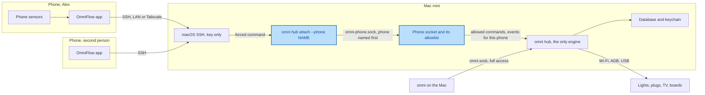

# Mac Mini Hub and Several Phones

> Status: approved, 2026-11-12. Building. Supersedes the "[Rejected for now] A Mac Mini hub" line in `docs/engine-design.md`.

## Problem

OmniFlow runs one engine on one phone. Each engine has its own database, so a second phone, or the Mac mini, starts empty. Today the only way to move a home is `config.export` and `config.import`, by hand, and the backup carries no secrets or pairings, so every Tuya key and TV pairing is entered again. Two phones cannot see each other's presence, and an ask goes only to the phone that ran it.

## Requirements

1. Every phone that connects sees the same devices, rooms, automations, scenes and variables, with nothing to copy.
2. Automations run once, in one place, even when two phones see the same trigger.
3. Each phone still feeds what only a phone can sense: Wi-Fi and Bluetooth presence, NFC tags, app and notification triggers, the screen, Do Not Disturb.
4. Asks and notifications reach the right person's phone.
5. It works away from home without opening anything to the internet.
6. No new network listener and no home-made authentication.
7. Installing, updating and backing up are a few commands, and the hub restarts by itself.

## What exists today

- `omni hub` keeps one engine running on a Mac and serves `<home>/omni.sock`, a 0600 unix socket in a 0700 folder. The protocol is newline JSON: `{id, command, args}` answered by `{id, result}`, and `{id, subscribe: "events"}` streaming every event. Every `omni` command and `omni mcp` already talk to a running hub this way.
- The engine has an SSH client (dartssh2) with host keys pinned on first use and `device.hostkey` to review a changed key. dartssh2 can also run a remote command with its stdin and stdout as a byte stream.
- A phone thing names its `person`, and presence is kept per person, so two people in one home already fit the model.
- On the Mac, secrets live in the login keychain under the `omniflow` service.
- `config.export` and `config.import` move a whole home, without secrets, and say which things need their secrets again.

## Options

| | A. Mac mini hub, phones as clients | B. Every device a full engine, synced | C. Phones talk to each other directly |
| --- | --- | --- | --- |
| Where config lives | Once, on the hub | A copy on every device, merged | A copy on every phone |
| Who runs an automation | The hub, always once | Whoever claims it first over the LAN | Unclear |
| Secrets | Only on the hub | Synced inside an encrypted log | Copied between phones |
| New listener | None (macOS's own SSH) | A signed UDP claim port on every device | A listener on every phone |
| Away from home | Tailscale to the hub | Each phone acts alone and can disagree | Needs a relay anyway |
| Works with the hub down | No, phones show it is down | Yes | Yes |
| Build size | Medium | Large (log, merge, claims, conflicts) | Large, and still needs B |

### A. The Mac mini is the hub, phones connect to it [Approved]

The Mac mini runs `omni hub` all the time and holds the only database, the secrets and the pairings. A phone in hub mode opens no engine of its own. Its app becomes a remote screen over the hub: every list, tile and editor reads from the hub, and every tap is a hub command. Its foreground service keeps listening to the phone's own sensors and sends them to the hub as `phone.*` inputs, tagged with that phone's id, so presence is per person. Phone to phone goes through the hub: one phone sees the other person arrive because both report to the same engine.

This meets every requirement. The weak point is that the home stops while the Mac mini is off.

### B. Every device runs its own engine and they sync [Rejected for now]

This is the deferred design in `docs/engine-design.md`: an encrypted change log in Google Drive and a signed "I will run this" claim on the LAN. It survives a hub outage, but it needs a merge for two edits made at once, a listener on every phone for the claims, secrets synced to every phone, and a rule for what an away phone does. It is several times the work of A, and the double-run risk never goes fully away. It stays the fallback if a single hub proves too fragile.

### C. Phones connect to each other directly [Rejected]

A phone would need a listener that other phones reach, which breaks requirement 6, keeps the radio awake, and still needs a relay when the phones are on different networks. Going through the hub gives the same result.

## How a phone reaches the hub

- **Transport: macOS Remote Login (OpenSSH).** It is an existing, maintained service with real authentication, so nothing new listens and no auth is invented.
- **The forced command names the phone.** `omni hub allow NAME KEY` writes `restrict,command="/Users/<you>/.local/bin/omni hub attach --phone NAME" ssh-ed25519 AAAA... omniflow-NAME` into `~/.ssh/authorized_keys`, optionally with `from="<LAN subnet>,100.64.0.0/10"`. `restrict` turns off shells, port forwarding, agent forwarding and terminals, and removing that one line revokes the phone. `--from` takes only plain IPv4 and IPv6 addresses and ranges, rebuilt from what parsed, so no zone, quote, comma or space can add options to the line.
- **Phone sessions use their own socket.** `attach --phone NAME` connects to `<home>/omni-phone.sock`, a second 0600 unix socket beside `omni.sock`, and writes `{"session": "phone", "phone": NAME}` as the first line, before any byte from the phone. The hub takes the phone from that line only, checks that NAME is a phone thing on the hub, and reads its person from the thing. A connection to that socket without a valid first line is refused and closed. `omni.sock` stays the Mac's own, with full access, for the CLI and `omni mcp`. A key line written before phone sessions runs plain `omni hub attach`, which refuses to start when sshd ran it as a forced command (`SSH_ORIGINAL_COMMAND` is set), and `omni hub phones` marks such lines `needsAllowAgain`. Running `omni hub allow NAME KEY` again rewrites the line in place.
- **What a phone session may send** is an allowlist: everything an agent may send at read or setup level, the phone's own readings, asks, action replies and NFC scans, and the user's steps the app offers (pairing, approving, removing, scenes, TV control and settings). It may never send `driver.register`, `driver.approve`, `config.import`, `device.hostkey`, `tv.shell`, `tv.install`, `tv.helper.install`, `tv.files.download`, `tv.files.upload`, `tv.app.backup` (each reads or writes a file on the Mac), `board.flash`, `hub.start`, `hub.stop`, `agent.access.set` or `agent.call`, nor their `android.*` twins. `device.add` and `thing.add` refuse an `exec` driver, a host that is the Mac itself (`local`, `localhost`, loopback), and any path except a USB serial port (`/dev/cu*` or `/dev/tty*`) for a serial device or a board. `thing.configure` and `secret.set` refuse a thing whose driver runs programs. A refusal answers `not_allowed` and says to run it on the Mac. A stolen phone key can then only do what the app can do, and nothing that runs a program or touches a file on the Mac.
- **The phone comes from the session, never from the client.** `hello.phone` is ignored on a phone session, and the hello answer says which phone and person the hub took the key for. Every `phone.*`, `sensor.*` and `nfc.scanned` reading and every `phone.actionDone` is tagged with the session's phone, and one that names another phone is refused. `presence.set` speaks only for the phone's person. `ask.answer` is taken only for an ask meant for that person or for no one. A `phone.actionDone` for a request sent to another phone is refused by the engine's own check, since the phone is always set.
- **Each phone gets only its events.** The hub filters per session: its person's asks and notifications plus those for no one, its own phone actions, Wi-Fi changes and phone-thing state, and the home-wide rest (devices, automations, runs, variables, timers, places). Another phone's readings, notification words and requests, another person's asks and notifications, and packet captures never leave the hub.
- **The phone side** is an engine client in the app that speaks the same newline JSON over an SSH exec channel. The app already has two clients (in-process and the service port), so screens do not change. The phone keeps its SSH private key in the Android keystore. The host key the user matched against `omni hub fingerprint` is kept in the hub settings and required on every connection: any other key fails with `host_key`, nothing is trusted on first use, and a hub with no matched key is set up again. `omni --hub user@host` from a Mac still pins on first use, and a pin it cannot read stops the connection instead of counting as none.
- **A version check** on every channel: the hello answer carries the hub's engine version, and a hub whose major or minor differs is refused with "Update the hub" or "Update the app", so command shapes never drift.
- **Timeouts and keepalive.** Connecting has 10 s from the first byte to the version check. Each command has 10 s, 30 s for one that waits on a device (`device.invoke`, `tv.*`), its listen window on top for discovery, and 10 minutes for one that runs as long as its work (running an automation, pairing, file copies, firmware), then answers `timeout` without dropping the link. Every channel, the command one and each event stream, is pinged every 15 s with `ping`, which the hub answers outside its command queue, and a ping unanswered for 10 s drops that channel: the command channel reopens on the next command and an event stream resubscribes. The hub runs up to 8 commands from one connection side by side, so a slow discovery does not hold up a tap. A failed subscription surfaces as `unavailable` instead of hanging, and a channel opened after the connection was closed or the stream cancelled is closed at once.

## What runs where

| Thing | Runs on |
| --- | --- |
| Devices, rooms, automations, scenes, variables, secrets, pairings | Hub |
| Schedules, sunrise, device polls, WiZ pushes, board hellos | Hub |
| TV over ADB, USB boards, MQTT, the Mac mini itself as a `macos_host` | Hub |
| Wi-Fi and Bluetooth presence, NFC scans, app and notification triggers, screen, Do Not Disturb | Each phone, sent to the hub |
| Notifications, asks, widgets, tiles, share sheet | Each phone, fed by hub events |

- **Asks:** the hub's `ask.request` event carries the automation's person when it has one. The hub sends each phone the asks for its own person, plus asks with no person, and takes an answer only from those phones. The first answer wins, and `ask.closed` clears it on every phone that had it.
- **Notify steps** gain an optional `to` (a person). With none, every connected phone shows it.
- **Two phones, one trigger:** each phone reports its own readings, and the engine decides per person, so "when I get home" fires once for the right person.

## When the hub is down

- The app shows "Hub not reachable" with the last known state, read-only, and keeps retrying with backoff up to a minute. A new Wi-Fi network, or coming back to the app, tries again at once.
- Phone readings taken while the hub was unreachable are dropped, except the latest presence, which is sent on reconnect so home and away are right again.
- No automatic fallback to a phone engine. Two engines with two databases is exactly the split that option A exists to avoid. The phone can still be moved back to "This phone" by hand from Settings, which imports the hub's latest backup.
- To keep outages rare: the Mac mini on Ethernet, on a UPS if possible, with Energy Saver set to start after a power failure and never sleep.

## Away from home

Install Tailscale on the Mac mini and on each phone, signed in to one tailnet. The phone uses the Mac mini's tailnet name as the hub address when the LAN address does not answer. Nothing is port-forwarded on the router, and SSH is never exposed to the internet. Tailscale's own identity plus the SSH key are the two checks. Lights and plugs keep working away from home, because the hub, not the phone, talks to them.

## Install

On the Mac mini, once:

1. Turn on Remote Login (System Settings, General, Sharing) for your user only, and set `PasswordAuthentication no` and `KbdInteractiveAuthentication no` in `/etc/ssh/sshd_config.d/omniflow.conf`.
2. Build `omni` on the dev Mac with `dart compile exe bin/omni.dart -o omni` (both Macs are arm64) and copy it to `~/.local/bin/omni` on the Mac mini.
3. Run `omni hub install`, which:
   - writes `~/Library/LaunchAgents/com.jashnm.omniflow.hub.plist` with `RunAtLoad` and `KeepAlive`, running `omni hub --quiet` and logging to `~/Library/Logs/OmniFlow/hub.log`, so the log holds starts and errors rather than every event
   - loads it with `launchctl bootstrap gui/$(id -u)`
   - sets up a daily `omni hub backup` (a second LaunchAgent at 03:30), which writes `config.export` to `~/OmniFlow/backups/omniflow-<date>.json` and keeps 30
   - prints the sshd settings for `/etc/ssh/sshd_config.d/omniflow.conf`, which you place with sudo
4. Allow `omni` in the macOS firewall prompt the first time, so WiZ pushes (UDP 38900) and board hellos (UDP 38951) arrive.

The hub runs as a LaunchAgent in your login session, not as a system daemon, because its secrets are in your login keychain, which is locked until you log in. With FileVault on, macOS turns off automatic login, so after a power cut the hub waits until someone logs in once. Planned restarts avoid this with `sudo fdesetup authrestart`.

On each phone:

1. Install the app as today.
2. Settings, Home runs on, Mac mini hub. The app finds the Mac mini over mDNS (`_ssh._tcp`, which Remote Login advertises), or takes an address.
3. The app makes a key pair and shows a one-line `omni hub allow <name> <key> --person <person>` command and a QR code. Run it on the Mac mini. It adds the restricted `authorized_keys` line and makes the phone thing `<name>` with that person, which the phone's readings name. So `<name>` is a thing id: lower-case letters, digits and `_`.
4. The app connects, shows the hub's host key fingerprint, and asks you to match it against `omni hub fingerprint` on the Mac mini.

## Moving today's home onto the hub

1. On the phone, Settings, Backup, export.
2. On the Mac mini, `omni config import backup.json --dry-run`, then without `--dry-run`. The reply lists `needsSecrets`.
3. Enter each secret on the Mac mini with `omni secret set`, and pair the TV again from the hub, because its ADB key is the hub's own.
4. Approve the automations that came back waiting.
5. Switch the phone to hub mode. Its own database stays on the phone, unused, until "Forget this phone's home" is tapped.

## Maintain

- **Updates:** both ends come from one repo commit and one version. Release the APK and the hub binary together. On the Mac mini, `omni hub update <binary>` replaces the binary and runs `launchctl kickstart -k`. A phone on the old version sees "Update the app" until it updates.
- **Health:** `omni hub status` shows uptime, version, connected phones, the last run and load issues. The app shows the same under Settings, Hub. A phone not seen for 7 days is listed there.
- **Backups:** the daily export on the Mac mini, each file 0600 in a 0700 `~/OmniFlow/backups` (a folder others can write is refused, and older backups are tightened), plus the existing "Back up to Google Drive" from any phone, which now exports the hub's home. Secrets are in the Mac mini's keychain, which Time Machine already covers.
- **Revoke a phone:** `omni hub revoke <name>` deletes its `authorized_keys` line. The next connection from that phone fails. A session that is already open stays until it drops, so for a lost phone also restart Remote Login. The phone thing stays, with its history.
- **Config files:** `omni hub install` writes the launchd plists and prints the sshd snippet, from templates in this repo (`packages/omniflow_engine/tool/hub/`). They stay out of dotfiles, since OmniFlow is a personal project kept to its own repo.

## What gets built

1. `omni hub attach`, `install`, `allow`, `revoke`, `fingerprint`, `update` and `status`, with tests against a loopback hub.
2. The app's SSH engine client, "Home runs on" in Settings, hub discovery and the key and fingerprint steps.
3. Hub mode for the foreground service: no local engine, phone readings and NFC scans sent as `phone.*` inputs with the phone's id, asks and notifications from hub events, filtered by person.
4. `to` on notify steps and the person on asks.
5. The version check and the "Hub not reachable" state.
6. The Tailscale fallback address.

Each step goes through the builder-security skill where it touches SSH or a listener.

## Decisions

- **Hub down:** phones are read-only with the last known state until the hub is back. Option B stays the later route if outages matter.
- **FileVault: off, with automatic login.** The hub's home has frequent power cuts and no UPS, so the Mac mini must come back and run automations without anyone logging in. The hub runs in a dedicated standard (non-admin) macOS user that logs in automatically, and the Mac starts on its own after a power failure. The accepted risk is that someone who takes the Mac mini can read the device keys on its disk; the owner's own account and files stay in a separate user.
- **Second person:** gets the full app on the same home.
